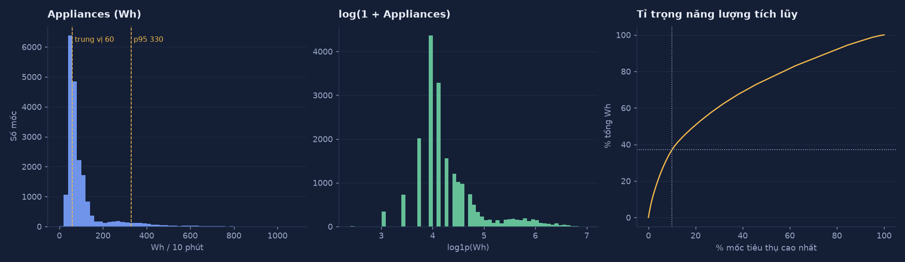
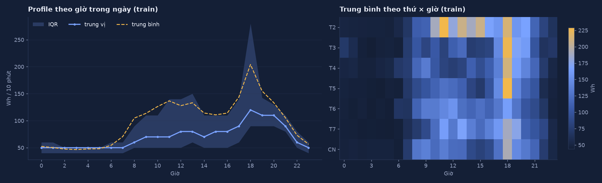
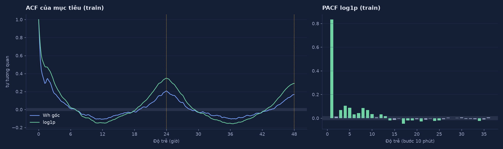
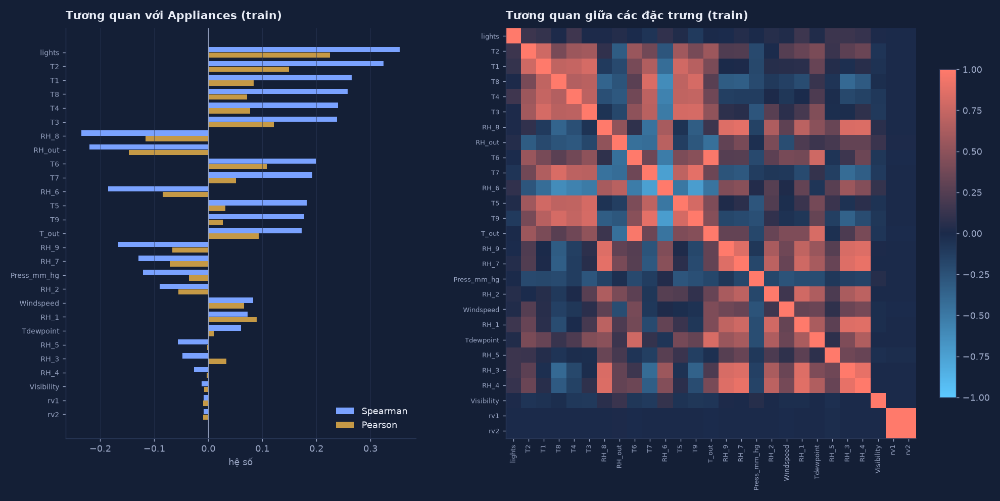
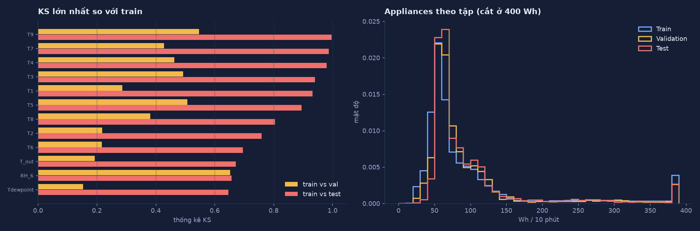
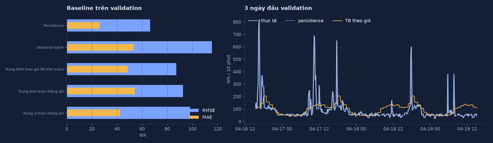

# Coursework — Dữ liệu và kết luận EDA

> **Trạng thái: đã chốt ngày 19/11/2026** (split 70/15/15 theo thời gian, rule cửa sổ ở §2). Tài liệu quy định dữ liệu, cách chia tập, hợp đồng đầu vào và các kết luận EDA phục vụ triển khai. Kiến trúc Transformer/LSTM thuộc `model.md`; độ dài cửa sổ, loss, lịch train và giao thức đánh giá thuộc `trainning.md`.

## 1. Dataset và trường dữ liệu

Dùng **UCI Appliances Energy Prediction** ([trang dataset](https://archive.ics.uci.edu/dataset/374/appliances+energy+prediction)), file `energydata_complete.csv` đặt tại `Coursework/data/raw/` (thư mục `data/` bị loại khỏi Git).

| Thuộc tính | Giá trị đã kiểm tra |
|---|---|
| Số dòng / cột | 19.735 / 29 (`date`, mục tiêu, 27 đặc trưng) |
| Thời gian | 11/01/2016 17:00 → 27/05/2016 18:00, 137 ngày |
| Bước thời gian | Đều 10 phút; 0 bước bất thường, 0 timestamp trùng |
| Giá trị thiếu / không hữu hạn | 0 / 0 |
| SHA-256 file | `2820bf71…a152a25d` (đầy đủ trong `eda_stats.json`) |

| Nhóm | Cột | Ý nghĩa | Đơn vị |
|---|---|---|---|
| **Mục tiêu** | `Appliances` | Điện năng thiết bị gia dụng trong 10 phút | Wh |
| Năng lượng | `lights` | Điện năng đèn trong 10 phút | Wh |
| Cảm biến trong nhà | `T1`–`T9`, `RH_1`–`RH_9` | Nhiệt độ, độ ẩm: 1 bếp, 2 phòng khách, 3 phòng giặt, 4 văn phòng, 5 phòng tắm, **6 ngoài nhà phía bắc**, 7 phòng ủi, 8 phòng ngủ con, 9 phòng ngủ bố mẹ | °C, % |
| Trạm thời tiết Chièvres | `T_out`, `Press_mm_hg`, `RH_out`, `Windspeed`, `Visibility`, `Tdewpoint` | Dữ liệu theo giờ, được nội suy về 10 phút | °C, mm Hg, %, m/s, km, °C |
| Biến ngẫu nhiên | `rv1`, `rv2` | Tác giả thêm vào để kiểm tra chọn đặc trưng | — |

Cảm biến trong nhà gửi khoảng 3,3 phút/lần và được lấy trung bình theo 10 phút; điện năng đo bằng đồng hồ M-Bus mỗi 10 phút.

## 2. Bài toán và split theo thời gian

**Bài toán:** dự báo `Appliances` tại mốc `t+1` (10 phút tới) từ cửa sổ `W` mốc đa biến `t−W+1 … t`. Độ dài `W` chọn bằng validation ở `trainning.md`.

| Tập | Số mốc | Từ | Đến | Mục đích |
|---|---:|---|---|---|
| Train | 13.814 (70%) | 11/01/2016 17:00 | 16/04/2016 15:10 | Học trọng số; fit chuẩn hoá và mọi thống kê cần học |
| Validation | 2.960 (15%) | 16/04/2016 15:20 | 07/05/2016 04:30 | Chọn cấu hình, cửa sổ, epoch, checkpoint |
| Test | 2.961 (15%) | 07/05/2016 04:40 | 27/05/2016 18:00 | Đánh giá cuối, một lần |

Chia **theo thứ tự thời gian, không xáo**: validation và test là tương lai so với train, giống điều kiện triển khai. Ranh giới sinh tất định bởi `EDA.py` và lưu ở `data/splits.json`.

**Tránh rò rỉ dữ liệu:**

- Một mẫu thuộc tập chứa **mốc mục tiêu** của nó. Cửa sổ đầu vào chỉ gồm mốc trước mục tiêu nên được lấy lịch sử của tập liền trước. Đây là dữ liệu quá khứ, không phải leakage, và mọi mốc của validation/test đều được đánh giá.
- Không mẫu train nào có mục tiêu thuộc validation/test.
- Mean/std chuẩn hoá chỉ fit trên train. Cắt cửa sổ trên chuỗi giữ nguyên thứ tự thời gian.

## 3. Hợp đồng đầu vào

| Bước / đầu ra | Yêu cầu |
|---|---|
| Cột số | 26 cột: lịch sử `Appliances` (tín hiệu mạnh nhất, §4.3), `lights`, `T1`–`T9`, `RH_1`–`RH_9`, 6 biến thời tiết. **Loại `rv1`, `rv2`** (§4.5) |
| Mã hoá thời gian | Thêm sin/cos giờ trong ngày (theo phút) tính từ `date`. Không mã hoá thứ trong tuần vì chênh lệch theo thứ nhỏ (§4.2) |
| Chuẩn hoá | z-score 26 cột số bằng mean/std của train (`metrics.normalization_train`); sin/cos giữ nguyên |
| Mục tiêu | Thang chuẩn hoá mặc định; `log1p` là phương án thử (mean 4.30584, std 0.68104 trên train). Metric **luôn tính trên Wh** sau khi đảo biến đổi |
| Batch | `x`: `[B, W, 28]`, `float32`, hữu hạn; `y`: `[B, 1]`; phần tử cuối cửa sổ là mốc `t`. Chọn `W` thuộc [trainning.md](trainning.md) |

## 4. Kết quả EDA và ý nghĩa sử dụng

Nguồn: [báo cáo EDA HTML](../reports/eda_report.html), [số liệu JSON](../reports/eda_stats.json). Thống kê dùng để fit (tương quan, ACF, profile giờ, chuẩn hoá) tính **chỉ trên train**. Số hiển thị đã làm tròn; khi tính toán dùng giá trị gốc trong JSON.

### 4.1. Biến mục tiêu lệch mạnh và có đỉnh

| Chỉ số | Giá trị |
|---|---:|
| Trung bình / trung vị | 97.7 / 60 Wh |
| p95 / p99 / max | 330 / 576.6 / 1080 Wh |
| Skewness: gốc / sau `log1p` | 3.39 / 1.19 |
| Tỉ trọng năng lượng của 10% mốc cao nhất | 37.1% |
| Số bước nhảy \|Δ\| ≥ 200 Wh giữa hai mốc liền kề | 822 |

- Mục tiêu chỉ có 92 giá trị, đều là bội số của 10 Wh. Đây là độ phân giải của đồng hồ đo, không phải lỗi. Không làm mịn hay loại outlier.
- Đỉnh ngắn nhưng chiếm nhiều năng lượng, nên MSE/RMSE trên thang gốc bị đỉnh chi phối. Vì vậy phải **báo cáo cả MAE và RMSE**, và cần thí nghiệm `log1p` (§3).

### 4.2. Chu kỳ ngày rõ, chu kỳ tuần yếu

- Trung bình theo giờ trên train cao nhất lúc **18h (204.1 Wh)**, thấp nhất lúc **3h (46.6 Wh)**, gấp 4.38 lần. Trung bình 0h–6h là 48.8 Wh.
- Ngày thường 99.3 Wh, cuối tuần 97.4 Wh, gần như không khác. Riêng thứ Hai cao nhất (124.1 Wh); chưa kiểm chứng đây là quy luật hay do vài ngày cá biệt.
- IQR cùng một giờ rất rộng, nên biết giờ là cần nhưng không đủ để đoán đỉnh. Đây là căn cứ thêm mã hoá giờ ở §3.

### 4.3. Tự tương quan và độ dài cửa sổ

| Độ trễ | 10 phút | 1 giờ | 2 giờ | 6 giờ | 12 giờ | 24 giờ |
|---|---:|---:|---:|---:|---:|---:|
| ACF gốc | 0.759 | 0.325 | 0.313 | 0.011 | −0.107 | 0.206 |
| ACF `log1p` | 0.833 | 0.503 | 0.437 | 0.025 | −0.149 | 0.349 |

- Thông tin gần nhất mạnh nhất; ACF `log1p` giảm dưới 0.2 sau 23 bước (khoảng 3.8 giờ). Tương quan **quay lại tại 24 h** (lag 144 là cực đại cục bộ).
- **Gợi ý cho [trainning.md](trainning.md):** `W = 36` (6 giờ) bao trọn đoạn ACF còn cao. Khi khảo sát `W`, nên có thêm 144 (24 giờ), vì chỉ cửa sổ này chứa mốc cùng giờ hôm trước.

### 4.4. Tương quan đặc trưng với mục tiêu yếu

- \|Spearman\| lớn nhất với mục tiêu: `lights` 0.354, `T2` 0.325, `T1` 0.265; mọi \|Pearson\| ≤ 0.226. Không đặc trưng nào tự nó dự báo tốt.
- Khi bật đèn (26.7% số mốc train), `Appliances` trung bình 140.0 Wh, so với 83.8 Wh khi tắt. Đèn là chỉ báo "có người hoạt động".
- `T6`–`T_out` tương quan 0.974 (cùng đo ngoài trời). Các độ ẩm trong nhà tương quan 0.85–0.90. Giữ cả hai nhóm; attention/ablation sẽ cho biết nhóm nào có ích.
- **Hệ quả:** tín hiệu chính nằm ở lịch sử của mục tiêu và giờ trong ngày. Việc cảm biến có giúp thêm hay không là **giả thuyết** để so Transformer/LSTM có và không có nhóm cảm biến. Không kết luận từ tương quan tuyến tính.

### 4.5. `rv1`, `rv2` là nhiễu

`rv1` và `rv2` **giống hệt nhau từng giá trị**, và tương quan Pearson với mục tiêu là −0.009 trên train. Loại cả hai khỏi đầu vào (§3). Nếu nhóm muốn dùng làm đối chứng cho attention map, phải đặc tả rõ ở `model.md`.

### 4.6. Lệch phân phối theo mùa giữa các tập

| Đặc trưng | KS train–val | KS train–test |
|---|---:|---:|
| `T9` (lệch lớn nhất) | 0.547 | 0.997 |
| `T2` | 0.218 | 0.759 |
| `T_out` | 0.193 | 0.671 |
| `RH_6` | 0.653 | 0.657 |
| `Appliances` | 0.097 | 0.154 |

- Train là mùa đông (tháng 1–4), test là cuối mùa xuân (tháng 5). Nhiệt độ trong nhà và ngoài trời tăng rõ ([biểu đồ thời gian](assets/eda_timeline.png)). Có **12/25 đặc trưng có hơn 5% giá trị test nằm ngoài khoảng [min, max] của train**.
- Mục tiêu lệch ít hơn: trung vị 60 Wh ở cả ba tập, trung bình 98.8 / 93.4 / 96.9 Wh.
- **Hệ quả:** mô hình dựa vào nhiệt độ tuyệt đối có nguy cơ ngoại suy kém. Sai số test có thể cao hơn validation vì lý do này, cần ghi nhận khi đánh giá thay vì sửa split. Không chuẩn hoá lại bằng thống kê validation/test.

### 4.7. Baseline tham chiếu trên validation

Dự báo 1 bước không dùng học máy, tính trên 2.960 mốc validation:

| Baseline | RMSE (Wh) | MAE (Wh) | R² |
|---|---:|---:|---:|
| **Persistence**: `ŷ(t+1) = y(t)` | **66.43** | **26.16** | **0.481** |
| Trung bình theo giờ (fit train) | 87.23 | 48.55 | 0.106 |
| Trung bình train (hằng số) | 92.39 | 53.97 | −0.003 |
| Seasonal naive: `ŷ(t+1) = y(t+1−144)` | 115.38 | 53.32 | −0.565 |

Persistence là mốc sàn mạnh nhất. LSTM và Transformer phải vượt mốc này mới có giá trị. Ngưỡng cụ thể đặt ở [lab-description.md §4](lab-description.md). Đây là số đo của baseline, không phải kết quả mô hình.

## 5. Quyền sử dụng

Dataset phát hành theo **[CC BY 4.0](https://creativecommons.org/licenses/by/4.0/)** trên UCI: được dùng, chỉnh sửa cho mọi mục đích với điều kiện ghi nguồn. Tài liệu và báo cáo cuối phải trích dẫn:

- Candanedo, L. (2017). *Appliances Energy Prediction* [Dataset]. UCI Machine Learning Repository. https://doi.org/10.24432/C5VC8G
- Candanedo, L. M., Feldheim, V., & Deramaix, D. (2017). Data driven prediction models of energy use of appliances in a low-energy house. *Energy and Buildings*, 140, 81–97.

Không phân phối lại file CSV qua Git; mỗi thành viên tự tải về `data/raw/` và đối chiếu SHA-256 ở §1.

## 6. Artifact

| Artifact | Vai trò |
|---|---|
| [EDA.py](../EDA.py) | Source EDA, theo cấu trúc [LAB2/EDA.py](../../LAB2/EDA.py); chạy `python EDA.py` trong thư mục `Coursework` |
| `data/splits.json` | Ranh giới train/val/test và SHA-256 CSV (ngoài Git, sinh lại tất định) |
| [reports/eda_stats.json](../reports/eda_stats.json) | Nguồn số liệu đầy đủ, gồm mean/std chuẩn hoá |
| [reports/eda_report.html](../reports/eda_report.html) | Báo cáo EDA HTML tự chứa, đọc offline |
| `docs/assets/eda_*.png` | Hình trích từ EDA, không thay thế số liệu JSON |

## 7. Phương án thay thế

| Rủi ro | Phương án |
|---|---|
| Tập test (20 ngày) nhỏ, kết quả nhạy với vài đỉnh | Khi đánh giá test, báo cáo thêm sai số theo ngày hoặc theo giờ; không đổi split |
| Lệch mùa làm mô hình dùng nhiệt độ tuyệt đối kém trên test (§4.6) | Thí nghiệm ablation bỏ nhóm nhiệt độ, hoặc dùng sai phân nhiệt độ; chọn bằng validation |
| Mô hình không vượt persistence | Ghi nhận như một kết quả hợp lệ; kiểm tra lại cửa sổ, `log1p`, mã hoá thời gian trước khi kết luận |
