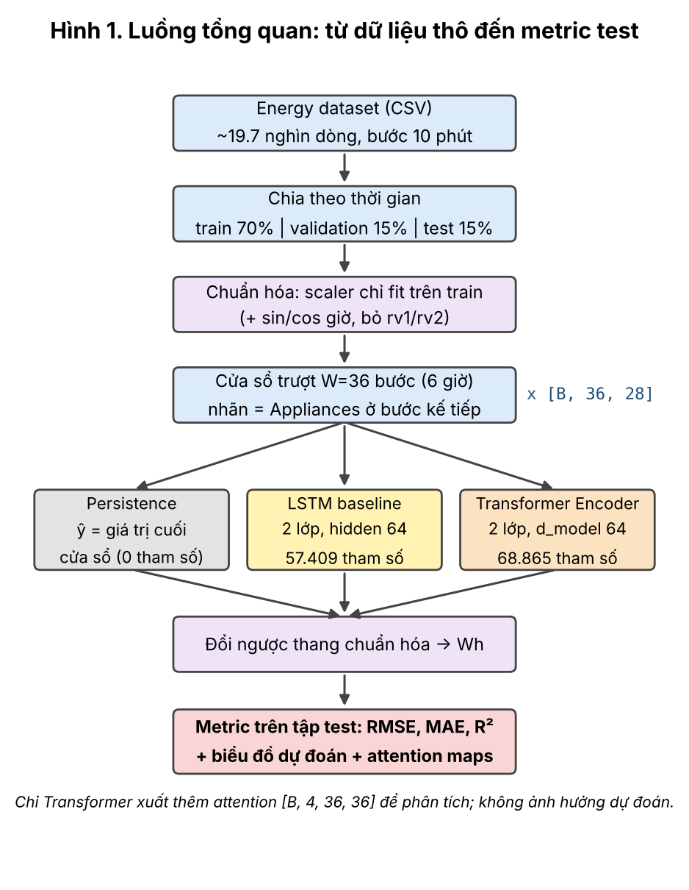
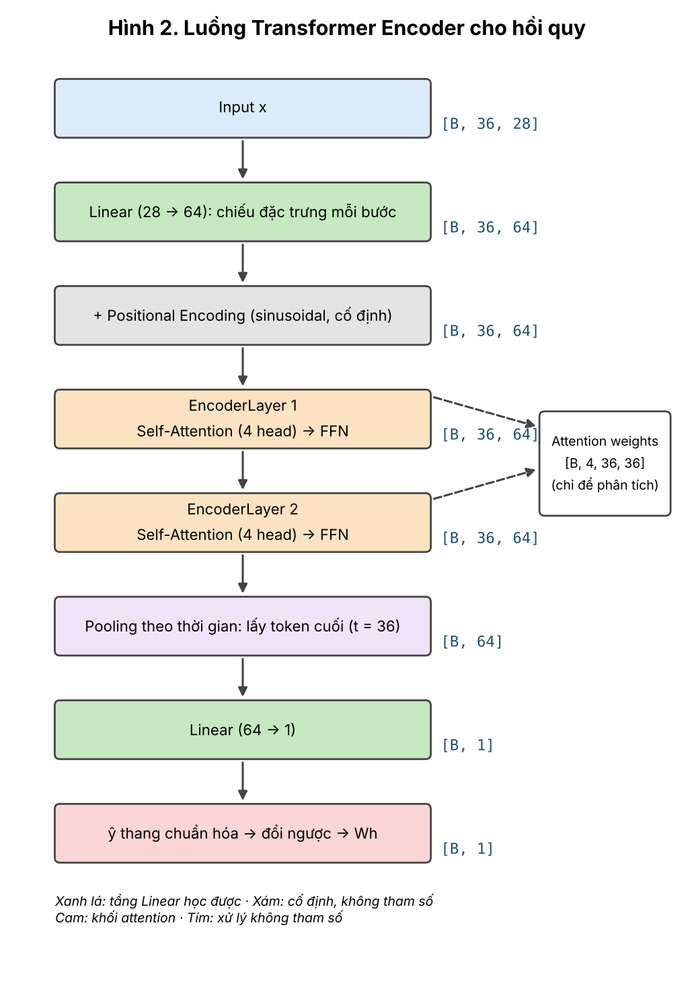
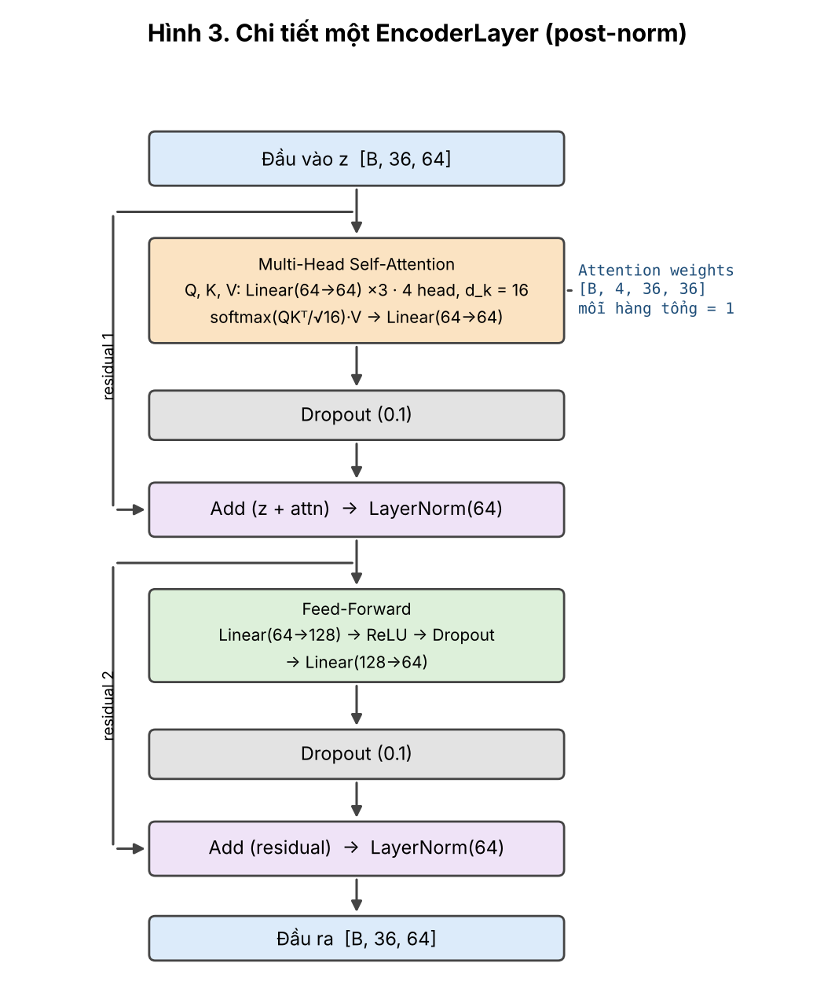
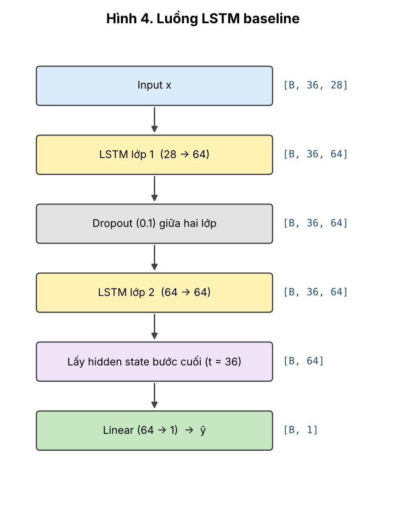

# Coursework — Thiết kế mô hình

Tài liệu đặc tả kiến trúc, luồng tensor, cách dựng mô hình trong [model.py](../model.py). Dữ liệu/preprocessing theo [data.md](data.md); cấu hình, điều phối run và lưu checkpoint theo [trainning.md](trainning.md).

> **Trạng thái:** siêu tham số là **đề xuất**, chờ duyệt và đối chiếu EDA. 

## 1. Kiến trúc lựa chọn

Dùng **Transformer Encoder** làm mô hình chính và **LSTM** làm baseline; cả hai huấn luyện từ khởi tạo ngẫu nhiên (không có trọng số pretrained). Persistence là mốc tham chiếu không học.

| Kiến trúc | Nhiệm vụ đảm nhận | Module từ `torch.nn` |
|---|---|---|
| [Transformer Encoder](https://docs.pytorch.org/docs/stable/generated/torch.nn.TransformerEncoderLayer.html) | Mô hình chính: self-attention cho mỗi bước nhìn trực tiếp mọi bước khác trong cửa sổ; attention weights phân tích được | `Linear`, `TransformerEncoderLayer` hoặc lớp attention tự viết, `LayerNorm` |
| [LSTM](https://docs.pytorch.org/docs/stable/generated/torch.nn.LSTM.html) | Baseline: xử lý tuần tự bằng bộ nhớ hồi quy, cùng cửa sổ và chuẩn hóa | `LSTM`, `Linear` |
| Persistence | Mốc không học: dự đoán bằng `Appliances` ở bước cuối cửa sổ | không có |

Mỗi bước thời gian là một token (vector 28 đặc trưng) chiếu bằng `Linear`, không dùng bảng embedding như NLP. Không dùng attention mask vì cửa sổ chỉ chứa quá khứ so với bước cần dự đoán. Tầng cuối là `Linear(·→1)`, không có Softmax.

**Vì sao chọn Transformer Encoder:** chuỗi đa biến có nhiều biến tương tác (nhiệt độ, độ ẩm, thời tiết ngoài trời, đèn); self-attention cho phép mô hình tự học bước nào trong 6 giờ qua quan trọng, và attention weights cho phép quan sát mô hình “nhìn” vào đâu, điều LSTM không cung cấp trực tiếp.

**Điểm khác của dự án so với Transformer thông thường:** token là bước thời gian; không dùng mask; lấy token cuối thay vì token đặc biệt; đầu ra là một số thực; xuất attention weights `[B,4,36,36]` để vẽ attention maps.

**Kỳ vọng cần kiểm chứng:** Transformer có thể bắt phụ thuộc xa tốt hơn LSTM, nhưng với chuỗi ngắn (36 bước) và dữ liệu nhỏ (khoảng 20 nghìn mẫu) lợi thế không chắc xảy ra. `Appliances` biến động mạnh theo từng 10 phút nên persistence có thể là mốc khó vượt; cần so sánh để biết hai mô hình học được có thật sự thêm thông tin hay không.

## 2. Luồng tổng quan và input/output



*Hình 1. Dữ liệu được chia, chuẩn hóa và cắt cửa sổ ngoài model; ba nhánh nhận cùng `x`. Đổi ngược thang và metric thuộc [demo.md](demo.md). [Mở SVG](assets/model_overview.svg).*

| Giao tiếp của `forward(x)` | Yêu cầu |
|---|---|
| Input | Tensor float `[B,36,28]` sau preprocessing theo `data.md`; `B` là batch size |
| Output | **Dự đoán `[B,1]`** cho `Appliances` ở bước kế tiếp, thang đã chuẩn hóa |
| Đặc trưng | 26 cột số gốc (bỏ `rv1`, `rv2`; gồm `Appliances` quá khứ và `lights`) + `sin`/`cos` giờ trong ngày = 28 |
| Đổi ngược thang | Không đặt trong `forward`; xử lý ở bước [inference](demo.md) |

## 3. Luồng chi tiết từng mạng
Các hình đọc từ trên xuống. Shape theo thứ tự `[B,T,C]` (batch, bước thời gian, kênh).
- Xanh lá: tầng `Linear` học được
- Xám: thành phần cố định, không tham số
- Cam: khối attention; vàng: LSTM; tím: xử lý không tham số

### 3.1. Transformer Encoder — chuỗi EncoderLayer



*Hình 2. Chiếu đặc trưng, positional encoding, hai EncoderLayer, lấy token cuối, đầu hồi quy; nhánh nét đứt là attention weights chỉ để phân tích. [Mở SVG](assets/model_transformer_flow.svg).*

Input `[B,36,28]` qua `Linear(28→64)` thành `[B,36,64]`, cộng positional encoding sinusoidal `[36,64]` (buffer cố định). Hai EncoderLayer giữ nguyên shape `[B,36,64]`. Lấy token cuối `[B,64]` rồi **`head = Linear(64→1)`** cho `[B,1]`.

### 3.2. EncoderLayer — attention và FFN



*Hình 3. Cấu trúc post-norm: Self-Attention → Add&Norm → FFN → Add&Norm. [Mở SVG](assets/model_encoder_layer.svg).*

Self-Attention dùng `Q`, `K`, `V` là ba `Linear(64→64)`, tách 4 head với `d_k = 16`; mỗi head tính `softmax(QKᵀ/√16)·V`, ghép lại rồi qua `Linear(64→64)`. Attention weights `[B,4,36,36]`, mỗi hàng tổng bằng 1. FFN là `Linear(64→128) → ReLU → Dropout → Linear(128→64)`. Dropout 0.1 sau attention và sau FFN; `LayerNorm(64)` sau mỗi phép cộng residual.

### 3.3. LSTM baseline



*Hình 4. LSTM hai lớp, lấy hidden state bước cuối. [Mở SVG](assets/model_lstm_flow.svg).*

`LSTM(28→64)` → Dropout 0.1 → `LSTM(64→64)` với `batch_first=True`; lấy hidden state bước cuối `[B,64]` rồi **`head = Linear(64→1)`**. Hidden/cell state khởi tạo bằng 0 cho mỗi cửa sổ, không truyền trạng thái giữa các cửa sổ.

## 4. Một giai đoạn huấn luyện và chính sách trainable

Không có giai đoạn feature extraction hay fine-tuning: mô hình khởi tạo ngẫu nhiên và **mọi tham số đều trainable** trong một giai đoạn duy nhất.

| Kiến trúc | Phần trainable |
|---|---|
| Transformer Encoder | Toàn bộ: `Linear` đầu vào, hai EncoderLayer, `head` |
| LSTM | Toàn bộ: hai lớp `LSTM`, `head` |

**Dropout và LayerNorm:** Dropout bật khi `train()` và tắt khi `eval()`; LayerNorm không có running statistics nên không cần cố định riêng. Khi validation/test, toàn bộ mô hình ở `eval()`.

**Attention:** `forward(x, return_attention=True)` trả thêm weights; dự đoán **không đổi** so với khi không yêu cầu.

**Công bằng so sánh:** Transformer và LSTM dùng cùng `x`, `y`, split, scaler, loss, optimizer và seed theo [trainning.md](trainning.md).

**Autograd:** không dùng `no_grad()` hoặc `detach()` trong `forward`. Optimizer nhận mọi tham số trainable, không trùng hay thiếu.

## 5. Giao diện triển khai theo form

Mỗi mô hình là một `nn.Module`, khai báo mạng trong `__init__`, gọi trực tiếp qua `forward`.

```python
TransformerRegressor(num_features=28, window=36, d_model=64, n_heads=4,
                     num_layers=2, dim_ff=128, dropout=0.1)
LSTMRegressor(num_features=28, hidden_size=64, num_layers=2, dropout=0.1)
```

| Tham số | Ý nghĩa |
|---|---|
| `num_features` | Số đặc trưng mỗi bước (`F`); giá trị không hợp lệ phải báo lỗi |
| `window` | Độ dài cửa sổ `W`, dùng cho positional encoding |
| `d_model`, `n_heads` | Kích thước biểu diễn và số head; `d_model % n_heads != 0` phải báo lỗi |
| `num_layers`, `dim_ff` | Số EncoderLayer và kích thước ẩn của FFN |
| `hidden_size`, `num_layers` (LSTM) | Kích thước ẩn và số lớp LSTM |
| `dropout` | Xác suất Dropout |

- **`__init__`:** dựng các tầng, đăng ký positional encoding là buffer.
- **`forward(self, x, return_attention=False)`** (Transformer): trả `[B,1]`, hoặc `(y, attn)` với `attn` là danh sách 2 tensor `[B,4,36,36]`.
- **`forward(self, x)`** (LSTM): trả `[B,1]`.

`model.py` chỉ phụ trách dựng mạng, forward và hỗ trợ đếm tham số. Không đặt DataLoader, vòng lặp epoch hay xuất báo cáo trong lớp mô hình. Danh sách `Config_parameter`, run ID, optimizer/scheduler và resume được quy định tại [trainning.md](trainning.md).

## 6. Đối chiếu cấu trúc và điều kiện nghiệm thu

Số tham số theo công thức, `F = 28`; sẽ đối chiếu bằng `model.parameters()` khi có source:

| Kiến trúc | Tổng tham số | Trainable | Cấu thành |
|---|---:|---:|---|
| Transformer Encoder | 68.865 | 68.865 | `Linear` đầu vào 1.856 + 2 × EncoderLayer 33.472 + `head` 65 |
| LSTM | 57.409 | 57.409 | LSTM lớp 1 24.064 + lớp 2 33.280 + `head` 65 |
| Persistence | 0 | 0 | — |

Một EncoderLayer: Self-Attention 16.640 (`in_proj` 12.480 + `out_proj` 4.160) + FFN 16.576 + 2 LayerNorm 256. Positional encoding là buffer, không tính. Mỗi mẫu có 2 × 4 × 36 × 36 = 10.368 giá trị attention. Bảng này không thay thế phép đo thời gian hoặc peak RAM/VRAM khi chạy thật.

Trước nghiệm thu source cần xác minh:

1. Forward của hai mô hình trả `[B,1]` hữu hạn với `x [B,36,28]`; số tham số khớp bảng trên.
2. `attn` có shape `[B,4,36,36]`, mỗi hàng tổng bằng 1; dự đoán với `return_attention` True/False giống nhau ở `eval()`.
3. Positional encoding là buffer, không nằm trong `parameters()`.
4. Sau backward, mọi tham số có gradient hữu hạn; một bước `optimizer.step()` làm đổi tham số.
5. Dropout tắt ở `eval()`: hai lần forward liên tiếp cho cùng kết quả.
6. In được cấu trúc và số tham số để đối chiếu; nạp lại checkpoint bằng `strict=True` tái tạo đúng kiến trúc và đầu ra.
