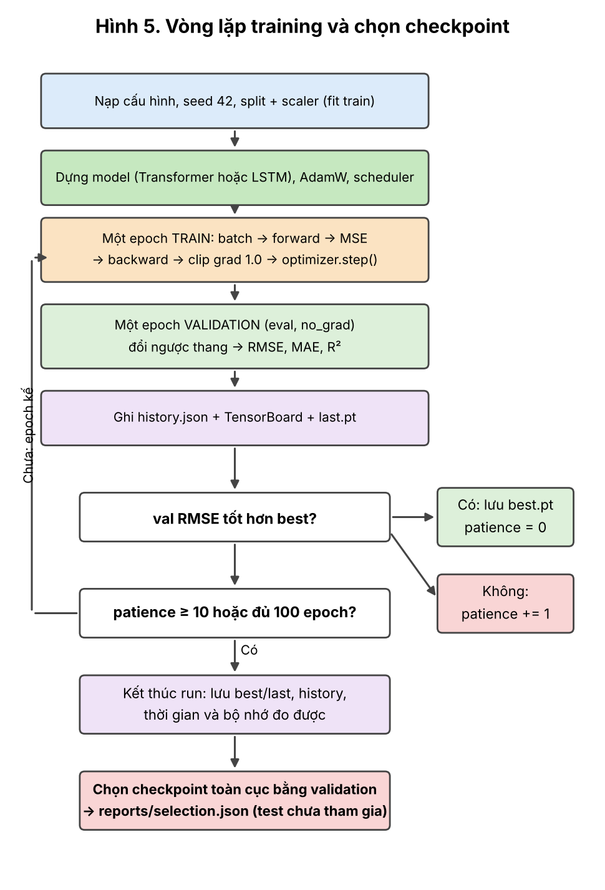

# Coursework — Cấu hình, thực thi và báo cáo training

Tài liệu quy định cấu hình, thực thi, tracking và output của training. Dữ liệu theo [data.md](data.md); kiến trúc theo [model.md](model.md); test theo [demo.md](demo.md).

> **Trạng thái:** giá trị dưới đây là **đề xuất**, chờ duyệt; các mục ghi *chốt sau EDA* sẽ được xác định lại sau khi chạy EDA. Chưa có run nào được chạy.

## 1. Run và tham số cấu hình

Hai run chính, mỗi run huấn luyện từ khởi tạo ngẫu nhiên trong một giai đoạn. Cả hai dùng **cùng mọi cấu hình**, chỉ khác mô hình. Persistence không train; chỉ tính metric ở validation và test.

| Run ID | Mô hình |
|---|---|
| `01_transformer` | `TransformerRegressor` |
| `02_lstm` | `LSTMRegressor` |

`Config_parameter` của một run:

| Tham số | Giá trị đề xuất | Ghi chú |
|---|---|---|
| `architecture` | `transformer` / `lstm` | Theo [model.md](model.md) |
| `window`, `horizon` | 36, 1 | *Chốt sau EDA* |
| `batch_size` | 64 (train) / 256 (validation) | |
| `max_epochs` | 100 | |
| `patience` | 10 | Early stopping, mục 4 |
| `lr`, `weight_decay` | `1e-3`, `1e-4` | Mục 3 |
| `grad_clip` | 1.0 | |
| `seed` | 42 | Mục 5 |
| `num_workers` | 0 | Dữ liệu nhỏ, nằm sẵn trong RAM |
| `amp` | `auto` | Chỉ bật FP16 khi có CUDA |

Không bố trí ablation hay khảo sát siêu tham số riêng trong phạm vi hai run này; phần mở rộng tùy chọn ở mục 9.

## 2. Dữ liệu trong training

| Mục | Yêu cầu |
|---|---|
| Nguồn | Cửa sổ `x [B,36,28]`, nhãn `y [B,1]` theo [data.md](data.md) |
| Dataset | Lớp kế thừa `torch.utils.data.Dataset` với `__len__` và `__getitem__`, dựng cửa sổ từ mảng đã chuẩn hóa |
| Chống rò rỉ | Scaler chỉ fit trên train; cửa sổ không vắt ngang ranh giới giữa các tập |
| Shuffle | Chỉ xáo trộn thứ tự các cửa sổ trong train mỗi epoch; validation không xáo trộn |
| Augmentation | Không dùng |
| DataLoader | `drop_last=False`; `torch.Generator` riêng với seed cố định để thứ tự cửa sổ tái lập được |

## 3. Loss, optimizer và scheduler

| Mục | Giá trị đề xuất |
|---|---|
| Loss | MSE ở thang đã chuẩn hóa (*chốt sau EDA*: Huber nếu ngoại lai mạnh) |
| Optimizer | `AdamW`, `lr = 1e-3`, `weight_decay = 1e-4` |
| Scheduler | `ReduceLROnPlateau` theo validation RMSE, `factor = 0.5`, `patience = 4`, `min_lr = 1e-5` |
| Gradient clipping | `clip_grad_norm_` với norm tối đa 1.0 |
| AMP | FP16 khi train trên GPU; validation và test dùng FP32 |

Optimizer nhận mọi tham số trainable theo [model.md](model.md) mục 4. `scheduler.step()` gọi sau validation.



*Hình 5. Mỗi epoch gồm train, validation, ghi history/checkpoint, cập nhật patience. [Mở SVG](assets/training_flow.svg).*

## 4. Early stopping và chọn checkpoint

| Mục | Quy định |
|---|---|
| Tiêu chí best | **Validation RMSE** thấp nhất, tính trên thang gốc (Wh) sau khi đổi ngược chuẩn hóa |
| Early stopping | Dừng khi validation RMSE không cải thiện sau 10 epoch liên tiếp |
| Hòa | Validation RMSE → validation MAE → run ID |
| Chọn global-best | Giữa hai run, bằng cùng tiêu chí trên validation; ghi `reports/selection.json` |
| Test | **Không** tham gia chọn checkpoint, early stopping hay chỉnh cấu hình |

Mỗi dòng history lấy toàn bộ metric từ cùng một epoch. Metric validation gồm RMSE, MAE, R² (thang gốc) và loss (thang chuẩn hóa).

## 5. Seed, checkpoint và resume

| Mục | Quy định |
|---|---|
| Seed | 42 cho `random`, `numpy`, `torch` (CPU và CUDA); bật thuật toán tất định khi có thể, ghi rõ nếu có phép toán không tất định |
| `best.pt` | Trạng thái ở epoch có validation RMSE tốt nhất |
| `last.pt` | Trạng thái epoch gần nhất, đủ để resume |
| Nội dung checkpoint | `model_state_dict`, `optimizer_state_dict`, `scheduler_state_dict`, epoch, metric best, bộ đếm patience, cấu hình, tham số scaler, seed, trạng thái RNG, hash source |
| Ghi file | Ghi file tạm rồi đổi tên để không mất file tốt khi bị ngắt |

`--resume` nạp `last.pt` và tiếp tục với **đúng cấu hình cũ**; cấu hình khác phải dùng output root mới. Không tự ghi đè output của run đã hoàn thành. Resume phải cho kết quả epoch kế tiếp khớp với chạy liên tục trong sai số số học.

## 6. Tracking và đo tài nguyên

| Artifact | Nội dung |
|---|---|
| TensorBoard `logs/<run>/` | Loss train/validation, validation RMSE/MAE/R², lr; tag thống nhất giữa hai run |
| `reports/<run>/history.json` | Theo epoch: loss train, loss validation, metric validation, lr, thời gian train và validation |
| `reports/run_summary.csv` | Mỗi run một dòng: best epoch, epoch đã chạy, metric tại best, lý do dừng |
| `reports/execution_events.json` | Sự kiện ngắt, sleep, resume có ảnh hưởng đến số đo thời gian |

Ghi cho từng run thời gian mỗi epoch (có đồng bộ CUDA nếu dùng GPU), thông lượng (cửa sổ/giây), peak CUDA allocated nếu có GPU, RSS tiến trình chính, tổng và trainable tham số. Không diễn giải thời gian như benchmark kiểm soát khi có ngắt hoặc tải khác.

## 7. Output và báo cáo training

```text
checkpoints/<run>/best.pt, last.pt
checkpoints/checkpoint_best_global.pt
logs/<run>/
reports/<run>/history.json
reports/run_summary.csv, selection.json
reports/report_all_models.html
```

`reports/report_all_models.html` tự chứa, mở offline, dùng dữ liệu thật từ `history.json`

| Tab | Nội dung |
|---|---|
| Tổng quan | Bảng hai run: best epoch, metric validation, lý do dừng |
| Đường học | Loss và validation RMSE theo epoch, đánh dấu best epoch |
| So sánh | Transformer, LSTM và persistence trên validation |
| Learning rate | lr theo epoch |
| Tài nguyên | Thời gian, thông lượng, bộ nhớ, số tham số |
| Cấu hình | Cấu hình đầy đủ và hash từng run |

## 8. Lệnh chạy

Chạy từ gốc repository:

```powershell
python Coursework/tests.py
python Coursework/train.py --run all --device auto
python Coursework/train.py --run 01_transformer --resume
python Coursework/TrainReport.py Coursework/reports
```

`train.py --smoke` dùng ít cửa sổ và output riêng để kiểm tra chức năng; smoke không phải kết quả chính thức.

## 9. Khảo sát mở rộng (tùy chọn)

Chỉ thực hiện sau khi hai run chính hoàn tất và được duyệt, với output root riêng để không lẫn vào kết quả chính.

| Khảo sát | Giá trị thử |
|---|---|
| Độ dài cửa sổ `W` | 18, 36, 72 |
| Horizon `h` | 1, 6 |
| Pooling | Token cuối, mean pooling |
| Seed | 42, 43, 44 |

## 10. Điều kiện nghiệm thu

1. Hai run hoàn thành, mỗi run có `history.json`, `best.pt`, `last.pt` và TensorBoard.
2. Hai run cùng split, scaler, cấu hình; hash source và seed khớp giữa checkpoint và history.
3. Nạp lại `best.pt` trên validation cho metric khớp `history.json` tại best epoch.
4. Resume cùng cấu hình tái lập được kết quả; khác cấu hình bị từ chối.
5. `selection.json` chọn bằng validation; test chưa được dùng.
6. Báo cáo HTML mở offline với dữ liệu thật; không có metric nào được dựng thay số liệu chưa có.
