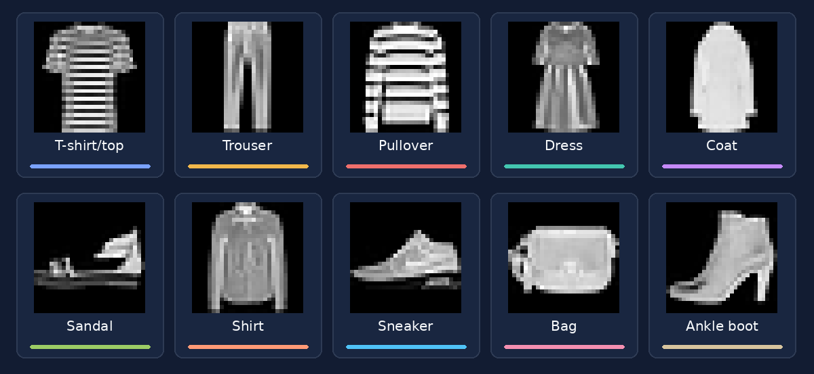
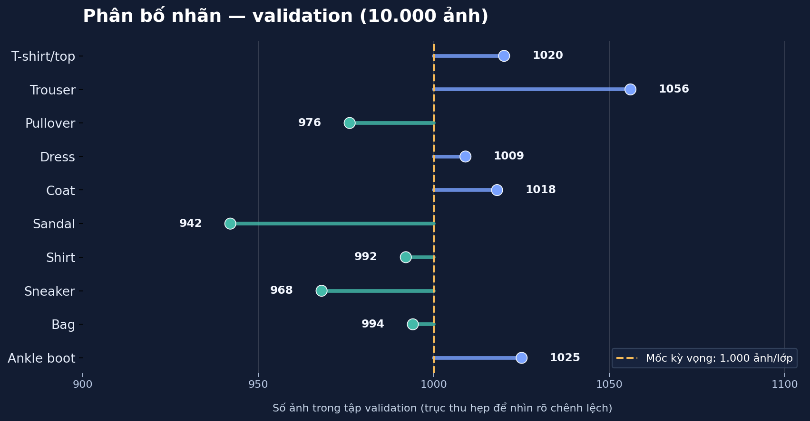
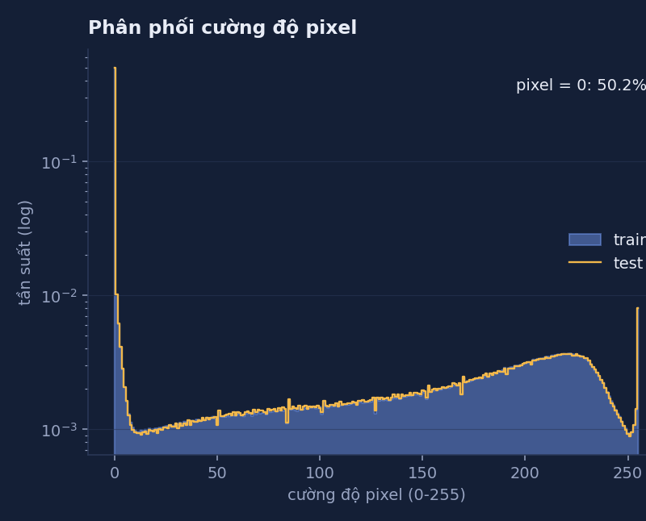
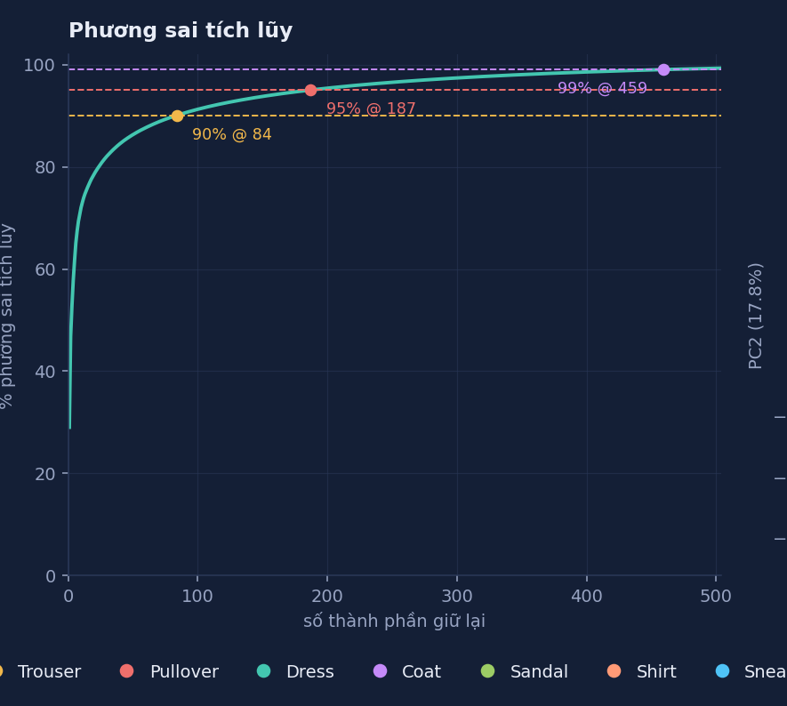
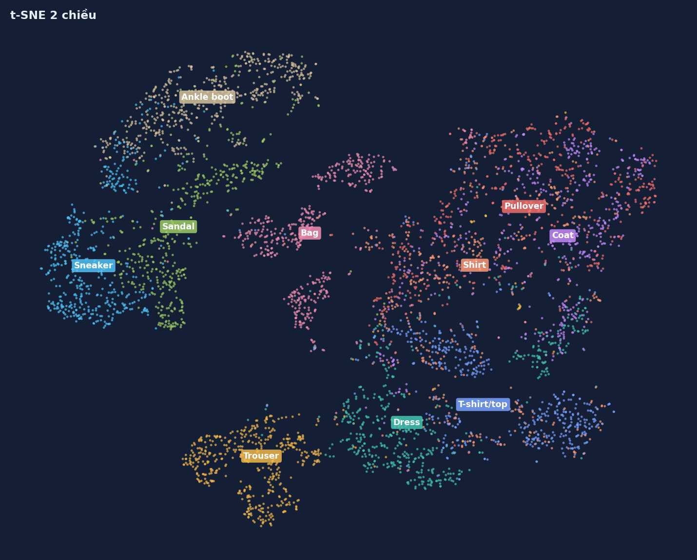

# Dữ liệu và phân tích khám phá — Fashion-MNIST

*Báo cáo dữ liệu sử dụng cho phân loại ảnh bằng mạng MLP*

Mục tiêu khảo sát: dữ liệu có cân bằng giữa các lớp hay không, những loại trang phục nào dễ bị nhầm lẫn và lựa chọn cách tiền xử lý phù hợp với đặc điểm ảnh.

## 1. Bộ dữ liệu được sử dụng

Fashion-MNIST gồm 70.000 ảnh xám kích thước 28 × 28 pixel, chia sẵn thành 60.000 ảnh train gốc và 10.000 ảnh test chính thức. Mỗi ảnh thuộc một trong mười nhóm sản phẩm thời trang, được đánh nhãn từ `0` đến `9`. Pixel ảnh gốc có giá trị nguyên từ `0` đến `255`.

*Hình 1. Mỗi lớp được minh họa bằng một ảnh lấy từ dữ liệu trong báo cáo EDA. Ở kích thước 28 × 28, một số loại áo có đường nét rất giống nhau.*

`10 nhãn gồm T-shirt/top, Trouser, Pullover, Dress, Coat, Sandal, Shirt, Sneaker, Bag và Ankle boot.`

## 2. Phân chia dữ liệu

| Tập dữ liệu | Số ảnh | Mục đích sử dụng |
|---|---:|---|
| **Training** | **50.000** | Cập nhật trọng số của MLP |
| **Validation** | **10.000** | Theo dõi loss, metrics, Early Stopping và chọn checkpoint |
| **Test chính thức** | **10.000** | Kiểm thử mô hình đã chọn, tính metrics và minh họa dự đoán |

[Train.py](../Train.py) chia 60.000 ảnh train `: lấy 50.000 chỉ số đầu cho training, 10.000 chỉ số còn lại cho validation. Hai tập sử dụng cùng chỉ số nhưng có transform riêng. [Predict.py](../Predict.py) đọc tập test bằng `

### Phân bố nhãn

Bộ train gốc có đúng 6.000 ảnh cho mỗi lớp. Số lượng ảnh validation ở mỗi lớp có sự lệch nhỏ nhưng không quá lớn so với quy mô dữ liệu.

*Hình 2. Phân bố 10.000 ảnh validation theo từng lớp.*

Dữ liệu tương đối cân bằng nên nhóm sử dụng accuracy để theo dõi kết quả tổng thể, đồng thời đối chiếu precision, recall và F1 ở bước đánh giá. Chi tiết metrics tại [evaluation.md](evaluation.md).

## 3. Tiền xử lý ảnh

Các ảnh có cùng kích thước nên không cần resize. Training có thêm phép lật ngang ngẫu nhiên; validation không sử dụng augmentation. Cấu hình thực tế trong [Train.py](../Train.py):

| Bước xử lý | Training | Validation |
|---|---|---|
| Lật ngang ngẫu nhiên | `RandomHorizontalFlip()` (`p=0.5`) | Không áp dụng |
| Chuyển ảnh sang tensor | `ToTensor()` | `ToTensor()` |
| Chuẩn hóa | `Normalize((0.2860,), (0.3530,))` | `Normalize((0.2860,), (0.3530,))` |

`ToTensor()` đưa pixel về `[0, 1]`. Sau đó, ảnh được chuẩn hóa theo công thức:

$$
x' = \frac{x-0.2860}{0.3530}, \qquad x \in [0,1].
$$

Đầu vào của MLP có kích thước `[B, 1, 28, 28]`, sau tầng `Flatten` thành `[B, 784]`. Chuẩn hóa theo mean/std **không** đồng nghĩa mọi pixel nằm trong `[-1, 1]`.

## 4. Kết quả khảo sát dữ liệu (EDA)

### 4.1. Độ sáng và phân bố pixel

Khi phân tích ảnh gốc trước chuẩn hóa, nhóm nhận thấy nền đen chiếm tỷ lệ đáng kể. Báo cáo EDA đã ghi nhận khoảng **50,2% số pixel của tập train gốc bằng 0**. Sản phẩm thường nằm giữa ảnh và được bao quanh bởi vùng nền.

*Hình 3. Phân bố cường độ pixel của train gốc và test trong báo cáo EDA.*

### 4.2. Sự tương đồng giữa các lớp

Trong báo cáo EDA, khi so sánh ảnh trung bình của mỗi lớp theo khoảng cách Euclid, ba cặp gần nhau nhất là:

| Cặp lớp | Khoảng cách Euclid giữa ảnh trung bình |
|---|---:|
| Pullover – Coat | **2,48** |
| Pullover – Shirt | **2,68** |
| Coat – Shirt | **3,02** |

Các khoảng cách này cho thấy hình dạng tổng quát của những lớp trên khá giống nhau ở không gian pixel. Đối chiếu với confusion matrix ở [demo.md](demo.md) để xác định các cặp lớp bị nhầm trong kết quả dự đoán.

### 4.3. PCA

Mỗi ảnh 28 × 28 được trải phẳng thành vector 784 chiều. Nhóm dùng kết quả PCA trong báo cáo EDA để xem phương sai tập trung ở bao nhiêu thành phần chính. Kết quả ghi nhận **84 thành phần giữ 90% phương sai**, **187 thành phần giữ 95%** và **459 thành phần giữ 99%**.

*Hình 4. Tỷ lệ phương sai tích lũy theo số thành phần chính.*

Trong phạm vi LAB này, không áp dụng PCA trước khi train; 6 mô hình cùng sử dụng đầu vào gốc 784 chiều. Phần PCA là khảo sát dữ liệu, không phải bước preprocessing trong [Train.py](../Train.py).

### 4.4. Quan sát các cụm dữ liệu bằng t-SNE

Để hình dung mức độ tách biệt giữa các lớp, báo cáo EDA sử dụng **5.000 ảnh train gốc**, giảm trước về 50 chiều bằng PCA, sau đó biểu diễn bằng t-SNE trên mặt phẳng hai chiều.

*Hình 5. Phép chiếu t-SNE trong báo cáo EDA.*

Trên bản đồ này, các nhóm giày, túi và quần hình thành những vùng tương đối dễ nhận diện. Ngược lại, Pullover, Coat và Shirt chồng lấn nhiều hơn. Quan sát này nhất quán với phân tích độ tương đồng của ảnh trung bình.

## 5. Phạm vi sử dụng kết quả EDA

Giữ cùng phép chia dữ liệu và preprocessing cho 6 thí nghiệm. Các giá trị đã quan sát ở EDA không thay thế kết quả validation hoặc test; phần đối chiếu kết quả được trình bày tại [evaluation.md](evaluation.md) và [demo.md](demo.md).
