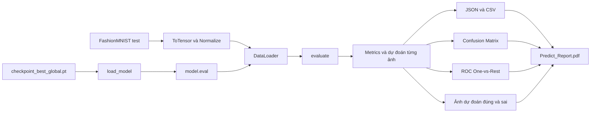

# Demo dự đoán Fashion-MNIST bằng Predict.py

## 1. Vai trò của Predict.py

`Predict.py` là script kiểm thử cuối cùng của mô hình. Script tải checkpoint tốt nhất theo validation, chạy toàn bộ 10.000 ảnh trong tập test chính thức của Fashion-MNIST, tính metrics tổng thể và theo từng lớp, sau đó xuất các file báo cáo, biểu đồ và danh sách dự đoán.

Script không huấn luyện lại hoặc cập nhật trọng số mô hình. Nó chỉ khôi phục checkpoint đã chọn và chuyển mô hình sang chế độ `eval()` để suy luận.

## 2. Đầu vào

| Thành phần | Giá trị |
|---|---|
| Model | `05_medium_mlp`, được lấy từ checkpoint có validation accuracy cao nhất |
| Checkpoint | [`checkpoints/checkpoint_best_global.pt`](../checkpoints/checkpoint_best_global.pt) |
| Dữ liệu | `FashionMNIST(train=False)` gồm 10.000 ảnh |
| Tiền xử lý | `ToTensor()` rồi `Normalize((0.286,), (0.353,))`, tương thích với `Train.py` |
| Batch size | 256 |
| Thiết bị | CUDA nếu có, ngược lại CPU |

Các đường dẫn trong script được tạo tương đối theo thư mục chứa `Predict.py`, nên script không phụ thuộc vào thư mục terminal hiện tại.

## 3. Luồng xử lý



## 4. Các chức năng chính

- Kiểm tra checkpoint có tồn tại hay không.
- Đọc kiến trúc từ trường `config` trong checkpoint.
- Khởi tạo lại `MLP`.
- Nạp `model_state_dict` bằng chế độ `strict=True`.
- Chuyển mô hình sang thiết bị đã chọn và gọi `eval()`.
- Tính tổng Cross-Entropy loss trên toàn bộ tập test;
- Tính accuracy, Macro Precision/Recall/F1, Macro FPR và ROC–AUC One-vs-Rest;
- Lưu nhãn thật, nhãn dự đoán, xác suất và confusion matrix để các phần sau sử dụng.


Vẽ confusion matrix:

- Hàng biểu diễn nhãn thật;
- Cột biểu diễn nhãn dự đoán;
- Ô ngoài đường chéo là số lượng ảnh bị phân loại sai;
- Biểu đồ được lưu vào thư mục `reports/test`.

Vẽ ROC One-vs-Rest cho từng lớp Fashion-MNIST:

- Nhãn đa lớp được chuyển sang dạng nhị phân cho từng lớp;
- Tính ROC curve và diện tích AUC của từng lớp;
- Biểu đồ tổng hợp được lưu vào thư mục `reports/test`.

Hàm tạo hình minh họa gồm tối đa:

- 9 ảnh dự đoán đúng được chọn ngẫu nhiên
- 3 ảnh dự đoán sai được chọn ngẫu nhiên
- Nhãn thật, nhãn dự đoán và confidence phía dưới mỗi ảnh.

Việc chọn ảnh chỉ phục vụ minh họa và không làm thay đổi metrics trên toàn bộ tập test.

## 5. Output được tạo ra

```text
reports/
├── Predict_Report.pdf
└── test/
    ├── test_metrics.json
    ├── test_predictions.csv
    ├── confusion_matrix.png
    ├── roc_ovr.png
    └── prediction_examples.png
```

Ý nghĩa từng file:

- `test_metrics.json`: accuracy, loss, precision, recall, F1, FPR, AUC và classification report của mười lớp.
- `test_predictions.csv`: từng ảnh với index, nhãn thật, nhãn dự đoán, confidence và cờ dự đoán đúng/sai.
- `confusion_matrix.png`: ma trận lỗi trên toàn bộ 10.000 ảnh.
- `roc_ovr.png`: ROC One-vs-Rest của từng lớp.
- `prediction_examples.png`: ví dụ trực quan về dự đoán đúng và sai.
- `Predict_Report.pdf`: báo cáo tổng hợp các kết quả và biểu đồ của lần test.

Phân tích số liệu kết quả được trình bày tại [evaluation.md](evaluation.md).
