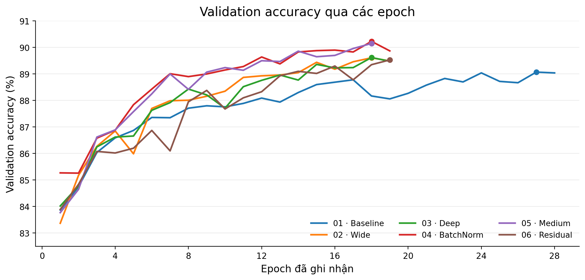
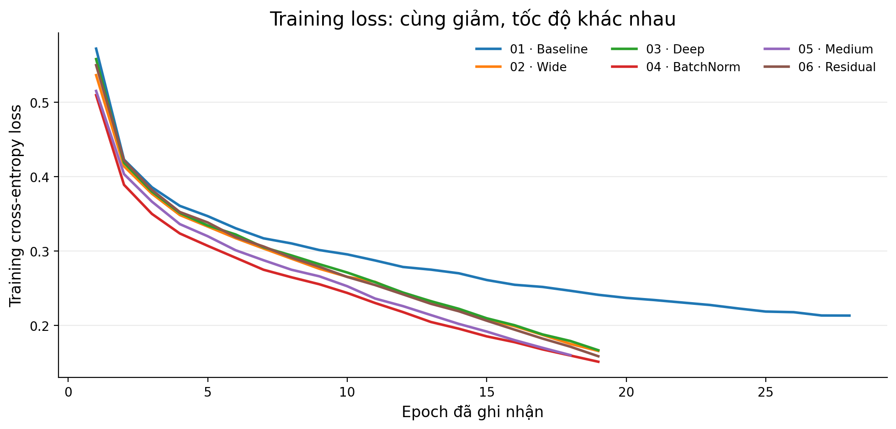
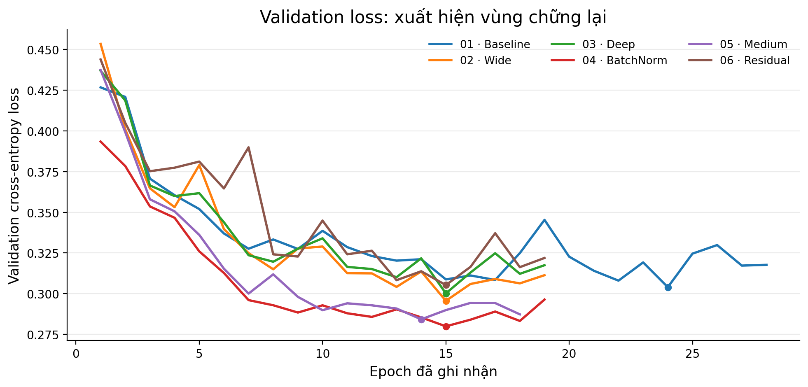
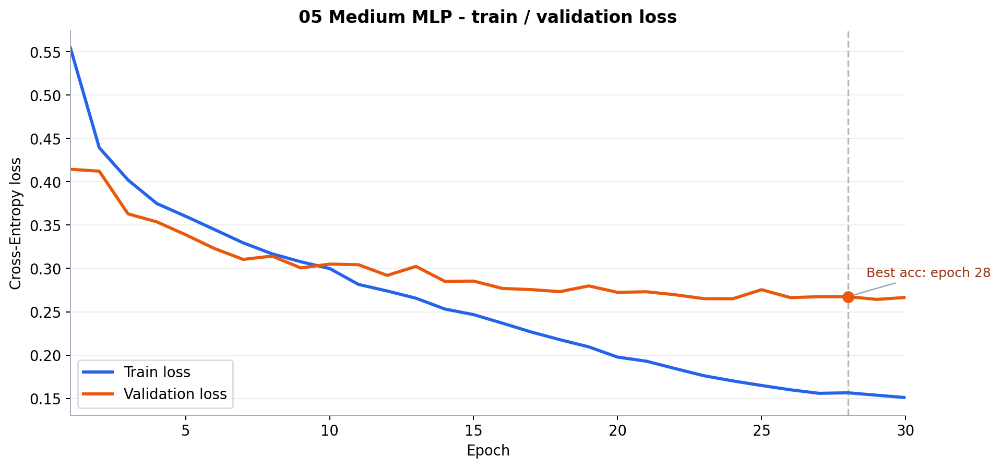
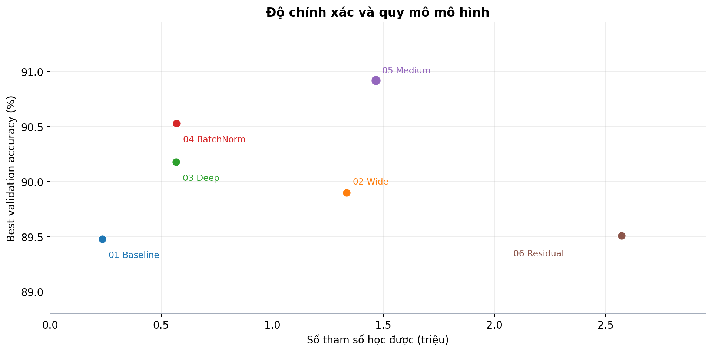
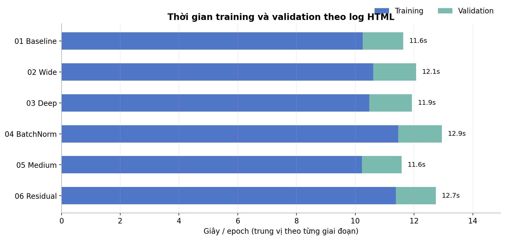
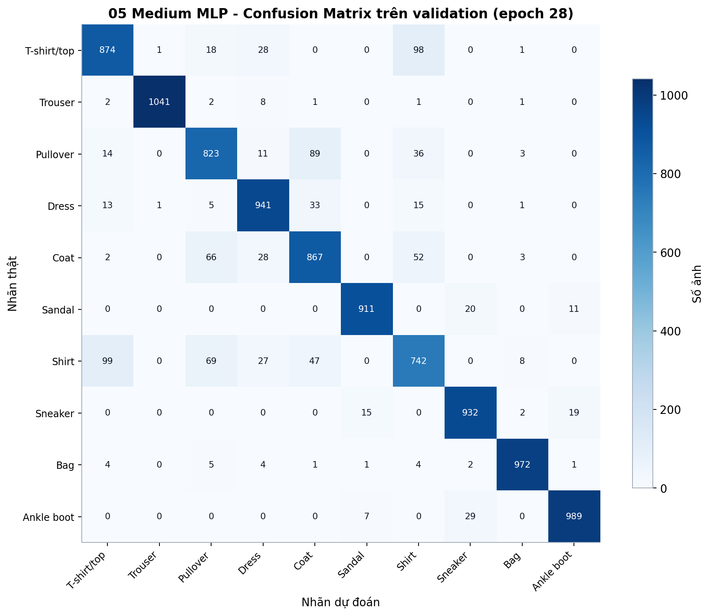
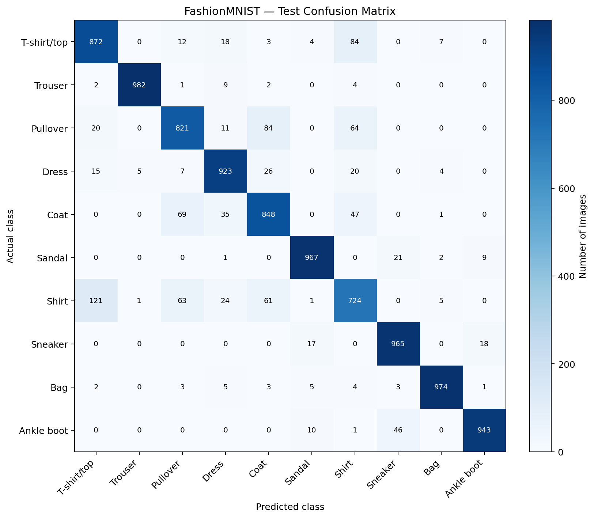
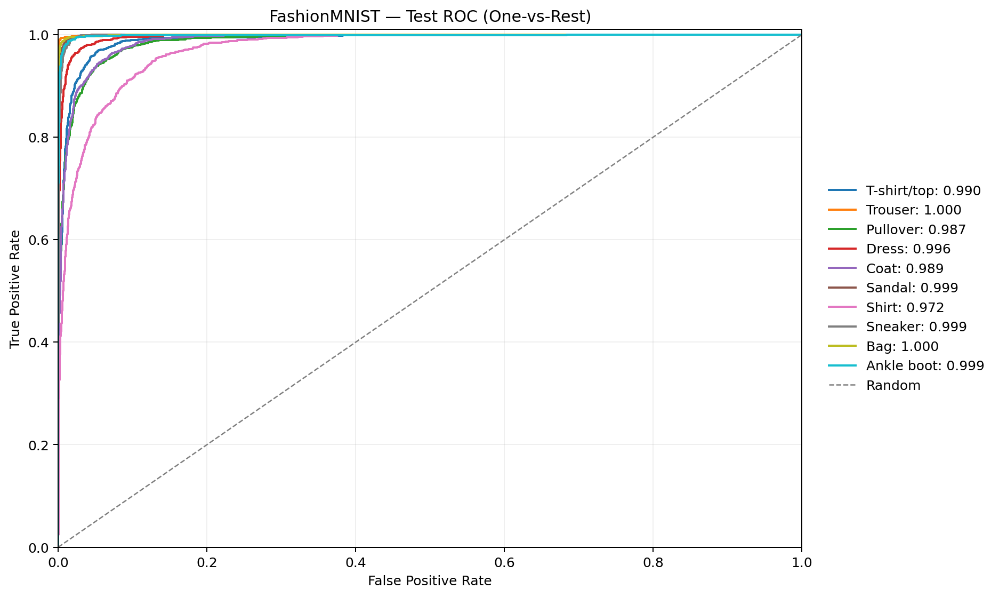

# Đánh giá thực nghiệm 6 cấu hình MLP

## 1. Kết quả chính

Kết quả lấy từ **[báo cáo HTML tổng hợp](../reports/report_all_models.html)**, gồm 6 lần huấn luyện trên tập **10.000 ảnh validation**. Mỗi dòng dùng metrics tại epoch có validation accuracy cao nhất của chính mô hình đó

| Mô hình | Best epoch | Accuracy ↑ | Macro F1 ↑ | Macro ROC–AUC ↑ | Val loss ↓ |
|:--|--:|--:|--:|--:|--:|
| `01_baseline` | 28 | 89,48% | 0,8940 | 0,9926 | 0,3041 |
| `02_wide_mlp` | 20 | 89,90% | 0,8985 | 0,9928 | 0,2980 |
| `03_deep_mlp` | 23 | 90,18% | 0,9011 | 0,9933 | 0,2892 |
| `04_batchnorm_mlp` | 29 | 90,53% | 0,9050 | 0,9940 | 0,2643 |
| **05_medium_mlp** | 28 | **90,92%** | 0,9089 | 0,9941 | 0,2674 |
| `06_residual_mlp` | 20 | 89,51% | 0,8944 | 0,9926 | 0,3098 |

**Nhận xét kết quả:** `05_medium_mlp` đạt accuracy cao nhất (**90,92%**, epoch 28), đồng thời có Macro F1 **0,9089** và Macro ROC–AUC **0,9941** cao nhất trong 6 run. `04_batchnorm_mlp` đứng sau với **90,53%**; chênh lệch **0,39 điểm phần trăm** nên thứ hạng này cần được xác nhận qua nhiều lần chạy độc lập mới kết luận ổn định.

- Chênh lệch Medium so với Baseline là **1,44%** (90,92% - 89,48%) nhưng tốn thêm **1.230.976 tham số** (từ 235.146 lên 1.466.122), nên cải thiện accuracy đi kèm chi phí tham số lớn.
- BatchNorm dẫn trước Baseline **1,05%** nhưng chỉ thêm 334.080 tham số; phần lớn cải thiện không đến từ quy mô lớn mà từ cơ chế normalization phù hợp.

## 2. Diễn biến trong quá trình huấn luyện

### 2.1. Accuracy tăng nhanh rồi bước vào vùng bão hòa

*Hình 1. Validation accuracy của 6 mô hình*

Accuracy của cả 6 cấu hình tăng rõ ở giai đoạn đầu và chậm dần về cuối. Chẳng hạn, `05_medium_mlp` đi từ **84,79% ở epoch 1** lên **88,73% ở epoch 10**, sau đó đạt **90,92% tại epoch 28**. Do đó train lâu hơn không đồng nghĩa tăng accuracy tương ứng.

Điểm hội tụ được quan sát cũng phân biệt rõ tốc độ học ban đầu và thời điểm đạt mục tiêu:

| Mô hình | Epoch đầu tiên ≥88% | Epoch đầu tiên ≥89% | Epoch accuracy tốt nhất | Nhận xét trực quan |
|:--|--:|--:|--:|:--|
| Baseline | 9 | 21 | 28 | Học chậm nhất khi vượt ngưỡng 89%; sau đó mới đạt gần mức đỉnh |
| Wide | 8 | 13 | 20 | Vào vùng tốt sớm hơn Baseline, nhưng độ bão hòa thấp hơn Deep và Medium |
| Deep | 8 | 13 | 23 | Hội tụ nhanh tương đương Wide ở giai đoạn đầu, còn độ chính xác cuối cao hơn |
| BatchNorm | 8 | 14 | 29 | Tăng từ 88% sớm, sau đó cải thiện đều và đạt 90,53% |
| Medium | **7** | 14 | 28 | Vào ngưỡng 88% nhanh nhất; lợi thế chủ yếu là độ chính xác đỉnh cao nhất |
| Residual | 8 | 15 | 20 | Không vượt Baseline về điểm số cuối và gánh nặng tham số không chuyển thành kết quả tốt |

Vì vậy, tốc độ hội tụ chỉ giải thích phần nào kết quả cuối. Baseline xác lập accuracy gần Residual (**89,48%** so với **89,51%**) nhưng cần **21 epoch mới vượt 89%**, trong khi Residual là epoch 15 và Wide là epoch 13. Điều này cho thấy Baseline có chu kỳ học chậm hơn, không phải vì thiếu điểm số cuối mà vì cần nhiều epoch hơn để đi vào vùng biểu diễn tương đương.

### 2.2. Training loss tiếp tục giảm nhưng validation loss không giảm mãi

*Hình 2. Training loss trung bình theo epoch của 6 mô hình.*

*Hình 3. Validation loss theo epoch*

Training loss nhìn chung giảm qua các epoch. Trong khi đó, validation loss giảm mạnh ban đầu rồi có những đoạn dao động nên epoch có loss thấp nhất không nhất thiết là epoch có accuracy cao nhất.

*Hình 4. Train/validation loss của `05_medium_mlp`*

Với `05_medium_mlp`, validation accuracy tốt nhất ở **epoch 28** (val loss **0,2674**), còn validation loss thấp nhất là **0,2642 tại epoch 29**. Hai tiêu chí không cho cùng một epoch. 
## 3. Sự khác nhau giữa các cấu hình

*Hình 5. Accuracy tốt nhất so với số tham số học được. Số tham số trích từ HTML*

### 3.1. Baseline → Wide: nhiều neuron hơn, hiệu quả tăng có giới hạn

Mở rộng mạng từ **235.146** lên **1.333.770 tham số** (**5,67 lần**) đi kèm accuracy tăng từ **89,48%** lên **89,90%**. Việc tăng số neuron có cải thiện kết quả, nhưng không tương ứng với mức tăng quy mô. 

### 3.2. Wide → Deep: độ sâu có hiệu quả tham số tốt hơn

`03_deep_mlp` đạt **90,18%**, cao hơn `02_wide_mlp` (**89,90%**), trong khi chỉ có **567.434 tham số** so với **1.333.770**. Deep sử dụng khoảng **42,5%** số tham số của Wide.

> Trong lần thực nghiệm này, Deep cho accuracy tốt hơn Wide với số tham số ít hơn. Điều này cho thấy rằng ở bài toán này thì việc tăng độ sâu hay rộng sẽ không khác biệt quá nhiều nhưng ảnh hưởng về các tham số tính toán khá lớn

### 3.3. Deep → BatchNorm: tác động khi giữ gần như cùng cấu hình

`03_deep_mlp` và `04_batchnorm_mlp` có cùng kích thước tầng ẩn, Dropout **0.2**, learning rate, weight decay và cosine scheduler. Khác biệt chính là bổ sung BatchNorm. Accuracy tăng từ **90,18%** lên **90,53%**, còn số tham số chỉ tăng **1.792**. Đây là cặp đối chiếu rõ nhất trong 6 cấu hình về tác động của normalization.

### 3.4. Medium và Residual: thêm độ phức tạp không đảm bảo điểm số tốt hơn

`05_medium_mlp` đạt **90,92%**, cao nhất trong 6 run, nhưng sử dụng **1.466.122 tham số**, lớn hơn `04_batchnorm_mlp` (**569.226**).

`06_residual_mlp` có **2.571.786 tham số** nhưng accuracy chỉ đạt **89,51%**. Cấu hình này đồng thời dùng LayerNorm, residual blocks và learning rate riêng

## 4. Chi phí thời gian

*Hình 6. Trung vị thời gian `train_time` và `val_time` theo epoch*

| Mô hình | Số epoch đã chạy | Thời gian train/epoch (trung vị) | Validation/epoch (trung vị) |
|:--|--:|--:|--:|
| `01_baseline` | 30 | 10,26 s | 1,37 s |
| `02_wide_mlp` | 20 | 10,61 s | 1,46 s |
| `03_deep_mlp` | 23 | 10,48 s | 1,45 s |
| `04_batchnorm_mlp` | 30 | 11,46 s | 1,49 s |
| `05_medium_mlp` | 30 | 10,23 s | 1,35 s |
| `06_residual_mlp` | 20 | 11,38 s | 1,36 s |

## 5. Đánh giá theo lớp trên validation

*Hình 7. Confusion Matrix của `05_medium_mlp` tại epoch 28 trên 10.000 ảnh validation.*

Với mô hình được chọn theo validation accuracy, **Shirt** có F1 thấp nhất (**0,7649**), recall **74,80%**. Các cặp nhầm lẫn lớn nhất tại epoch 28 gồm:

| Nhãn thật | Dự đoán thành | Số ảnh |
|---|---|---:|
| Shirt | T-shirt/top | **99** |
| T-shirt/top | Shirt | **98** |
| Pullover | Coat | **89** |
| Shirt | Pullover | **69** |
| Coat | Pullover | **66** |

Các lỗi nổi bật vẫn tập trung ở nhóm áo có hình dạng gần nhau.

Trong 10 lớp được đánh giá, ranh giới “Shirt” - “T-shirt/top” là điểm yếu rõ nhất trên validation: Shirt có recall **74,80%** và F1 thấp nhất.
- Các lớp như Trouser, Bag và Sandal đạt F1 trên 0,965; phần lớn sai của model do một cụm lớp khó phân biệt, không phân bố đều cho cả 10 lớp.

## 6. Kiểm thử cuối trên tập test

*Hình 8. Confusion matrix của checkpoint epoch 28 trên 10.000 ảnh test chính thức.*

Kết quả test không tham gia quá trình chọn mô hình hoặc checkpoint. `05_medium_mlp` dự đoán đúng **9.028/10.000 ảnh**, cho:

| Chỉ số | Giá trị test |
|---|---:|
| Cross-Entropy loss | 0,2909 |
| Accuracy | **90,28%** |
| Macro Precision | 0,9025 |
| Macro Recall | 0,9028 |
| Macro F1-score | 0,9025 |
| Macro FPR | 0,0108 |
| Macro ROC–AUC (OvR) | 0,9934 |
| Micro ROC–AUC (OvR) | 0,9958 |

So với validation, accuracy giảm **0,64 điểm phần trăm** (90,92% xuống 90,28%) và Macro F1 giảm **0,0064** (0,9089 xuống 0,9025). Mức chênh lệch nhỏ cho thấy checkpoint được chọn không phụ thuộc mạnh vào một lỗi đặc thù của validation

### 6.1. Hiệu năng chi tiết theo lớp trên test

| Lớp | Precision | Recall | F1 |
|:--|--:|--:|--:|
| T-shirt/top | 0,8553 | 0,8570 | 0,8561 |
| Trouser | 0,9949 | 0,9780 | 0,9864 |
| Pullover | 0,8232 | 0,8520 | 0,8373 |
| Dress | 0,8977 | 0,9210 | 0,9092 |
| Coat | 0,8365 | 0,8490 | 0,8427 |
| Sandal | 0,9745 | 0,9570 | 0,9657 |
| Shirt | 0,7631 | 0,7150 | 0,7383 |
| Sneaker | 0,9403 | 0,9610 | 0,9505 |
| Bag | 0,9819 | 0,9780 | 0,9800 |
| Ankle boot | 0,9581 | 0,9600 | 0,9590 |

**Kết quả tốt nhất theo F1:** Trouser (**0,9864**), Bag (**0,9800**) và Ankle boot (**0,9590**).

**Điểm yếu rõ nhất:** Shirt chỉ có F1 **0,7383**, recall **71,50%**. Trong số 1.000 ảnh Shirt thật, mô hình nhận đúng 715 ảnh và nhầm 285 ảnh sang các lớp khác.

Các nhầm lẫn ngoài đường chéo lớn nhất trên test là:

| Nhãn thật | Dự đoán thành | Số ảnh |
|---|---|---:|
| Shirt | T-shirt/top | **112** |
| T-shirt/top | Shirt | **96** |
| Shirt | Pullover | **83** |
| Pullover | Coat | **71** |
| Coat | Pullover | **71** |

Do đó sai số chủ yếu tập trung ở bốn lớp áo có hình dạng tương đồng: Shirt, T-shirt/top, Pullover và Coat. Không phân bố lỗi đều: nhiều lớp như Trouser, Sandal, Bag và Ankle boot vẫn duy trì recall từ 95,7% đến 97,8%.

*Hình 9. Macro ROC–AUC của mô hình trên test đạt 0,9934, nhưng ROC–AUC không thay thế recall/classification report trong đánh giá lỗi cuối cùng.*

## 7. Kết luận đánh giá

> Kết quả của 6 run trong [báo cáo HTML](../reports/report_all_models.html) cho thấy `05_medium_mlp` đứng đầu về validation accuracy (**90,92%**) và Macro F1 (**0,9089**).

> Deep tốt hơn Wide với **42,5%** số tham số; BatchNorm cải thiện kết quả khi giữ gần như cùng cấu trúc với Deep. Mạng lớn hơn không tự động có accuracy cao hơn, và validation loss không nhất thiết thấp nhất ở epoch có accuracy tốt nhất.

**Đánh giá tổng quan:**
- `05_medium_mlp` là cấu hình cân bằng tốt nhất trên validation: dẫn đầu accuracy và Macro F1, đồng thời không phải là mô hình chậm nhất.
- Trên tập test chính thức 10.000 ảnh, cùng checkpoint đạt accuracy **90,28%**, giảm **0,64 điểm phần trăm** so với validation. Macro F1 test là **0,9025**.
- `04_batchnorm_mlp` là lựa chọn thay thế đáng cân nhắc nếu muốn mô hình nhỏ hơn: thấp hơn Medium **0,39 điểm phần trăm accuracy** nhưng có số tham số khoảng **2,57 lần nhỏ hơn** (569.226 so với 1.466.122) và val loss thấp hơn **0,0031**.
- `01_baseline` không kém accuracy nhiều (chỉ thấp hơn Medium **1,44 điểm phần trăm**) nhưng đi vào ngưỡng 89% muộn hơn các mô hình khác. Với Baseline, tăng độ sâu thuần FCN có thể giúp optimization ổn định hơn nhưng chưa phải cấu hình hiệu quả nhất.
- `06_residual_mlp` minh họa rõ giới hạn của FCN: gấp ~10,94 lần số tham số Baseline nhưng accuracy gần như ngang Baseline và thấp hơn Deep/Wide/Medium/BatchNorm. Việc thêm residual, LayerNorm hoặc LR riêng không tự tạo cải thiện nếu không đi cùng chiến lược đánh giá và tối ưu phù hợp.

> **Kết luận:** trong các Fully Connected Network được thử, việc tăng chiều sâu có thể mang lại hiệu quả tham số tốt hơn, nhưng không có bằng chứng rằng “mạng sâu hơn” tự động tạo ra một đường chẩn đoán tốt hơn. Deep cải thiện Baseline **0,70 điểm phần trăm accuracy**; sự điều chỉnh sang Medium đưa accuracy lên **90,92%** trên validation. Điều này cho thấy trần hiệu năng của MLP bị ảnh hưởng bởi việc flatten ảnh sang vector 1D. BatchNorm và sự cân bằng giữa độ rộng - độ sâu mang lại lợi ích rõ hơn Residual blocks trong bài toán này.