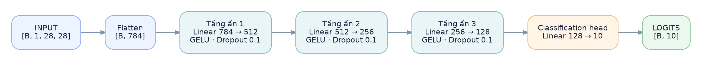
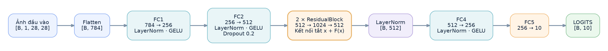
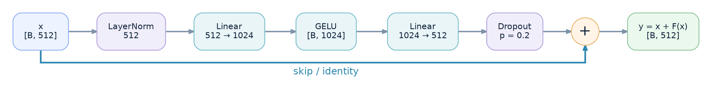

# Thiết kế mô hình — Multilayer Perceptron trên Fashion-MNIST

## 1. Hướng thiết kế

Nhóm xây dựng sáu cấu hình MLP để đối chiếu độ rộng, độ sâu, normalization và residual connections. Tất cả mô hình sử dụng các tầng `nn.Linear`, không sử dụng CNN.

Đầu vào là ảnh xám 28 × 28 pixel. Lớp `Flatten(start_dim=1)` chuyển ảnh từ `[B, 1, 28, 28]` thành `[B, 784]`. Đầu ra là **10 logits** `[B, 10]`, không có Softmax ở tầng cuối. Phép chia và tiền xử lý được trình bày tại [data.md](data.md).

Source: [lớp `MLP`](../ModelMLP.py#L26-L88) trong [ModelMLP.py](../ModelMLP.py).

## 2. Luồng xử lý của MLP thông thường

Với các cấu hình không sử dụng residual (`residual_blocks=0`), nhóm xây dựng mạng bằng cách ghép các tầng ẩn theo cùng một thứ tự:

**`Linear → Normalization → Activation → Dropout`**

Sau tầng ẩn cuối cùng là một lớp `Linear` đưa đặc trưng về 10 logits.

*Hình 1. Luồng xử lý `03_deep_mlp`. Model này không dùng normalization; các model có BatchNorm sẽ thêm `BatchNorm1d` sau mỗi tầng Linear ẩn.*

**Activation thực tế:** Trong [ModelMLP.py](../ModelMLP.py#L39), `activation` được gán trực tiếp bằng `nn.LeakyReLU()`. Dù [Train.py](../Train.py#L43-L67) ghi `activation="relu"`, cả sáu cấu hình hiện **thực thi LeakyReLU**, không phải ReLU hoặc GELU. Cần đồng bộ tên tham số với source trước khi chốt tài liệu và checkpoint; xem [plan-progression.md](plan-progression.md).

## 3. Residual MLP: thêm đường truyền thông tin trực tiếp

Đối với cấu hình `06_residual_mlp`, nhóm sử dụng **skip connection**: đầu vào của một block được cộng trực tiếp với đầu ra của nhánh biến đổi.

$$
\boxed{y = x + F(x)}
$$

### 3.1. Luồng tổng thể của model 06

Với `hidden=(256,)` và `residual_blocks=2`, nhóm lấy phần tử đầu tiên của `hidden` làm chiều rộng nền `c=256`, sau đó tạo đặc trưng trung gian có chiều rộng `2c=512`.

*Hình 2. Kiến trúc `06_residual_mlp` trong [ModelMLP.py](../ModelMLP.py#L51-L80).*

| Thành phần | Phép biến đổi | Kích thước đầu ra |
|---|---|---|
| Flatten | Ảnh → vector | `[B, 784]` |
| FC1 | `Linear(784, 256)` → LayerNorm → LeakyReLU | `[B, 256]` |
| FC2 | `Linear(256, 512)` → LayerNorm → LeakyReLU → Dropout(0.3) | `[B, 512]` |
| Residual stack | 2 × `ResidualBlock(512)` → LayerNorm | `[B, 512]` |
| FC4 | `Linear(512, 256)` → LayerNorm → LeakyReLU | `[B, 256]` |
| FC5 | `Linear(256, 10)` | `[B, 10]` |

### 3.2. Bên trong một ResidualBlock

*Hình 3. Hai nhánh của [ResidualBlock](../ModelMLP.py#L11-L23): nhánh biến đổi `F(x)` và nhánh identity.*

Trong source, nhánh biến đổi gồm **`LayerNorm(512) → Linear(512, 1024) → LeakyReLU → Linear(1024, 512) → Dropout(0.3)`**. Không có normalization sau `Linear(1024, 512)` trong block; `LayerNorm(512)` được đặt sau toàn bộ chuỗi hai residual blocks.

## 4. Sáu cấu hình nhóm đã xây dựng

Các tham số kiến trúc lấy từ [`Config_parameter`](../Train.py#L43-L67); số tham số được đối chiếu bằng cách khởi tạo `MLP` từ [ModelMLP.py](../ModelMLP.py).

| Mô hình | Dãy kích thước đặc trưng | Activation thực tế | Chuẩn hóa | Dropout | Residual blocks | Số tham số |
|---|---|---|---|---:|---:|---:|
| `01_baseline` | 784 → 256 → 128 → 10 | LeakyReLU | Không | 0.2 | 0 | **235.146** |
| `02_wide_mlp` | 784 → 1024 → 512 → 10 | LeakyReLU | Không | 0.2 | 0 | **1.333.770** |
| `03_deep_mlp` | 784 → 512 → 256 → 128 → 10 | LeakyReLU | Không | 0.2 | 0 | **567.434** |
| `04_batchnorm_mlp` | 784 → 512 → 256 → 128 → 10 | LeakyReLU | BatchNorm1d | 0.2 | 0 | **569.226** |
| `05_medium_mlp` | 784 → 1024 → 512 → 256 → 10 | LeakyReLU | BatchNorm1d | 0.3 | 0 | **1.466.122** |
| `06_residual_mlp` | 784 → 256 → 512 → 2 × ResidualBlock → 256 → 10 | LeakyReLU | LayerNorm | 0.3 | 2 | **2.571.786** |

*Bảng 1. Tham số của sáu cấu hình MLP. Số tham số bao gồm trọng số và bias của các tầng học được; không phải dung lượng RAM/VRAM đo thực tế.*

- Baseline, nhóm sử dụng hai tầng ẩn vừa phải làm mốc xuất phát.
- Wide MLP tăng số neuron ở các tầng ẩn.
- Deep MLP sử dụng thêm một tầng ẩn.
- Model 04 giữ cấu trúc của Deep MLP nhưng bổ sung BatchNorm.
- Model 05 tiếp tục mở rộng kích thước mạng và điều chỉnh mức Dropout.
- Model 06 đưa LayerNorm và kết nối residual vào kiến trúc.

Learning rate, weight decay, scheduler và các điều kiện huấn luyện được ghi tại [trainning.md](trainning.md); không lặp lại ở đây.

## 5. Kiểm tra tính nhất quán của kiến trúc

- [x] Khởi tạo đủ sáu cấu hình từ `Config_parameter`, đối chiếu số tham số và kiểm tra forward với `[2, 1, 28, 28]`: tất cả trả về `[2, 10]`.
- [x] Xác nhận activation và dropout thực tế từ [ModelMLP.py](../ModelMLP.py) và [Train.py](../Train.py).
- [ ] Đồng bộ tên `activation="relu"` với phép kích hoạt thực tế trước khi công bố cấu hình của một lần train mới.
- [ ] Đối chiếu `config` lưu trong checkpoint với source và kết quả tại [evaluation.md](evaluation.md) trước khi nhận xét sự khác nhau giữa các mô hình.

Các cấu hình có thể thay đổi nhiều tham số cùng lúc. Phần so sánh kết quả thuộc [evaluation.md](evaluation.md), không mặc nhiên quy mọi chênh lệch cho một thay đổi kiến trúc riêng lẻ.
