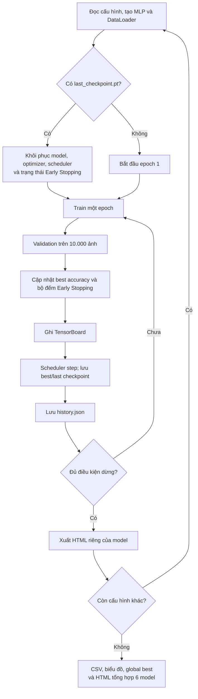

# Thiết kế quy trình huấn luyện MLP

> **Vai trò tài liệu:** Quy định cách nhóm triển khai, theo dõi và kiểm tra quá trình huấn luyện. Bảng kết quả và phân tích thực nghiệm được trình bày trong [evaluation.md](evaluation.md).

## 1. Định hướng huấn luyện

Sử dụng một quy trình training/validation chung cho 6 cấu hình MLP. Phép chia dữ liệu và preprocessing được thống nhất theo [data.md](data.md); thiết kế từng mô hình được trình bày tại [model.md](model.md).

## 2. Luồng xử lý tổng thể

*Hình 1. Luồng trong [Train.py](../Train.py#L250-L490). Epoch cuối vẫn được ghi log, checkpoint và lịch sử trước khi dừng sớm.*

## 3. Điều kiện huấn luyện chung

| Thiết lập | Giá trị trong source |
|---|---|
| Dataset và split | Theo [data.md](data.md): 50.000 training / 10.000 validation |
| Batch size train / validation | `64` / `256` |
| Optimizer | `AdamW` |
| Loss training | `CrossEntropyLoss(label_smoothing=0.0)` khi config không ghi khác |
| Loss validation | `CrossEntropyLoss()` |
| Epoch tối đa | `30` |
| Early Stopping | Patience `5`, theo validation loss |
| Gradient clipping | `max_norm=5.0` |
| Seed khởi tạo | `Seed=42` |
| Seed chia train/validation | `1` |
| DataLoader workers | `0` |
| Device | `cuda` nếu có; ngược lại `cpu` |

## 4. Các cấu hình tối ưu hóa

Dữ liệu cấu hình được lấy trực tiếp từ [Train.py](../Train.py#L43-L67). Kích thước mạng và normalization xem tại [model.md](model.md).

| Cấu hình | Learning rate | Weight decay | Batch size | Scheduler |
|:--|--:|--:|--:|:--|
| `01_baseline` | 0.001 | 0.01 | 64 | Không |
| `02_wide_mlp` | 0.001 | 0.01 | 64 | CosineAnnealingLR |
| `03_deep_mlp` | 0.001 | 0.01 | 64 | CosineAnnealingLR |
| `04_batchnorm_mlp` | 0.001 | 0.01 | 64 | CosineAnnealingLR |
| `05_medium_mlp` | 0.002 | 0.01 | 64 | CosineAnnealingLR |
| `06_residual_mlp` | 0.0005 | 0.01 | 64 | CosineAnnealingLR |

### Cross-Entropy Loss

Đầu ra MLP là logits có kích thước `[B, 10]`. Với batch gồm $B$ ảnh, nhãn $y_i \in \{0,\ldots,9\}$ và logit lớp $k$ là $z_{i,k}$, nhóm sử dụng:

$$
\mathcal{L}_{\mathrm{CE}}
= -\frac{1}{B}\sum_{i=1}^{B}
\log\left(\frac{\exp(z_{i,y_i})}{\sum_{k=0}^{9}\exp(z_{i,k})}\right).
$$

Loss được tính trực tiếp từ logits, không gọi Softmax trước `CrossEntropyLoss`. Source: [`train()`](../Train.py#L94-L134).

### Learning-rate scheduler

Năm cấu hình sử dụng `CosineAnnealingLR(optimizer, T_max=30)` với `eta_min=0` mặc định. Baseline không dùng scheduler. Scheduler được cập nhật một lần **sau mỗi epoch**.

$$
\eta_t = \frac{\eta_0}{2}\left(1+\cos\frac{\pi t}{T_{\max}}\right),
\qquad T_{\max}=30.
$$

Khi resume, trạng thái scheduler phải được khôi phục cùng optimizer; source thực hiện tại [`load_checkpoint()`](../Train.py#L199-L206).

## 5. Quy trình train và validation

Trong mỗi batch, nhóm thực hiện **forward → backward → gradient clipping → optimizer step**. 

Training loss của toàn epoch được tính theo số ảnh thực tế mỗi batch:

$$
L_{\mathrm{train,epoch}}
= \frac{\sum_{b=1}^{M} n_b L_b}{\sum_{b=1}^{M}n_b},
$$

trong đó $L_b$ là loss trung bình batch $b$ và $n_b$ là số ảnh của batch đó.

Validation chạy [`validate()`](../Train.py#L138-L179) trên toàn bộ 10.000 ảnh, sử dụng `model.eval()` và `@torch.no_grad()`; không cập nhật trọng số. Các metrics dùng để đánh giá mô hình được trình bày tại [evaluation.md](evaluation.md).

## 6. Validation, checkpoint và Early Stopping

| Quyết định | Tiêu chí trong source | Quy tắc |
|:--|:--|:--|
| Best checkpoint từng model | Validation accuracy | Lưu khi lớn hơn best accuracy trước đó |
| Early Stopping | Validation loss | Dừng sau `5` epochs liên tiếp không giảm quá `1e-4` |
| Global best | Best validation accuracy | So sánh 6 model bằng `max(results, key=lambda x: x["accuracy"])` |

**File checkpoint**

| File | Vai trò |
|:--|:--|
| `checkpoints/<model>/checkpoint_best.pt` | Trọng số và metrics tại epoch có validation accuracy cao nhất |
| `checkpoints/<model>/last_checkpoint.pt` | Phục vụ resume từ epoch đã hoàn thành |
| `checkpoints/checkpoint_best_global.pt` | Bản sao best checkpoint của model dẫn đầu sau khi hoàn thành 6 run |

Checkpoint chứa `epoch`, `config`, `model_name`, `model_state_dict`, `optimizer_state_dict`, `scheduler_state_dict`, `best_acc` và `best_metrics`. Trường trạng thái bổ sung khi lưu là **`best_val_loss`, `bad_epochs`, `early_stopped`**; khi resume các trường này được khôi phục cùng model, optimizer và scheduler.

## 7. Theo dõi bằng TensorBoard và báo cáo HTML

Training ghi log vào `logs/<model>/` qua [`SummaryWriter`](../Train.py#L291-L296); mỗi epoch gọi [`log_tensorboard()`](../Train.py#L209-L248). `writer.flush()` được gọi sau khi ghi metrics/hình.

| Nhóm log | Nội dung |
|:--|:--|
| `Loss/train/batch`, `Optimization/grad_norm/batch` | Ghi mỗi 50 iteration (`LOG_EVERY=50`) |
| `Loss/train/epoch`, `Loss/validation`, `Accuracy/train` | Loss và accuracy train/validation theo epoch |
| `Validation/accuracy`, `Validation/precision`, `Validation/recall`, `Validation/f1`, `Validation/fpr`, `Validation/auc` | Metrics validation theo epoch |
| `Optimization/learning_rate`, `Optimization/grad_norm_mean`, `Optimization/grad_norm_max`, `Optimization/clip_fraction`, `Optimization/weight_norm` | Chỉ số optimizer và gradient |
| `Time/train_seconds`, `Time/validate_seconds`, `Time/images_per_second` | Thời gian train, validation và throughput **được đo trong source** |
| `Class_F1/*`, `Class_Recall/*`, `Class_Precision/*`, `Class_AUC/*` | Metrics theo từng lớp |
| `Confusion_matrix`, `ROC_Curve`, `Weights/*` | Hình và histogram tại epoch 1, mỗi 5 epoch và epoch cuối |

 Lưu `reports/<model>/history.json` sau từng epoch và xuất `reports/<model>/report.html` khi run kết thúc. Sau 6 run, [phần tổng hợp](../Train.py#L352-L490) tạo `reports/best_models.csv`, các ảnh so sánh và **`reports/report_all_models.html`**.

HTML được tạo từ **`history.json`**, không phải chuyển đổi trực tiếp TensorBoard event files. TensorBoard cập nhật khi đang train; HTML tổng hợp được tạo sau khi kết thúc 6 run. Có thể dựng lại từ history đã lưu bằng cách chạy `python TrainReport.py ./reports` tại thư mục `LAB1/`.

## 8. Điều kiện hoàn thành

- [ ] Cấu hình 6 run trong checkpoint tương ứng với các cấu hình trong [model.md](model.md) ở bảng tại mục 4.
- [ ]  train/validation dùng cùng split; validation không cập nhật gradient.
- [ ]  TensorBoard ghi đúng loss, metrics, learning rate, hình và thời gian theo các tag trong source.
- [ ]  Best checkpoint lấy theo accuracy và mọi metric đi kèm thuộc đúng epoch đó.
- [ ]  Đảm bảo hoạt động các chức năng resume khôi phục model, optimizer, scheduler, `best_val_loss`, `bad_epochs` và `early_stopped`.
- [ ]  Early Stopping không làm mất log, `history.json` hay checkpoint của epoch cuối.
- [ ] Mở `report_all_models.html`, kiểm tra đủ 6 model khi đã có đủ history
