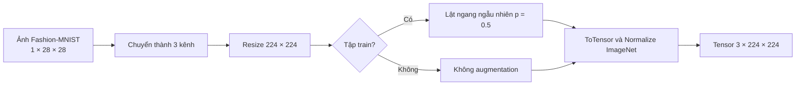

# Practice 2 — Đặc tả dữ liệu và tiền xử lý

> **Mục đích:** Cả ba kiến trúc và cả hai chế độ *feature extraction* / *fine-tuning* phải sử dụng cùng một cách chia dữ liệu và một quy trình tiền xử lý nhất quán. Tài liệu mô tả yêu cầu triển khai, không phải kết quả của một lần huấn luyện đã thực hiện.

## 1. Bộ dữ liệu và đầu ra cần đạt

Nhóm tiếp tục chọn Fashion-MNIST từ Practice 1 để đối chiếu kết quả của MLP huấn luyện từ đầu với các mạng đã học đặc trưng từ ImageNet. Bộ dữ liệu gồm 70.000 ảnh xám 28 × 28, trong đó 60.000 ảnh thuộc tập huấn luyện chính thức và 10.000 ảnh thuộc tập test chính thức.


*Hình 1. Mười lớp của Fashion-MNIST*

Các nhãn phải giữ đúng thứ tự từ `0` đến `9`:

| ID | Nhãn | ID | Nhãn |
|:--:|---|:--:|---|
| 0 | T-shirt/top | 5 | Sandal |
| 1 | Trouser | 6 | Shirt |
| 2 | Pullover | 7 | Sneaker |
| 3 | Dress | 8 | Bag |
| 4 | Coat | 9 | Ankle boot |

**Hợp đồng đầu vào/đầu ra:** một ảnh sau preprocessing phải có dạng **`float32 [3, 224, 224]`**; một batch có dạng **`[B, 3, 224, 224]`**. Nhãn là số nguyên `0..9` (`torch.long` khi đưa vào loss), không chuyển thành one-hot cho `CrossEntropyLoss`.

## 2. Chia dữ liệu và phòng tránh rò rỉ

Nhóm yêu cầu giữ lại phép chia của Practice 1, để phép đối chiếu giữa LAB1 và LAB2 không bị ảnh hưởng bởi việc thay tập validation.

| Tập | Số ảnh | Cách lấy | Vai trò |
|---|---:|---|---|
| **Train** | 50.000 | Từ 60.000 ảnh `train=True` | Học trọng số của classifier và phần backbone được mở khóa |
| **Validation** | 10.000 | Phần còn lại của `train=True` | So sánh cấu hình, theo dõi hội tụ, chọn checkpoint |
| **Test** | 10.000 | Toàn bộ `train=False` | Đánh giá cuối cùng sau khi chọn model |

Phép chia phải dùng `torch.randperm(60000, generator=torch.Generator().manual_seed(1))`, lấy 50.000 chỉ số đầu cho train và 10.000 chỉ số còn lại cho validation. Đây là phép chia ngẫu nhiên cố định, không phải stratified split. Cần lưu hai danh sách chỉ số để các lần chạy và các kiến trúc dùng đúng một tập dữ liệu; kiểm tra phân bố nhãn sau chia nhưng không tự ý chia lại nếu chưa thay đổi đặc tả.

Không được sử dụng tập test để điều chỉnh augmentation, learning rate, epoch, lựa chọn kiến trúc hoặc checkpoint. Tập test chỉ dùng cho bước kiểm thử cuối cùng được mô tả trong [`demo.md`](demo.md).

## 3. Tiền xử lý phù hợp với mô hình pre-trained

Pre-trained models nhận đầu vào 3 kênh với kích thước lớn hơn 28 × 28 và được huấn luyện trên ảnh ImageNet. Chọn một pipeline chung cho cả ba kiến trúc để bảo đảm tính nhất quán khi so sánh:



| Bước | Training | Validation / Test |
|---|---|---|
| Chuyển kênh | `Grayscale(num_output_channels=3)` | Giống training |
| Kích thước | `Resize((224, 224), BILINEAR)` | Giống training |
| Augmentation | `RandomHorizontalFlip(p=0.5)` | Không có phép ngẫu nhiên |
| Chuyển tensor | `ToTensor()` | `ToTensor()` |
| Chuẩn hóa | ImageNet mean / std | Cùng mean / std|

Dùng thống kê chuẩn hóa ImageNet sau khi `ToTensor()` đưa pixel về `[0, 1]`:

```python
IMAGENET_MEAN = (0.485, 0.456, 0.406)
IMAGENET_STD  = (0.229, 0.224, 0.225)
```

Với mỗi kênh `c`, phép chuẩn hóa là:

$$
x'_c = \frac{x_c - \mu_c}{\sigma_c}, \qquad x_c \in [0,1].
$$

Việc chuyển từ ảnh xám sang 3 kênh không tạo thêm thông tin màu; nó chỉ giúp dữ liệu phù hợp với các tầng đầu vào của trọng số ImageNet. Tương tự, phóng ảnh từ 28 lên 224 pixel không làm tăng độ chi tiết vốn có của ảnh gốc.

**Quyết định thiết kế:** sử dụng `Resize((224, 224))` thay vì crop ngẫu nhiên hoặc crop giữa ảnh, nhằm hạn chế cắt mất sản phẩm nhỏ. Pipeline này là lựa chọn thống nhất cho thí nghiệm của nhóm, không mặc nhiên trùng hoàn toàn với `weights.transforms()` mặc định của mọi phiên bản trọng số torchvision. AI phải ghi lại phiên bản weights đã dùng và kiểm tra yêu cầu preprocessing tương ứng; nếu thay pipeline, phải chạy lại các cấu hình liên quan để so sánh công bằng.

## 4. Yêu cầu triển khai trong source

Đây là khung tham chiếu cho phần chuẩn bị dữ liệu; AI có thể tổ chức thành hàm nhưng không được thay đổi hành vi đã nêu ở trên.

```python
from torch import Generator, randperm
from torch.utils.data import Subset
from torchvision import datasets, transforms
from torchvision.transforms import InterpolationMode

IMAGENET_MEAN = (0.485, 0.456, 0.406)
IMAGENET_STD = (0.229, 0.224, 0.225)

TRAIN_TRANSFORM = transforms.Compose([
    transforms.Grayscale(num_output_channels=3),
    transforms.Resize((224, 224), interpolation=InterpolationMode.BILINEAR),
    transforms.RandomHorizontalFlip(p=0.5),
    transforms.ToTensor(),
    transforms.Normalize(IMAGENET_MEAN, IMAGENET_STD),
])

EVAL_TRANSFORM = transforms.Compose([
    transforms.Grayscale(num_output_channels=3),
    transforms.Resize((224, 224), interpolation=InterpolationMode.BILINEAR),
    transforms.ToTensor(),
    transforms.Normalize(IMAGENET_MEAN, IMAGENET_STD),
])

train_source = datasets.FashionMNIST("data", train=True, download=True,
                                     transform=TRAIN_TRANSFORM)
val_source = datasets.FashionMNIST("data", train=True, download=True,
                                   transform=EVAL_TRANSFORM)
test_data = datasets.FashionMNIST("data", train=False, download=True,
                                  transform=EVAL_TRANSFORM)

indices = randperm(60000, generator=Generator().manual_seed(1)).tolist()
train_data = Subset(train_source, indices[:50000])
val_data = Subset(val_source, indices[50000:])
```

**Lưu ý bắt buộc:** `train_source` và `val_source` đọc cùng ảnh gốc nhưng gắn hai transform riêng. Không dùng một dataset với `RandomHorizontalFlip` rồi `random_split()` thành train/validation

Các chỉ số chia train/validation cần được lưu vào một file cố định, chẳng hạn `data/split_indices_seed1.pt`; lần chạy sau ưu tiên tải lại chỉ số này và kiểm tra tổng số ảnh thay vì chia lại. Không nhân bản 50.000 ảnh đã resize thành dữ liệu riêng trong RAM; transform được áp dụng khi `Dataset` trả về mẫu.

## 5. DataLoader và nguyên tắc thực nghiệm

`DataLoader` cần tuân thủ các quy tắc sau:

- **Train:** `shuffle=True`; **validation/test:** `shuffle=False`. Không áp dụng augmentation ngẫu nhiên ngoài tập train.
- `batch_size`, `num_workers` và `pin_memory` là tham số cấu hình, được chọn theo phần cứng và ghi lại trong log; không hard-code một batch size có thể gây hết bộ nhớ với VGG16.
- Cùng một chiến lược preprocessing phải được dùng cho cả **feature extraction** và **fine-tuning**. Mọi thử nghiệm augmentation mới cần là một cấu hình có tên riêng, không âm thầm thay dữ liệu giữa các run.
- Với batch ảnh, kiểm tra shape `[B, 3, 224, 224]`, dtype `float32`, giá trị hữu hạn và nhãn thuộc `[0, 9]` trước khi bắt đầu training.

Do ảnh được tăng từ 28 × 28 lên 224 × 224 và từ 1 lên 3 kênh, chi phí bộ nhớ đầu vào tăng đáng kể so với LAB1. Nếu gặp lỗi thiếu VRAM, ưu tiên giảm `batch_size` hoặc dùng mixed precision ở bước huấn luyện; **không âm thầm đổi độ phân giải của riêng một model** rồi so sánh như cùng điều kiện.

## 6. Tiêu chí nghiệm thu phần dữ liệu

Chỉ được coi bước chuẩn bị dữ liệu hoàn thành khi kiểm tra được các điều kiện sau:

- [ ] Tải đúng Fashion-MNIST, có **50.000 train / 10.000 validation / 10.000 test**.
- [ ] Hai tập train và validation không trùng chỉ số; test là split chính thức độc lập.
- [ ] Seed chia dữ liệu là `1`, có lưu và có thể khôi phục lại danh sách chỉ số.
- [ ] Train và validation dùng hai transform khác nhau; validation/test luôn cho ra tensor xác định với cùng một ảnh.
- [ ] Mẫu đầu vào có shape `[3, 224, 224]`, batch có shape `[B, 3, 224, 224]`; nhãn là số nguyên thuộc `0..9`.
- [ ] Không có `NaN`/`Inf` sau normalization; tên và thứ tự 10 lớp không thay đổi.
- [ ] Tất cả 6 lượt chạy cốt lõim(3 kiến trúc × 2 chiến lược) dùng cùng chỉ số chia tập và cùng preprocessing cơ sở.
- [ ] Ghi lại cấu hình transform, seed, kích thước ảnh và phiên bản trọng số pre-trained để có thể chạy lại.

Khi hoàn tất, phần dữ liệu cần cung cấp **ba đối tượng dataset hoặc DataLoader có thể sử dụng ngay** cho training, validation và test, cùng thông tin về phép chia.

