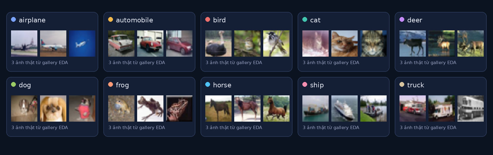
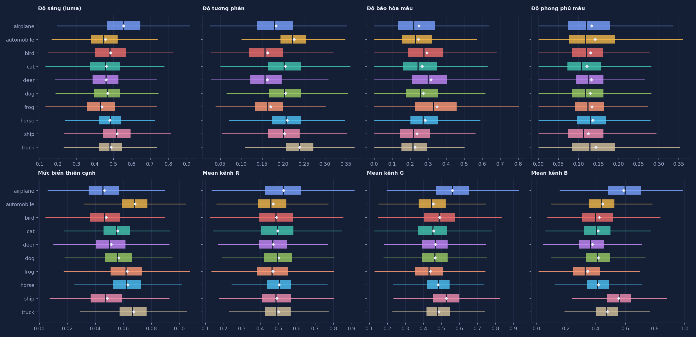

# LAB2 — Dữ liệu và kết luận EDA

Tài liệu quy định dữ liệu, cách chia tập, đầu vào và các kết luận EDA phục vụ triển khai. Thiết kế mạng thuộc [model.md](model.md); cấu hình augmentation và DataLoader thuộc [trainning.md](trainning.md); quy trình test thuộc [demo.md](demo.md).

## 1. Dataset và nhãn

Dùng **CIFAR-10** qua `torchvision.datasets.CIFAR10`. Dataset hiện được giải nén tại `LAB2/data/prepared/cifar-10-batches-py/`; `root` của torchvision là `LAB2/data/prepared/`.

| Thuộc tính | Yêu cầu |
|---|---|
| Train gốc /  test | 50.000 / 10.000 ảnh, tổng 60.000 |
| Ảnh gốc | RGB, 32×32×3; mảng NHWC `[N,32,32,3]`, `uint8`, pixel 0–255 |
| Nhãn | Một nhãn nguyên 0–9 cho mỗi ảnh; không có lớp bổ sung |
| Cân bằng lớp | Train gốc 5.000 ảnh/lớp;  test 1.000 ảnh/lớp |

Thứ tự lớp phải thống nhất giữa dataset, đầu ra mạng và báo cáo dự đoán:

| ID | Lớp | ID | Lớp |
|:--:|---|:--:|---|
| 0 | airplane | 5 | dog |
| 1 | automobile | 6 | frog |
| 2 | bird | 7 | horse |
| 3 | cat | 8 | ship |
| 4 | deer | 9 | truck |

Không đổi chỉ số nhãn khi trình bày tên lớp. Cột đầu ra thứ `k` luôn ứng với lớp có ID `k`.

*Ảnh mẫu trích từ báo cáo EDA; hình ảnh minh họa không xác định mức độ khó của từng lớp.*

## 2. Split cố định và giới hạn sử dụng

| Tập | Số ảnh | Mỗi lớp | Mục đích |
|---|---:|---:|---|
| Train fit | 45.000 | 4.500 | Học trọng số; fit các thống kê hoặc phép biến đổi cần học từ dữ liệu |
| Validation | 5.000 | 500 | Chọn cấu hình, augmentation, epoch và checkpoint |
|  test | 10.000 | 1.000 | Đánh giá cuối cùng sau khi khóa lựa chọn bằng validation |

Train fit và validation cùng lấy từ **50.000 ảnh train gốc**, chia phân tầng theo lớp. Test lấy riêng bằng `CIFAR10(train=False)`. [Biểu đồ phân phối nhãn](assets/eda_class_distribution.png) đối chiếu số lượng trên.

**Tránh rò rỉ dữ liệu:** thống kê cần fit, PCA và prototype chỉ học trên train fit. Không dùng validation/test để fit preprocessing; không dùng test để chọn mô hình hoặc augmentation. Các thống kê test đã có trong EDA chỉ phục vụ mô tả để đóng góp ý kiến cho việc cấu hình train chứ không quyết định hoàn toàn huấn luyện.

## 3. Hợp đồng preprocessing

Áp dụng cho ba kiến trúc đã chọn: **ResNet18, VGG16 và DenseNet121**. Lựa chọn weights cụ thể thuộc [model.md](model.md); dữ liệu phải đi qua preprocessing khớp `weights.transforms()` của weights đó.

| Bước / đầu ra | Yêu cầu |
|---|---|
| Ảnh đầu vào | Giữ RGB, không flatten hoặc chuyển grayscale trước CNN |
| Resize và crop khi validation/test | Resize cạnh ngắn thành 256, giữ tỷ lệ; center crop 224×224; bilinear, antialias bật |
| Chuyển kiểu | Pixel được chuyển thành `float32` trong `[0,1]` trước normalization |
| Normalize | ImageNet mean `(0.485,0.456,0.406)`, std `(0.229,0.224,0.225)` theo thứ tự RGB |
| Batch đưa vào mạng | `x`: `[B,3,224,224]`, `float32`, mọi giá trị hữu hạn; sau normalize không còn giới hạn trong `[0,1]` |
| Batch nhãn | `y`: `[B]`, `torch.long`, giá trị 0–9, khớp từng ảnh |

Các giá trị trên phải đối chiếu với preset của weights khi triển khai. Không thay resize/crop bằng kéo giãn trực tiếp về 224×224; không normalize hai lần hoặc thay ImageNet mean/std bằng thống kê CIFAR-10 khi chưa có thí nghiệm được đặc tả.

Train được augmentation ngẫu nhiên theo [trainning.md](trainning.md), vẫn phải thỏa hợp đồng tensor cuối cùng. Tách dataset/transform train và validation để augmentation không lan sang validation; validation và test dùng cùng preprocessing tất định. Inference phải khớp preprocessing đã lưu cùng checkpoint, không suy đoán từ tên kiến trúc.

## 4. Kết quả EDA và ý nghĩa sử dụng

Nguồn: [báo cáo EDA HTML](../reports/eda_report.html), [số liệu JSON](../reports/eda_stats.json). Các số dưới đây đã đối chiếu JSON; số hiển thị làm tròn, phép tính phải dùng giá trị gốc trong artifact.

### 4.1. Toàn vẹn dữ liệu

| Phép kiểm tra trên dữ liệu gốc | Kết quả EDA |
|---|---:|
| Ảnh trùng hệt pixel trong train gốc / test | 0 / 0 |
| Ảnh trùng hệt pixel giữa train gốc và test | 0 |
| Nhãn mâu thuẫn trên ảnh trùng hệt trong train gốc | 0 |
| Ảnh gần đen / gần trắng trong train gốc | 0 / 3 |

EDA băm toàn bộ pixel mỗi ảnh để kiểm tra trùng tuyệt đối; chưa kiểm tra gần trùng về thị giác. “Gần đen/trắng” dùng brightness luma trung bình `<0.04` / `>0.96`, không đồng nghĩa ảnh hỏng hoặc sai nhãn. Giữ nguyên dataset và split; không tự loại ba ảnh sáng hoặc ảnh xa prototype chỉ theo các chỉ số này.

### 4.2. Màu sắc và đặc trưng theo lớp

Mean/std dưới đây tính trên pixel RGB đã chia 255 của **45.000 train fit**:

| Kênh | Mean | Std |
|---|---:|---:|
| R | 0.49184 | 0.24705 |
| G | 0.48254 | 0.24354 |
| B | 0.44682 | 0.26169 |

Đây là thống kê mô tả CIFAR-10, **không phải normalization thay thế cho pretrained**

EDA còn đo brightness, contrast, saturation, colorfulness, edge và mean từng kênh trên train fit. Những quan sát hữu ích:

- Brightness trung bình của `airplane` và `ship` là 0.556 và 0.521; `frog` có saturation trung bình cao nhất, 0.348. Biến đổi màu cần được kiểm tra để tránh làm mất tín hiệu nhận diện.
- `automobile` và `truck` có edge trung bình 0.068 và 0.067; `airplane` là 0.046. Edge ở đây là trung bình sai khác tuyệt đối luma theo hai trục, không phải số cạnh Canny/Sobel; blur/crop mạnh có thể làm mất chi tiết nhỏ và cần kiểm chứng.
- Tương quan Pearson contrast–edge là 0.543, saturation–colorfulness là 0.718. Các phép đo có liên hệ với nhau, không đủ để suy ra augmentation hoặc kiến trúc tối ưu.

*Thống kê từng lớp và tương quan đầy đủ nằm tại `metrics.feature_mean_by_class`, `feature_correlations_train` và báo cáo HTML. Chênh lệch màu/texture không dự đoán chính xác recall của CNN.*

### 4.3. Prototype, giảm chiều và baseline EDA

EDA average-pool ảnh 32×32 thành **8×8×3 = 192 chiều**. Descriptor này chỉ phục vụ phân tích
| Phân tích | Kết quả đã quan sát | Giới hạn diễn giải |
|---|---|---|
| Prototype lớp, fit trên train fit | Ba cặp gần nhất theo Euclidean: bird–horse 0.384; cat–dog 0.388; deer–frog 0.453 | Dùng làm giả thuyết để xem confusion matrix validation; chưa chứng minh CNN nhầm các cặp này |
| PCA, fit trên train fit | 25 / 43 / 82 thành phần giữ 90% / 95% / 99% phương sai; PC1 giữ 35.40% | PCA của descriptor 192 chiều; không quyết định số tầng/filter của CNN |
| t-SNE | 1.500 ảnh train fit, seed 42; PCA 30 chiều trước t-SNE | Hình dung lân cận descriptor, không phải learned embedding hoặc accuracy |
| Nearest prototype | Validation accuracy 26.18% trên đủ 5.000 ảnh; prototype từ 45.000 train fit | Baseline mô tả RGB |
| k-NN, k=5 + PCA50 | Fit trên mẫu 3.000 train fit, đánh giá mẫu 1.200 validation; accuracy 29.25% | Khác số mẫu với nearest prototype; không so trực tiếp như cùng một giao thức |

Hình đối chiếu: [prototype và độ biến thiên](assets/eda_rgb_prototypes.png), [độ giống prototype](assets/eda_prototype_similarity.png), [PCA](assets/eda_pca_variance_projection.png), [t-SNE](assets/eda_tsne_clusters.png), [baseline validation](assets/eda_knn_validation_baseline.png).

### 4.4. Khác biệt giữa các tập

KS một chiều trên tám đặc trưng ảnh có giá trị lớn nhất:

| So sánh | KS lớn nhất | Đặc trưng |
|---|---:|---|
| Train fit–validation | 0.01904 | Mean Red |
| Train fit– test, chỉ mô tả | 0.01364 | Brightness |

[Biểu đồ đối chiếu phân phối](assets/eda_distribution_shift.png) và `metrics.distribution_comparison` chứa đủ tám phép đo. Chênh lệch quan sát nhỏ theo các đặc trưng đó; chưa chứng minh hai phân phối hoàn toàn giống nhau hoặc không có leakage. Giữ nguyên split và đánh giá riêng từng lớp; cấu hình huấn luyện và metrics cụ thể theo tài liệu sở hữu tương ứng.

## 5. Artifact và điều kiện bàn giao dữ liệu

| Artifact | Vai trò |
|---|---|
| [EDA.py](../EDA.py) | Source EDA, custom theo cấu trúc tham chiếu [LAB1/EDA.py](../../LAB1/EDA.py) |
| [data/splits.npz](../data/splits.npz) | Danh tính train fit/validation cố định |
| [reports/eda_stats.json](../reports/eda_stats.json) | Nguồn số liệu đầy đủ và trạng thái các phân tích EDA |
| [reports/eda_report.html](../reports/eda_report.html) | Báo cáo EDA HTML tự chứa để đọc offline và xem các hình/phân tích chi tiết |
| `Docs/assets/eda_*.png` | Hình minh họa trích từ EDA, không thay thế số liệu JSON |
6. Giao diện triển khai (nếu dùng dataset tự thu thập)
- Triển khai chuyên nghiệp bằng cách kế thừa Dataset từ thư viện tourch , cùng cấp đầy đủ các hàm như _ _ len_ _, getitem()