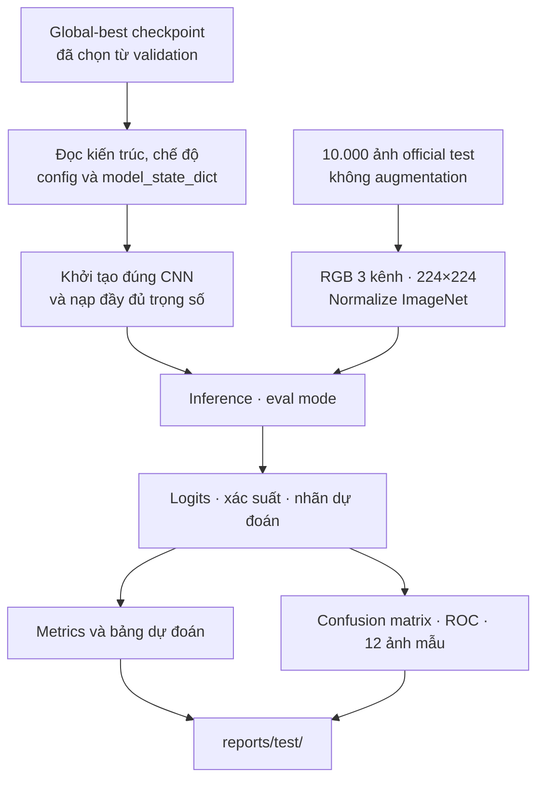

# Practice 2 — Đặc tả demo và kiểm thử mô hình

*Fashion-MNIST · Pre-trained CNN · PyTorch / torchvision*

> **Vai trò tài liệu:** Nhóm sử dụng `demo.md` làm yêu cầu để AI xây dựng **`Predict.py`**. Chương trình phải khôi phục mô hình được chọn từ validation, đánh giá độc lập trên **10.000 ảnh test chính thức** và tạo minh chứng trực quan. Đây là **đặc tả trước khi triển khai**, không phải báo cáo đã có kết quả kiểm thử.

## 1. Mục tiêu và phạm vi

Sau khi hoàn thành sáu thí nghiệm **ResNet18, VGG16 và DenseNet121** ở hai chế độ feature extraction/fine-tuning, nhóm chỉ sử dụng **global-best checkpoint** đã được chọn bằng validation accuracy (nếu hòa, xét macro F1) để làm demo. `Predict.py` không cần huấn luyện lại và không thay đổi bất kỳ tham số nào của mô hình.

Phần này phải trả lời ba câu hỏi: mô hình được chọn là cấu hình nào, phân loại tập test tốt đến đâu, và những loại sản phẩm nào còn dễ nhầm lẫn. Việc **so sánh sáu thí nghiệm trên validation** thuộc [`evaluation.md`](evaluation.md), không lặp lại ở đây.

| Thành phần | Quy định |
|---|---|
| Mô hình cần kiểm thử | Mô hình nằm trong `checkpoints/checkpoint_best_global.pt` |
| Nguồn chọn mô hình | Best **validation accuracy**, không phải test accuracy |
| Dữ liệu kiểm thử | `FashionMNIST(train=False)`, đúng **10.000 ảnh** |
| Đầu vào | `[B, 3, 224, 224]`, transform xác định từ [`data.md`](data.md) |
| Đầu ra mô hình | Logits `[B, 10]`, chuyển sang xác suất bằng `softmax` khi báo cáo |
| Chế độ chạy | `model.eval()` và `torch.inference_mode()`; **không** backward/optimizer |

## 2. Luồng thực hiện



*Hình 1. Demo là một quy trình độc lập sau bước chọn checkpoint, không nằm trong training loop.*

### 2.1. Khôi phục đúng checkpoint

AI cần đọc từ checkpoint tối thiểu các trường `run_id`, `architecture`, `mode`, `config`, `model_state_dict`, `best_epoch` và `best_accuracy`. Phải đối chiếu chúng trước khi dựng mô hình và hiển thị **cấu hình thật được lưu trong checkpoint**, không tự hard-code ResNet18 hoặc tên run cụ thể.

Yêu cầu khi nạp mô hình:

1. Đọc checkpoint bằng `torch.load(..., map_location="cpu", weights_only=True)` khi nội dung checkpoint tương thích; chỉ sử dụng checkpoint từ nguồn đáng tin cậy. Báo lỗi rõ ràng nếu thiếu trường cần thiết hoặc định dạng không tương thích.
2. Khởi tạo đúng kiến trúc và classification head **10 lớp** theo [`model.md`](model.md); sau đó `load_state_dict(..., strict=True)` để xác nhận tất cả trọng số và buffer đều khớp.
3. **Không tải ImageNet weights lần thứ hai nếu checkpoint đã chứa toàn bộ `state_dict`.** Để làm việc này, AI cần bổ sung tùy chọn dựng kiến trúc không tải pretrained (ví dụ `build_model(..., load_pretrained=False)`) mà vẫn giữ hành vi mặc định `load_pretrained=True` của `Model.py` cho training. Đây là khởi tạo để *phục hồi checkpoint*, **không phải train from scratch** và không được bỏ qua bước load trọng số đã học.
4. Chuyển sang thiết bị được chọn, gọi `model.eval()` rồi chạy inference. `mode` là metadata để dựng đúng mô hình và giải thích cấu hình; cả hai chế độ đều phải được đánh giá ở `eval()`.

**Thông tin cần in ra terminal và lưu vào JSON:** `run_id`, `architecture`, `mode`, `best_epoch` (đếm từ 1), best validation accuracy, phiên bản pretrained weights (`IMAGENET1K_V1`), input size, normalization, total parameters, device và toàn bộ `config`. Cần phân biệt **validation accuracy trong checkpoint** với **test accuracy mới tính**.

### 2.2. Dữ liệu và inference

Sử dụng **test transform y hệt validation** trong `data.md`:

```python
transforms.Compose([
    transforms.Grayscale(num_output_channels=3),
    transforms.Resize((224, 224), interpolation=InterpolationMode.BILINEAR),
    transforms.ToTensor(),
    transforms.Normalize(
        mean=(0.485, 0.456, 0.406),
        std=(0.229, 0.224, 0.225),
    ),
])
```

Test loader phải có `shuffle=False` và không dùng `RandomHorizontalFlip`, random crop hay biến đổi ngẫu nhiên khác. Chạy hết **10.000 ảnh**; không bỏ batch cuối, không chọn vài ảnh mẫu để thay cho kết quả toàn tập. AI phải xác nhận tổng `support` bằng 10.000 và mỗi dự đoán thuộc 10 nhãn Fashion-MNIST theo thứ tự ở `data.md`.

Chỉ dùng `softmax(logits, dim=1)` để tính xác suất phục vụ confidence và ROC–AUC; khi tính Cross-Entropy thì dùng **logits gốc**. Thu thập nhãn thật, nhãn dự đoán và ma trận xác suất `[10000, 10]` từ **cùng một lượt inference**, tránh tính các chỉ số trên các tập con khác nhau.

## 3. Kết quả kiểm thử bắt buộc

Chương trình cần xuất các chỉ số trên **toàn bộ official test set**:

| Nhóm | Chỉ số phải có | Ý nghĩa khi trình bày |
|---|---|---|
| Phân loại | Accuracy; Macro Precision, Recall, F1 | Chất lượng chung và mức đồng đều giữa các lớp |
| Loss | Cross-Entropy trung bình theo **số ảnh** | So sánh khả năng dự đoán và mức tự tin |
| Sai dương tính | Macro FPR (One-vs-Rest) | Mức nhầm một lớp với các lớp còn lại |
| Xếp hạng xác suất | Macro ROC–AUC (OvR); Micro ROC–AUC | Khả năng phân biệt qua các ngưỡng |
| Theo từng lớp | Precision, Recall, F1, support; ROC–AUC nếu xác định được | Xác định lớp khó và lớp dễ |
| Kiểm thử hệ thống | Tổng ảnh, số đúng/sai, thiết bị, thời gian inference | Kiểm tra tính đầy đủ và chi phí chạy test |

Dùng `sklearn.metrics` để tính confusion matrix, classification report, Precision/Recall/F1 và ROC–AUC. Macro FPR được tính từ các ma trận nhị phân One-vs-Rest. Nếu không thể tính một AUC vì thiếu positive/negative thì ghi `N/A` kèm lý do, **không tạo giá trị giả**.

Không chọn lại backbone, checkpoint, learning rate hoặc threshold dựa trên kết quả test. Một khi đã xem kết quả test, các thay đổi tiếp theo phải được xem là thí nghiệm mới và không dùng lại test làm tập lựa chọn.

## 4. Hình ảnh demo bắt buộc

Nhóm yêu cầu **ba hình riêng**, kích thước đủ để đọc khi mở trong VS Code hoặc đưa lên slide. Tất cả hình phải xuất từ dữ liệu test thật, không dùng ảnh minh họa giả lập.

### 4.1. Confusion Matrix — sai ở lớp nào?

- Vẽ ma trận **10 × 10**: hàng là nhãn thật, cột là nhãn dự đoán; ghi **số ảnh** trong từng ô, có colorbar và thứ tự nhãn cố định.
- Lưu `confusion_matrix.png` tối thiểu **200 dpi**; tên lớp đầy đủ và không bị cắt.
- Trong báo cáo test, AI tự nhận diện **3–5 cặp nhầm lẫn có số lượng lớn nhất** từ các ô ngoài đường chéo. Không mặc định Shirt luôn là lớp tệ nhất nếu kết quả LAB2 khác LAB1.

### 4.2. ROC One-vs-Rest — khả năng phân biệt 10 lớp

- Vẽ mười đường ROC theo cùng hệ trục FPR–TPR, kèm đường chéo random classifier.
- Legend ghi tên lớp và **AUC tính từ xác suất** của lớp đó; đặt legend ngoài vùng dữ liệu khi cần.
- Lưu `roc_ovr.png` tối thiểu **200 dpi**; báo cáo thêm Macro/Micro AUC trong bảng kết quả, không nhầm chúng với từng đường ROC.

### 4.3. Ảnh dự đoán đúng và sai

- Tạo grid **3 hàng × 4 cột** gồm **6 ảnh đúng và 6 ảnh sai**, chọn bằng seed `42` để có thể tái lập; nếu một nhóm không đủ ảnh, dùng số thực tế và ghi rõ.
- Mỗi ô phải hiển thị **ảnh gốc dễ quan sát**, nhãn thật, nhãn dự đoán và confidence (từ xác suất lớn nhất). Dùng chữ/màu để phân biệt đúng–sai nhưng không chỉ dựa vào màu.
- Khi hiển thị, lấy ảnh gốc trước Normalize (hoặc hoàn nguyên normalization đúng cách); **không đưa tensor đã Normalize thẳng vào `imshow()`**.
- Lưu `prediction_examples.png` tối thiểu **200 dpi**, bảo đảm tiêu đề và nhãn không bị cắt khi xem trong TensorBoard/Markdown.

## 5. Giao diện chạy và cấu trúc đầu ra

AI cần triển khai `Predict.py` sao cho có thể chạy từ thư mục gốc `LAB2/`:

```bash
python Predict.py \
  --checkpoint checkpoints/checkpoint_best_global.pt \
  --batch-size 32 \
  --num-images 12 \
  --device auto \
  --output-dir reports/test
```

Các tham số mặc định phải có: `--checkpoint`, `--batch-size` (32), `--num-images` (12), `--workers` (0), `--device` (`auto` / `cpu` / `cuda`), `--seed` (42) và `--output-dir`. Kiểm tra đối số không hợp lệ; nếu không có CUDA thì `auto` dùng CPU. Không giả định người dùng có GPU hoặc kết nối Internet. Trường hợp thiếu VRAM, thông báo rõ và cho phép giảm batch size qua CLI; không tự ý đổi input size hay mô hình.

```text
LAB2/
├── Model.py
├── Predict.py
├── checkpoints/
│   └── checkpoint_best_global.pt
├── data/
└── reports/
    └── test/
        ├── test_metrics.json
        ├── test_classification_report.csv
        ├── test_predictions.csv
        ├── test_summary.md
        ├── confusion_matrix.png
        ├── roc_ovr.png
        └── prediction_examples.png
```

**Hợp đồng file kết quả:**

- `test_metrics.json`: chứa metadata checkpoint, **toàn bộ config thực tế**, thông tin dataset/device và các test metrics; các số thực lưu dạng number, không phải chuỗi đã định dạng phần trăm.
- `test_classification_report.csv`: mỗi hàng một lớp với precision, recall, F1 và support; có thể thêm macro/weighted summary nhưng phải gắn nhãn rõ.
- `test_predictions.csv`: mỗi ảnh một hàng, gồm `sample_index`, `true_label`, `pred_label`, `confidence`, `correct` và **`prob_0` … `prob_9`**. Thứ tự hàng phải khớp thứ tự test loader để có thể tính lại ROC–AUC.
- `test_summary.md`: báo cáo **được tạo sau khi chạy**, nêu model/config được dùng, bảng test metrics, ba hình và nhận xét từ các nhầm lẫn thực tế. Không đưa số liệu LAB1 hoặc số liệu giả định vào báo cáo LAB2.

Đo thời gian suy luận bằng `time.perf_counter()`; nếu chạy CUDA, đồng bộ GPU trước/sau đoạn đo bằng `torch.cuda.synchronize()`. Phải ghi rõ `inference_seconds` là thời gian của các lượt forward (không gọi đó là training time); nếu đo tổng thời gian gồm DataLoader, đặt tên khác. Thời gian và RAM/VRAM **khi huấn luyện** vẫn thuộc [`evaluation.md`](evaluation.md), không suy ra từ lần chạy demo.

## 6. Tiêu chí nghiệm thu `Predict.py`

AI chỉ được xem phần demo hoàn thành khi:

- [ ] `Predict.py` chạy độc lập **không import hoặc thực thi `Train.py`**, không kích hoạt training, optimizer hay scheduler.
- [ ] Load đúng `checkpoint_best_global.pt`, hiển thị **đầy đủ config** và khôi phục model bằng `strict=True`.
- [ ] Không yêu cầu tải lại pretrained weights nếu đã có đầy đủ `model_state_dict` trong checkpoint.
- [ ] Test dùng đúng **10.000 ảnh chính thức**, thứ tự nhãn và transform của `data.md`, không có augmentation ngẫu nhiên.
- [ ] Metrics, report, CSV và các hình đều lấy từ **một lượt inference**; `test_predictions.csv` có đúng 10.000 hàng dữ liệu.
- [ ] Confusion matrix có tổng các ô bằng 10.000; số dự đoán đúng trên đường chéo khớp với accuracy và số đúng trong JSON.
- [ ] ROC–AUC tính từ xác suất; `prob_0` … `prob_9` hữu hạn và có tổng xấp xỉ 1 ở mỗi ảnh.
- [ ] Có **12 ảnh minh họa đúng/sai**, nhãn và confidence dễ đọc; mọi đường dẫn ảnh trong `test_summary.md` đều hợp lệ.
- [ ] Kết quả test không được dùng để chọn lại mô hình; lỗi thiếu checkpoint/metadata, thiếu dữ liệu hoặc không tương thích kiến trúc phải được báo rõ ràng.

**Đầu ra mong đợi:** một `Predict.py` có thể tiếp nhận global-best checkpoint của bất kỳ run nào trong sáu cấu hình, kiểm thử độc lập trên Fashion-MNIST và xuất báo cáo cùng hình ảnh có thể kiểm chứng, phục vụ trình bày Practice 2 mà không phải chỉnh sửa code theo tên mô hình.

---

*Tài liệu liên quan: [Tổng quan Practice 2](lab-description.md) · [Dữ liệu](data.md) · [Kiến trúc](model.md) · [Huấn luyện](trainning.md) · [Đánh giá sáu run](evaluation.md).*
