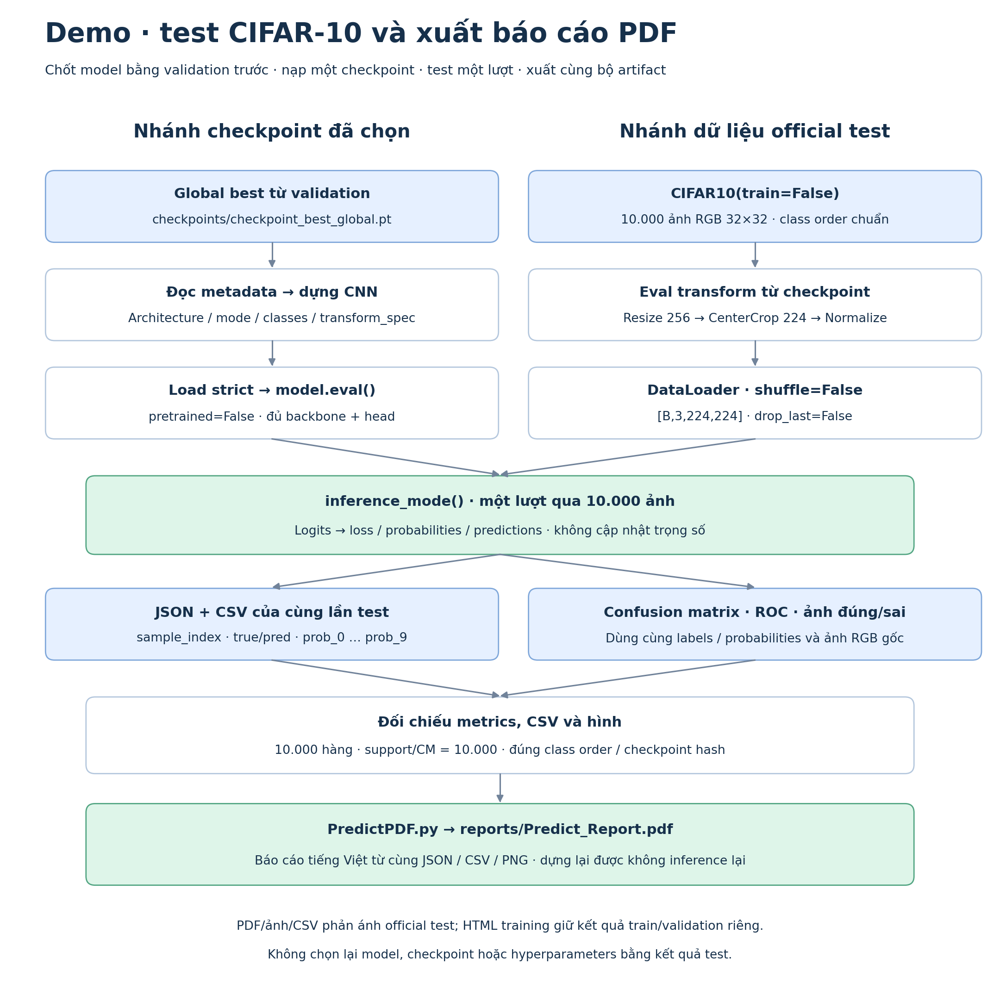

# LAB2 — Test, inference và báo cáo demo

Tài liệu quy định hai source cần triển khai: `LAB2/Predict.py` kiểm thử checkpoint đã chọn và lưu dự đoán/metrics/hình; `LAB2/PredictPDF.py` dựng PDF từ bộ kết quả đó. Dataset, class order và eval preprocessing thuộc [data.md](data.md); giao diện mạng thuộc [model.md](model.md); selection và metadata checkpoint thuộc [trainning.md](trainning.md).

## 1. Phạm vi và nguồn đầu vào

Chỉ test **một global-best checkpoint đã chốt bằng validation** từ sáu core run. Không chọn lại model, checkpoint, hyperparameter hoặc threshold bằng kết quả test. Báo cáo tổng hợp sau thực nghiệm thuộc [evaluation.md](evaluation.md).

| Đầu vào | Yêu cầu |
|---|---|
| Checkpoint | `<output_root>/checkpoints/checkpoint_best_global.pt` và `reports/selection.json` của cùng bộ training |
| Dữ liệu | test CIFAR-10 theo `data.md`: đủ 10.000 ảnh, giữ thứ tự gốc, `sample_index` 0–9.999 |
| Preprocessing | Eval transform đã lưu cùng checkpoint, đối chiếu weights enum theo `model.md`; không áp augmentation train hoặc test-time augmentation |
| Chế độ | `model.eval()`, `torch.inference_mode()`, không cập nhật trọng số |

`output_root` là thư mục đầu ra đã dùng khi training, mặc định `LAB2`. Nếu training nằm trong root khác, phải truyền các đường dẫn checkpoint/output tương ứng; không lấy checkpoint cũ ở root mặc định để thay thế.

*Hai nhánh checkpoint và dữ liệu hội tụ ở một lượt inference. Đường dẫn trong hình tính theo `output_root`; đây là sơ đồ quy trình, không phải kết quả test. [Mở SVG](assets/demo_workflow.svg).*

## 2. Quy trình inference

1. **Khôi phục mạng:** dựng `CNN(..., pretrained=False)` bằng architecture/mode của checkpoint, nạp đầy đủ `model_state_dict` với `strict=True`, chuyển thiết bị và eval. Không tải lại ImageNet hoặc thay head khi inference.
2. **Nạp test:** dùng `CIFAR10(train=False)` từ data root đã chuẩn bị, mặc định không tải lại. Kiểm tra định dạng, số lượng và nhãn theo `data.md`; thiếu dữ liệu/quyền đọc thì báo đường dẫn cụ thể.
3. **DataLoader:** batch size `32`, workers `0`, `shuffle=False`, `drop_last=False`; pin memory khi CUDA. Không lấy subset cho kết quả chính thức, xử lý cả batch cuối.
4. **Một lượt qua test:** kiểm tra logits hữu hạn, đúng  `model.md`; tính Cross-Entropy từ logits với tổng theo mẫu. Lấy Softmax để lưu đủ mười xác suất, `pred_label=argmax`, `confidence=max(probabilities)`; không Softmax trước loss.
5. **Xuất kết quả:** mọi metrics, CSV và hình dùng chính labels/probabilities của lượt này. Kiểm tra tính nhất quán trước khi gọi module PDF; xuất PDF không chạy inference lại.

## 3. Metrics và kiểm tra tính nhất quán

Dùng cùng định nghĩa metrics với mục **Vòng epoch, metrics và selection** của [trainning.md](trainning.md), áp dụng trên toàn bộ test. Loss test là tổng Cross-Entropy chia tổng ảnh thực xử lý.

| Nhóm | Thông tin bắt buộc |
|---|---|
| Tổng thể | `samples`, `correct_count`, `incorrect_count`, `loss`, `accuracy`, `precision_macro`, `recall_macro`, `f1_macro`, `fpr_macro`, `auc_macro_ovr`, `auc_micro_ovr` |
| Theo lớp | ID/tên lớp, precision, recall, F1, support, FPR và AUC OvR |
| Confusion matrix | Ma trận đếm 10×10, hàng là nhãn thật, cột là nhãn dự đoán |
| Diễn giải | 3–5 cặp nhầm lớn nhất theo hướng thật→dự đoán, chỉ liệt kê các ô ngoài đường chéo có số đếm dương |

Metrics không xác định được phải ghi `null`/`N/A` cùng lý do; JSON không chứa NaN/Inf và không thay dữ liệu thiếu bằng số 0 giả. Confidence Softmax chưa được xem là xác suất đã hiệu chỉnh về khả năng dự đoán đúng.

## 4. Output và hình minh chứng

Các đường dẫn dưới đây tương đối với `output_root`; không tạo output chính thức bằng dữ liệu smoke.

| File | Nội dung và vai trò |
|---|---|
| `reports/test/test_metrics.json` | Metadata cùng lần test, metrics mục 3, `classification_report`, `per_class`, CM, index gallery, thời gian và hash artifact |
| `reports/test/test_predictions.csv` | Đủ 10.000 hàng: `sample_index`, `true_label`, `pred_label`, `confidence`, `correct`, `prob_0`…`prob_9`; nhãn là ID, `correct` là 0/1 |
| `reports/test/test_classification_report.csv` | Đúng 10 hàng theo class order: `class_id`, `class_name`, `precision`, `recall`, `f1`, `support`, `fpr`, `auc` |
| `reports/test/test_summary.md` | Run/checkpoint, bảng Test metrics, các nhầm lẫn thực tế và giới hạn kết luận; link tương đối tới ba hình/PDF, Validation ghi riêng |
| `reports/test/confusion_matrix.png` | CM từ cùng labels/predictions |
| `reports/test/roc_ovr.png` | ROC từ cùng labels/probabilities |
| `reports/test/prediction_examples.png` | Ảnh gốc và dự đoán của các index đã chọn |
| `reports/Predict_Report.pdf` | Báo cáo cuối từ đúng bộ JSON/CSV/PNG trên, mở offline được |

### Yêu cầu trình bày hình

| Hình | Nội dung/bố cục |
|---|---|
| Confusion matrix | Đủ tên mười lớp, số đếm từng ô và colorbar. Nếu màu chuẩn hóa theo hàng, ghi rõ và vẫn giữ số đếm gốc |
| ROC OvR | Mười đường FPR–TPR, legend tên lớp/AUC, đường chéo tham chiếu; đặt legend tránh che dữ liệu. Macro/micro AUC ghi riêng, không gắn như AUC của một lớp |
| Gallery đúng/sai | Mặc định 3×4, tối đa 6 đúng và 6 sai, chọn không lặp bằng seed `42`; lưu index trong JSON. Thiếu nhóm nào thì ghi số thật, không bù bằng ảnh/nhãn giả |

Gallery dùng **ảnh RGB gốc trước preprocessing**, phóng lớn để quan sát; mỗi ô ghi nhãn thật, nhãn dự đoán, confidence, index và Đúng/Sai. Không hiển thị tensor đã Normalize trực tiếp. Gallery chỉ minh họa; metrics vẫn tính đủ test. Ba PNG tối thiểu 200 dpi, nhãn rõ, không cắt chữ/hình; class order khớp JSON.

## 5. Xuất PDF theo form 

Tham khảo [Predict.py](../../LAB1/Predict.py) và [PredictPDF.py](../../LAB1/PredictPDF.py), custom thành hai module LAB2 chạy độc lập. Giữ cách tách inference/xuất artifact và hàm `export_prediction_pdf()`; giữ nguyên source LAB1.

`Predict.py` xuất và kiểm tra JSON/CSV/PNG, sau đó gọi `PredictPDF.py`. Module PDF chỉ đọc bundle đã lưu, kiểm tra mục 3–4 và dựng báo cáo; không nạp dữ liệu để test lại, không import/chạy vòng train.

PDF cần có:

1. Run/model, best epoch, checkpoint hash, test run ID; nguồn chọn model bằng validation, cấu hình/weights, preprocessing, augmentation training và lineage.
2. Bảng Validation và Test được ghi nhãn riêng, tổng số đúng/sai; metrics tổng thể, per-class và thời gian inference với phạm vi đo rõ ràng.
3. Ba hình minh chứng; các cặp nhầm thực tế, lớp có recall thấp và nhận xét gắn với số liệu. Không mặc định trước lỗi hoặc dùng giả thuyết EDA thay cho kết quả test.
4. Giới hạn: một split/seed chưa xác nhận độ ổn định, confidence chưa hiệu chỉnh, gallery chỉ là mẫu minh họa; không suy ra nguyên nhân lỗi hoặc mức cải thiện giữa các mạng từ một checkpoint được test.

Dùng font Unicode có dấu tiếng Việt, nhúng font cần thiết vào PDF, ảnh giữ tỷ lệ, bảng/ngắt trang đọc được. Khi nghiệm thu phải mở đủ các trang để kiểm tra mất dấu, cắt nhãn, tràn bảng và khả năng đọc hình. Thiếu/sai artifact hoặc lỗi export phải báo rõ; có JSON/CSV chưa đồng nghĩa demo hoàn thành. PDF phải dựng lại được từ bundle mà không train/test lại.
