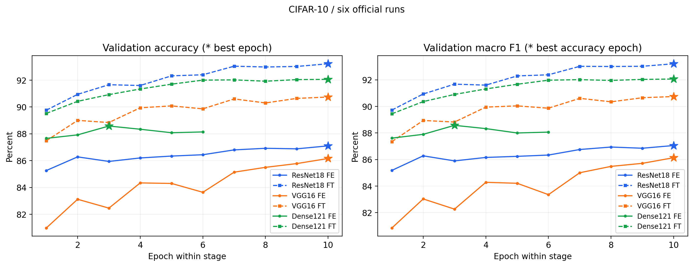
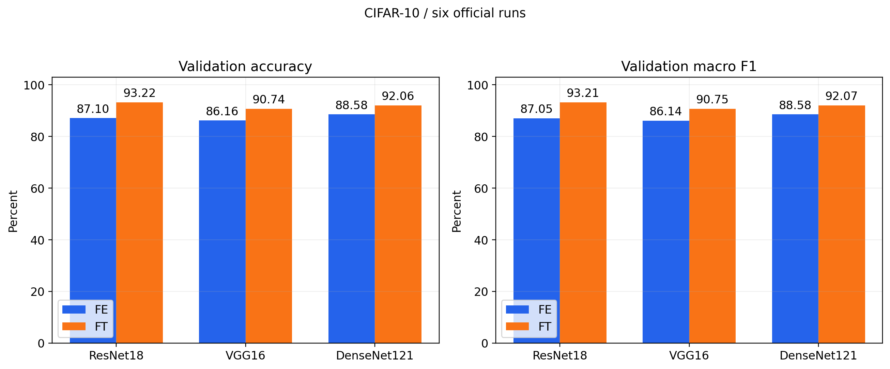
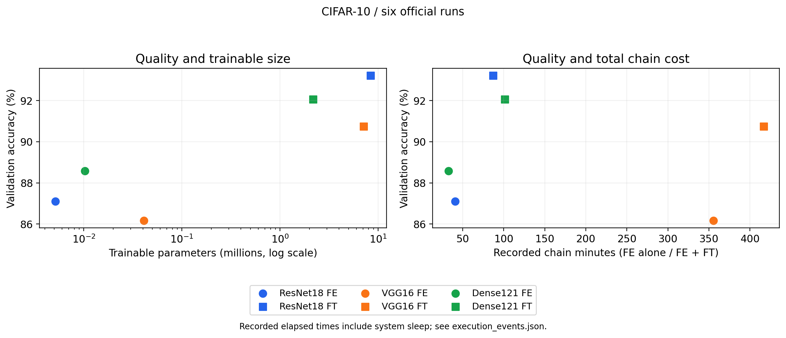
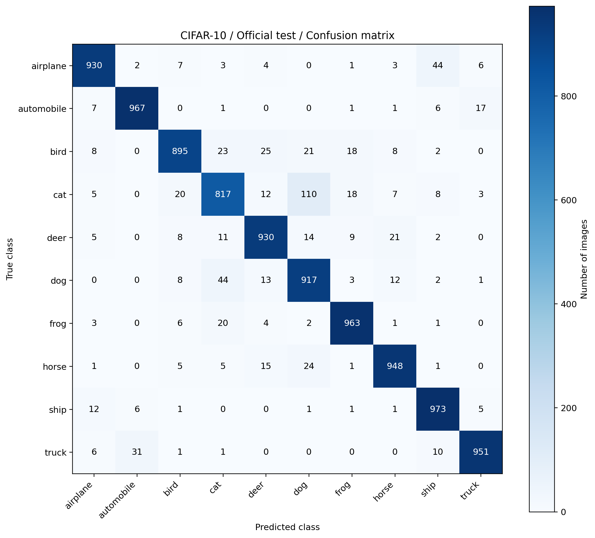

# LAB2 — Kết quả và đánh giá thực nghiệm

**ResNet18 fine-tuning là global-best:** validation accuracy **93.22%**, test accuracy **92.91%** trên 10.000 ảnh. Báo cáo dùng kết quả thực nghiệm ngày 10–11/11/2026, gồm đúng sáu run đã duyệt; FE là chỉ train head, FT là fine-tune tiếp từ best checkpoint của FE.

## 1. Giao thức và bằng chứng

| Nội dung | Thực tế đã chạy |
|---|---|
| Dữ liệu | CIFAR-10: train 45.000, validation 5.000, official test 10.000; split cố định, seed 42 theo [data.md](data.md) |
| Mô hình | ResNet18, VGG16, DenseNet121; weights `IMAGENET1K_V1`; ba chuỗi FE → FT theo [model.md](model.md) |
| Training | Cấu hình tại [trainning.md](trainning.md); batch train/val 16/32, workers **4**, tối đa 10 epoch/giai đoạn; cùng augmentation đã duyệt |
| Môi trường | RTX 3050 Laptop 6 GB, Python 3.13.0, PyTorch 2.7.1+cu118, torchvision 0.22.1+cu118; train AMP FP16, validation/test FP32 |
| Selection/test | Chọn bằng validation accuracy, hòa thì macro F1 → loss → run ID; chỉ test một global-best theo [demo.md](demo.md), batch 32, workers 0 |

Đã nạp lại sáu best checkpoint trên cùng validation set, kiểm tra source hash, parent hash, metadata, lịch sử epoch và TensorBoard. Xác suất tính lại khớp `best_validation.npz` với sai lệch lớn nhất **0.0 ở cả sáu run**. [Biên bản đối chiếu](../reports/validation_verification.json) và [selection](../reports/selection.json) xác nhận checkpoint được chọn trùng checkpoint test. Không dùng test để xếp hạng hoặc điều chỉnh cấu hình; không bố trí ablation LR/batch riêng trong phạm vi sáu run này.

## 2. Kết quả validation và hội tụ

Mỗi hàng dưới đây lấy **toàn bộ metrics từ cùng best-accuracy epoch**, không ghép với epoch có loss thấp nhất. Accuracy/F1 theo %, AUC theo tỷ lệ 0–1. Link ở cột Run mở history tương ứng; [CSV đầy đủ](../reports/validation_best_metrics.csv) có thêm precision, recall, FPR, micro AUC và hash từng checkpoint.

| Run | Mô hình | Best / epoch đã chạy | Accuracy (%) | Macro F1 (%) | CE tại best | Macro AUC OvR |
|---|---|---:|---:|---:|---:|---:|
| [01](../reports/01_resnet18_feature_extract/history.json) | ResNet18 FE | 10 / 10 | 87.10 | 87.05 | 0.3822 | 0.99061 |
| [02](../reports/02_resnet18_fine_tune/history.json) | ResNet18 FT | 10 / 10 | **93.22** | **93.21** | **0.2438** | **0.99715** |
| [03](../reports/03_vgg16_feature_extract/history.json) | VGG16 FE | 10 / 10 | 86.16 | 86.14 | 0.4221 | 0.98846 |
| [04](../reports/04_vgg16_fine_tune/history.json) | VGG16 FT | 10 / 10 | 90.74 | 90.75 | 0.3287 | 0.99475 |
| [05](../reports/05_densenet121_feature_extract/history.json) | DenseNet121 FE | 3 / 6 | 88.58 | 88.58 | 0.3424 | 0.99236 |
| [06](../reports/06_densenet121_fine_tune/history.json) | DenseNet121 FT | 10 / 10 | 92.06 | 92.07 | 0.2465 | 0.99624 |

| Run | CE validation thấp nhất (epoch) | Accuracy epoch cuối (%) | Kết thúc |
|---|---:|---:|---|
| 01 | 0.3815 (9) | 87.10 | Đủ 10 epoch |
| 02 | 0.2365 (7) | 93.22 | Chạm early stopping tại epoch 10 |
| 03 | 0.4221 (10) | 86.16 | Đủ 10 epoch |
| 04 | 0.3287 (10) | 90.74 | Đủ 10 epoch |
| 05 | 0.3424 (3) | 88.14 | Dừng sớm tại epoch 6 |
| 06 | 0.2430 (7) | 92.06 | Chạm early stopping tại epoch 10 |

**DenseNet121 FE chững lại sớm:** sau epoch 3, train loss tiếp tục giảm nhưng validation CE không cải thiện trong ba epoch liên tiếp, nên quy tắc patience dừng ở epoch 6. Accuracy tốt nhất vẫn là 88.58%, giữ checkpoint epoch 3. ResNet18/DenseNet121 FT đạt CE thấp nhất ở epoch 7, trong khi accuracy tốt nhất ở epoch 10. Hai run FT này chạm patience đúng giới hạn 10 epoch, vì vậy không tiết kiệm epoch thực chạy.

**ResNet18 FT cải thiện mạnh ở đầu giai đoạn:** accuracy từ 89.76% ở epoch 1 lên 93.04% ở epoch 7, rồi chỉ thêm 0.18 điểm phần trăm đến epoch 10. CE tăng nhẹ sau epoch 7 dù train loss còn giảm, cho thấy tối ưu train tiếp không đồng nghĩa mọi metric validation đều tốt hơn. VGG16 FE dao động ở epoch 3 và 6 rồi phục hồi; VGG16 FT kết thúc với cả best accuracy và minimum CE ở epoch 10, nên không thể kết luận overfitting kéo dài chỉ từ vài epoch loss tăng.

[Đường loss train/validation](../reports/figures/02_loss_curves.png) cho thấy train loss giảm ở cả sáu run. Train có augmentation và AMP, validation dùng preprocessing cố định và FP32; chênh lệch giữa hai loss không tự nó chứng minh overfitting hay underfitting. [Confusion matrix validation của global-best](../reports/figures/07_best_validation_confusion_matrix.png) có 4.661/5.000 ảnh đúng; cat có recall thấp nhất, 83.20%.

## 3. Ảnh hưởng của backbone và fine-tuning

Ba run FT nạp đầy đủ best checkpoint FE, gồm head đã học, rồi mở các tầng cuối theo `model.md`. Parent best epoch lần lượt là **10, 10, 3**; không khởi tạo lại từ ImageNet. Chênh lệch dưới đây là **điểm phần trăm**, tính giữa hai best checkpoint của từng cặp.

| Chuỗi | Δ Accuracy (pp) | Δ Macro F1 (pp) | Epoch FE + FT đã chạy | Thời gian phase FE + FT (phút) |
|---|---:|---:|---:|---:|
| ResNet18: 01 → 02 | **+6.12** | **+6.16** | 10 + 10 | 87.12 |
| VGG16: 03 → 04 | +4.58 | +4.61 | 10 + 10 | 416.73* |
| DenseNet121: 05 → 06 | +3.48 | +3.49 | 6 + 10 | 101.24 |

*Thời gian VGG16 chứa các khoảng Windows sleep/hibernation, được giải thích ở mục 4. Tổng chuỗi cộng mọi epoch hoàn thành của hai giai đoạn, kể cả các epoch sau parent best; không chỉ cộng các epoch dẫn trực tiếp đến checkpoint được giữ.*

**Khi chỉ train head**, DenseNet121 tốt nhất: hơn ResNet18 1.48 pp và VGG16 2.42 pp. **Sau fine-tuning**, thứ hạng đổi thành ResNet18 → DenseNet121 → VGG16; ResNet18 hơn DenseNet121 1.16 pp và VGG16 2.48 pp. ResNet18 nhận được mức tăng lớn nhất từ chiến lược train tiếp trong lần chạy này.

Cả ba cặp đều tăng accuracy/F1 và giảm CE tại best checkpoint. Tuy nhiên, FT có thêm ngân sách train, learning rate khác FE và phạm vi trainable khác nhau; các chênh lệch này không tách riêng tác động của việc mở khóa backbone. Một seed/split cũng chưa chứng minh mức tăng ổn định qua nhiều lần chạy.

## 4. Thời gian, thông lượng và bộ nhớ

**Lưu ý trước khi so thời gian:** nhật ký Windows ghi máy ngủ ngày 10/11/2026 lúc **17:41:20–18:30:47** và **18:55:58–23:02:59** (UTC+7), nằm trong run 03. Validation epoch 3 được ghi 3,050.6 giây, train epoch 8 là 15,071.3 giây. Giữ nguyên số đo gốc trong [execution_events.json](../reports/execution_events.json); không diễn giải tổng 355.37 phút của VGG16 FE như thời gian GPU tính liên tục.

| Run | Tổng train (phút) | Tổng val (phút) | Trung vị train (s/epoch) | Trung vị val (s/epoch) | Train (ảnh/s) | Val (ảnh/s) |
|---|---:|---:|---:|---:|---:|---:|
| 01 | 30.69 | 10.17 | 187.53 | 62.97 | 244.40 | 81.97 |
| 02 | 35.16 | 11.10 | 217.79 | 66.94 | 213.33 | 75.05 |
| 03* | 291.45 | 63.92 | 268.61 | 89.35 | 25.73 | 13.04 |
| 04 | 47.43 | 13.94 | 291.59 | 86.19 | 158.14 | 59.78 |
| 05 | 25.09 | 7.50 | 269.16 | 77.85 | 179.39 | 66.70 |
| 06 | 55.26 | 13.40 | 340.98 | 79.19 | 135.72 | 62.21 |

Trung vị dùng **tất cả epoch hoàn thành, gồm epoch đầu**. Thông lượng bằng tổng ảnh đã xử lý chia tổng giây của phase, nên run 03 chịu ảnh hưởng rõ của sleep. Timer có đồng bộ CUDA, bao gồm DataLoader/preprocessing và vòng train/val; không phải benchmark forward thuần. Tổng phase không bao gồm khởi tạo model, tổng hợp metrics cuối tập, ghi checkpoint/xuất báo cáo hoặc phần epoch bị ngắt chưa lưu được.

| Run | Tổng tham số | Trainable | Trainable (%) | Peak CUDA allocated train / val (MiB) | RSS đỉnh quan sát, tiến trình chính (MiB) |
|---|---:|---:|---:|---:|---:|
| 01 | 11,181,642 | 5,130 | 0.046 | 123.9 / 273.4 | 1,753.8 |
| 02 | 11,181,642 | 8,398,858 | 75.113 | 196.5 / 369.6 | 1,183.2 |
| 03 | 134,301,514 | 40,970 | 0.031 | 931.1 / 1,724.4 | 3,417.5 |
| 04 | 134,301,514 | 7,120,394 | 5.302 | 984.4 / 1,804.8 | 2,759.3 |
| 05 | 6,964,106 | 10,250 | 0.147 | 129.8 / 369.4 | 1,823.0 |
| 06 | 6,964,106 | 2,170,378 | 31.165 | 147.1 / 394.2 | 1,820.1 |

RSS chỉ đo tiến trình chính, **không gồm bốn DataLoader worker**. CUDA allocated là bộ nhớ do PyTorch quản lý, không phải tổng VRAM thiết bị. Reserved và RSS chịu ảnh hưởng cache/lịch sử tiến trình và các lần resume; không suy ra FT tiết kiệm RAM chỉ vì một giá trị RSS thấp hơn FE. Batch val lớn hơn và dùng FP32, nên peak val cao hơn train AMP trong các run này. [CSV tài nguyên](../reports/resource_comparison.csv) lưu đầy đủ cả reserved, phase và tổng chuỗi.

**Đánh đổi quan sát được:** ResNet18 FT đạt accuracy cao nhất, có trung vị train 217.79 s/epoch so với 340.98 của DenseNet121 FT. DenseNet121 có ít tham số hơn và peak allocated khi train thấp hơn (147.1 so với 196.5 MiB), nhưng peak val cao hơn nhẹ. VGG16 FT có khoảng 12 lần tổng tham số và 5 lần peak allocated khi train so với ResNet18 FT, trong khi accuracy thấp hơn 2.48 pp. Ít trainable parameters không tự động đồng nghĩa ít bộ nhớ hoặc nhanh hơn.

[Biểu đồ thời gian: tổng phase và trung vị/epoch](../reports/figures/05_runtime_comparison.png) · [Biểu đồ bộ nhớ thực đo](../reports/figures/06_memory_comparison.png). Do sleep, tải hệ thống và resume, các số thời gian phản ánh lần chạy này, không phải thứ hạng tốc độ kiến trúc trong điều kiện kiểm soát hoàn toàn.

## 5. Test chính thức của checkpoint đã chọn

Run **02_resnet18_fine_tune**, best epoch **10**; [checkpoint global](../checkpoints/checkpoint_best_global.pt), SHA-256 `b55b143e53b08e5d14f304c4b5196848c1127db04dac81e2b497e65fa1de02a7`. Test ID `20261111T064512Z_2af074c5`; [JSON gốc](../reports/test/test_metrics.json), [10.000 dự đoán](../reports/test/test_predictions.csv) và [per-class CSV](../reports/test/test_classification_report.csv) thuộc cùng lượt inference.

| Metric | Validation (5.000 ảnh) | Test (10.000 ảnh) |
|---|---:|---:|
| Accuracy (%) | 93.22 | **92.91** |
| Macro precision (%) | 93.25 | 92.97 |
| Macro recall (%) | 93.22 | 92.91 |
| Macro F1 (%) | 93.21 | **92.90** |
| Cross-Entropy | 0.2438 | 0.2572 |
| Macro FPR OvR (%) | 0.7533 | 0.7878 |
| Macro AUC OvR | 0.99715 | 0.99680 |
| Micro AUC OvR | 0.99756 | 0.99719 |

Test đúng **9.291**, sai **709** ảnh; accuracy thấp hơn validation **0.31 pp**. Macro recall trùng accuracy vì mỗi lớp có cùng 1.000 ảnh. Macro FPR OvR không phải tỷ lệ sai tổng thể 7.09%. Forward FP32 theo batch mất **11.789 s**; vòng inference gồm preprocessing/transfer/loss/thu dự đoán mất **38.902 s**, chưa gồm tải model, tổng hợp metrics cuối tập và xuất artifact. Đây không phải latency một ảnh.

| Nhầm thật → dự đoán | Số ảnh | % trên lớp thật (1.000 ảnh/lớp) |
|---|---:|---:|
| cat → dog | 110 | 11.0 |
| dog → cat | 44 | 4.4 |
| airplane → ship | 44 | 4.4 |
| truck → automobile | 31 | 3.1 |
| bird → deer | 25 | 2.5 |

**Cat là lớp yếu nhất:** recall 81.70%, F1 84.88%; dog có precision 84.21%, F1 87.79%. Hai hướng cat ↔ dog chiếm 154/709 lỗi, khoảng **21.72%**, và nhầm cat → dog nhiều hơn chiều ngược lại. Ship có recall cao nhất 97.30%, automobile có F1 cao nhất 96.41%. Cat cũng có recall thấp nhất trên validation; CM chỉ xác định dạng nhầm, chưa xác định nguyên nhân.

[ROC test](../reports/test/roc_ovr.png) cho thấy AUC cao nhưng không loại bỏ các lỗi phân loại trên. [Gallery](../reports/test/prediction_examples.png) gồm 6 đúng và 6 sai, seed 42, lưu index trong JSON; tỷ lệ 50/50 là cách chọn minh họa, không đại diện tỷ lệ lỗi test. Confidence Softmax chưa hiệu chỉnh.

## 6. Kết luận và nghiệm thu

Trong sáu run đã duyệt, **chọn ResNet18 partial fine-tuning** theo validation. Chiến lược này tăng 6.12 pp accuracy so với chỉ train head và đạt 92.91% trên test. DenseNet121 là phương án ít tham số hơn; VGG16 không đem lại lợi thế chất lượng/bộ nhớ trong cấu hình đã chạy. Chỉ một checkpoint được test, nên bảng xếp hạng giữa sáu run vẫn là **xếp hạng validation**.

Một seed/split chưa xác nhận độ ổn định; chưa có ablation để quy mức cải thiện cho augmentation mạnh hoặc riêng việc unfreeze. Nếu mở rộng nghiên cứu, ưu tiên nhiều seed và các thí nghiệm kiểm soát từng yếu tố; các thí nghiệm đó chưa được chạy trong báo cáo này.

Đã hoàn thành train sáu run, test global-best, đối chiếu lại validation/TensorBoard/lineage và xuất bảy hình đánh giá. [HTML training](../reports/report_all_models.html) mở offline, đủ bảy tab, xuất CSV/SVG/PNG và hiển thị trên desktop/mobile; [PDF test sáu trang](../reports/Predict_Report.pdf) đã mở kiểm tra và dựng lại được từ bundle không cần inference lại.

Các lượt bị ngắt được giữ trong `LAB2/archives`: lượt workers=0 không dùng trong so sánh; VGG16 được phục hồi từ last checkpoint epoch 9 sau lỗi thay file best; DenseNet121 được khởi động lại trước epoch đầu rồi resume từ epoch 1 khi cần. Cấu hình/source training và bốn run đã hoàn thành được giữ nguyên. Chi tiết sự kiện và giới hạn thời gian nằm trong `execution_events.json`; không cộng phần epoch bị ngắt thiếu số đo vào bảng bằng số giả định.
