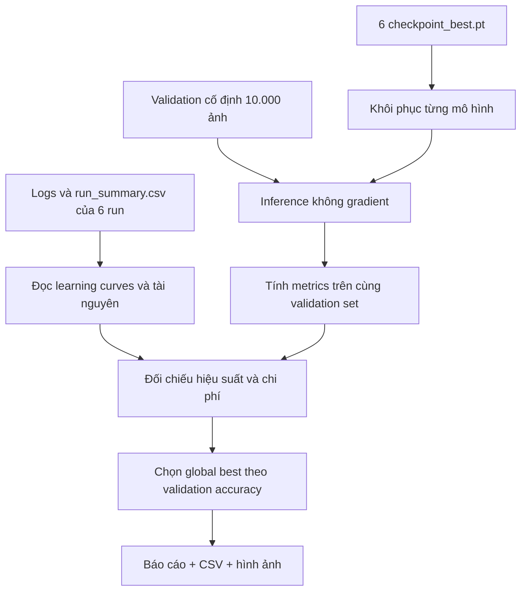

# Practice 2 — Đặc tả đánh giá mô hình

*ResNet18 · VGG16 · DenseNet121 | Feature Extraction & Fine-tuning*

> **Mục đích:** Tài liệu quy định cách nhóm yêu cầu AI **xây dựng phần đánh giá và báo cáo so sánh** sau khi huấn luyện LAB2. Đây là **đặc tả cần triển khai**, chưa phải báo cáo kết quả đã đo. Mọi con số về accuracy, thời gian hay RAM/VRAM phải lấy từ checkpoint và log thực tế; không được điền số liệu giả định.

## 1. Câu hỏi đánh giá và phạm vi

Nhóm cần trả lời ba câu hỏi: **kiến trúc nào phân loại tốt hơn**, **fine-tuning có đem lại lợi ích đáng kể so với chỉ huấn luyện head hay không**, và **mức cải thiện đó có xứng đáng với thời gian cùng bộ nhớ phải sử dụng không**.

Phần đánh giá sử dụng **10.000 ảnh validation** đã chốt trong [`data.md`](data.md). Bộ **10.000 ảnh test chính thức không được dùng để chọn mô hình**, điều chỉnh hyperparameters hoặc xếp hạng sáu run; bước kiểm thử trên test thuộc [`demo.md`](demo.md). Quy trình huấn luyện, cách đo hiệu năng và checkpoint được quy định tại [`trainning.md`](trainning.md); chi tiết các tầng frozen/trainable nằm tại [`model.md`](model.md).

### Sáu thí nghiệm phải xuất hiện trong báo cáo

| Kiến trúc | Feature extraction | Partial fine-tuning |
|---|---|---|
| ResNet18 | `01_resnet18_feature_extract` | `02_resnet18_fine_tune` |
| VGG16 | `03_vgg16_feature_extract` | `04_vgg16_fine_tune` |
| DenseNet121 | `05_densenet121_feature_extract` | `06_densenet121_fine_tune` |

Cả sáu run dùng chung split seed `1`, đầu vào `3 × 224 × 224`, trọng số ImageNet `IMAGENET1K_V1` và cùng cách tính metric. Mỗi run khởi tạo **độc lập từ pretrained weights**. Giới hạn là **10 epochs**, có thể dừng sớm sau **3 epochs không cải thiện validation loss**; vì vậy số epochs thực tế phải được ghi lại thay vì giả sử mọi run đều hoàn thành 10 epochs.

## 2. Giao thức đánh giá và nguồn số liệu



AI cần xây dựng chức năng đánh giá độc lập, có thể đặt trong `Evaluate.py`, sao cho **không phải train lại** khi chỉ cần tạo báo cáo. Quy trình bắt buộc:

1. Đọc `reports/run_summary.csv`, TensorBoard events và sáu `checkpoints/<run_id>/checkpoint_best.pt`. Kiểm tra `run_id`, `architecture`, `mode`, `config` và `best_epoch` khớp nhau.
2. Với mỗi checkpoint, dựng lại mô hình bằng `build_model()` từ `Model.py`, nạp `model_state_dict`, gọi `model.eval()` và `torch.inference_mode()`; inference trên **cùng validation loader không shuffle, không augmentation ngẫu nhiên**.
3. Tính toàn bộ validation metrics từ **cùng một lượt dự đoán của checkpoint tốt nhất**. Không chọn riêng epoch tốt nhất cho từng metric và không dùng số ở epoch cuối để thay số của best checkpoint.
4. Trích thời gian, thông lượng và đỉnh bộ nhớ **đã đo khi huấn luyện** từ logs/summary; không chạy lại inference rồi gọi thời gian đó là thời gian training.
5. Xuất bảng, biểu đồ và kết luận dựa trên số liệu. Nếu thiếu trường bắt buộc, dừng với thông báo chỉ rõ run và trường thiếu; trường tài nguyên không đo được có thể ghi `N/A` kèm lý do.

**Quy tắc chọn mô hình:** chọn checkpoint có **validation accuracy cao nhất** trong sáu run; nếu bằng nhau, ưu tiên **macro F1** cao hơn. Với từng run, `best_epoch` phải là số epoch bắt đầu từ `1`, đúng theo checkpoint. Khi so sánh hai chỉ số chênh nhau rất nhỏ, cần ghi mức chênh lệch theo **điểm phần trăm** và không mặc nhiên coi đó là cải thiện ổn định qua các seed.

## 3. Các chỉ số cần tính

| Chỉ số | Cách sử dụng trong báo cáo | Chiều tốt hơn |
|---|---|:--:|
| **Validation accuracy** | Tiêu chí chính để chọn checkpoint và xếp hạng | ↑ |
| **Cross-Entropy loss** | Đối chiếu khả năng tối ưu và độ tự tin của dự đoán | ↓ |
| **Macro precision / recall / F1** | Đánh giá đồng đều giữa 10 lớp | ↑ |
| **Macro FPR (OvR)** | Mức dự đoán dương tính nhầm, tính trên từng lớp One-vs-Rest | ↓ |
| **Macro ROC–AUC (OvR)** | Khả năng xếp hạng xác suất lớp đúng và lớp còn lại | ↑ |
| **Confusion matrix** | Xác định cặp nhãn dễ bị nhầm | — |

Với tập validation gồm `N = 10.000` ảnh, accuracy được tính bằng:

$$
\mathrm{Accuracy}=\frac{N_{\mathrm{correct}}}{N}
$$

Với 10 lớp, nhóm yêu cầu **macro-average**, tức tính từng lớp rồi lấy trung bình, không chỉ tính F1 trên một lớp đại diện:

$$
\mathrm{MacroF1}=\frac{1}{10}\sum_{c=0}^{9}
\frac{2P_cR_c}{P_c+R_c}
$$

Trong đó các trường hợp mẫu số bằng 0 phải được xử lý nhất quán bằng `zero_division=0`. Macro FPR dùng cách tính One-vs-Rest cho từng lớp:

$$
\mathrm{MacroFPR}=\frac{1}{10}\sum_{c=0}^{9}
\frac{FP_c}{FP_c+TN_c}
$$

ROC–AUC phải tính từ **xác suất `softmax(logits)`**, không tính từ nhãn `argmax`. Macro ROC–AUC là trung bình AUC One-vs-Rest của 10 lớp; chỉ tính khi validation có đủ positive/negative cho từng lớp. Các metrics này được tính trên **toàn bộ 10.000 ảnh**, không lấy trung bình đơn giản của metric từng batch. `CrossEntropyLoss` nhận **logits thô**; giá trị validation loss được tổng hợp có trọng số theo số ảnh trong batch, cùng quy ước ở [`trainning.md`](trainning.md).

## 4. Phân tích quá trình hội tụ

### 4.1. Diễn biến loss và accuracy

Cần trình bày đường `Loss/train_epoch`, `Loss/validation`, `Validation/accuracy` và `Validation/f1_macro` theo epoch của cả sáu run. Nhóm cần chỉ ra: mô hình cải thiện nhanh ở giai đoạn nào, khi nào bắt đầu chững lại, có dao động bất thường hay không và liệu Early Stopping có xảy ra trước giới hạn 10 epochs.

Phân tích **training loss và validation loss song song**, không kết luận mô hình tốt chỉ vì train loss giảm. Nếu train loss tiếp tục giảm nhưng validation loss tăng, cần nêu đây là **dấu hiệu có thể xảy ra khi overfitting**, đồng thời kiểm tra validation accuracy/F1. Hai loss cũng không hoàn toàn tương đương về điều kiện tính vì train có augmentation và model ở `train()` còn validation ở `eval()`.

### 4.2. Best accuracy, minimum loss và Early Stopping

Với từng run, báo cáo ít nhất `best_epoch`, `best_val_accuracy`, `val_loss_at_best_epoch`, `min_val_loss`, `epoch_of_min_val_loss` và `epochs_trained`. **Epoch có accuracy cao nhất không nhất thiết trùng epoch có loss thấp nhất**; không ghép các số này thành một bộ metrics tưởng như lấy từ cùng checkpoint.

Để tránh diễn giải quá mức, báo cáo phải phân biệt:

- **Hội tụ:** mức cải thiện qua các epoch trở nên nhỏ hơn; không có nghĩa là đạt cực trị lý thuyết.
- **Overfitting:** cần chứng cứ từ khoảng cách train/validation và xu hướng validation, không chỉ từ một lần loss tăng.
- **Dừng sớm:** là quyết định theo quy tắc `patience=3` và validation loss, không đồng nghĩa epoch dừng là epoch có accuracy cao nhất.

## 5. So sánh ảnh hưởng của kiến trúc và chiến lược transfer learning

Đây là phần kết luận trung tâm của LAB2. Nhóm yêu cầu **hai cách đối chiếu riêng**, tránh đánh đồng tác động của backbone và chế độ huấn luyện.

| Phép so sánh | Câu hỏi cần trả lời | Lưu ý khi kết luận |
|---|---|---|
| **Cùng ResNet18:** run 01 ↔ 02 | Mở khóa `layer4` có cải thiện accuracy/F1 so với chỉ train `fc`? | Chi phí gradient, thời gian, VRAM có thể tăng |
| **Cùng VGG16:** run 03 ↔ 04 | Fine-tuning các convolution cuối có đáng chi phí? | VGG16 có bộ classifier pretrained rất lớn |
| **Cùng DenseNet121:** run 05 ↔ 06 | Fine-tune `denseblock4`/`norm5` có hiệu quả không? | Xem cả chất lượng và tài nguyên |
| **Giữa 3 backbone ở feature extraction** | Đặc trưng pretrained nào có thể chuyển giao tốt hơn khi chỉ học head? | Giữ nguyên chế độ và pipeline |
| **Giữa 3 backbone ở fine-tuning** | Kiến trúc nào đạt hiệu quả tổng thể tốt hơn? | So cùng ngân sách/cấu hình đã ghi nhận |

Đối với mỗi cặp feature extraction → fine-tuning, AI phải tính chênh lệch:

$$
\Delta\mathrm{Accuracy}_{pp}
=100\left(\mathrm{Accuracy}_{\mathrm{fine\_tune}}
-\mathrm{Accuracy}_{\mathrm{feature\_extract}}\right)
$$

Trong đó `Accuracy` được lưu theo tỷ lệ từ 0 đến 1; kết quả là **điểm phần trăm**. Đồng thời so sánh chênh lệch macro F1, số tham số trainable, thời gian huấn luyện và VRAM đỉnh.

Kết luận cần có điều kiện: **fine-tuning không mặc định tốt hơn feature extraction**, và mạng nhiều tham số hơn không tự động có accuracy cao hơn. Hai chế độ còn có learning rate khác nhau theo thiết kế, nên nếu quan sát một mức cải thiện, không được tuyên bố nguyên nhân **chỉ** do mở khóa backbone. Với chênh lệch nhỏ, nhóm chỉ nhận xét đó là **kết quả của lần chạy hiện tại**; để kết luận ổn định cần thêm các seed độc lập và thống kê trung bình/độ lệch chuẩn.

Hai thí nghiệm hyperparameters `07_resnet18_fine_tune_lr` và `08_resnet18_fine_tune_bs8` tại [`trainning.md`](trainning.md) phải được phân tích **trong mục phụ riêng**, so với run 02; không tự động nhập vào bảng xếp hạng **sáu run cốt lõi**.

## 6. Đánh giá thời gian xử lý và bộ nhớ thực tế

Đây là **yêu cầu bắt buộc**, không được thay bằng nhận xét chung kiểu “VGG16 nặng hơn”. Cần sử dụng các chỉ số `Performance/*` và `Resources/*` đã quy định tại [`trainning.md`](trainning.md), cộng với số tham số lấy từ chính model.

| Nhóm | Cần báo cáo cho **từng run** | Cách hiểu đúng |
|---|---|---|
| **Quy mô mô hình** | `total_params`, `trainable_params`, tỷ lệ trainable (%) | Tham số không phải RAM thực đo |
| **Thời gian train** | Tổng `train_seconds`, trung vị giây/epoch, `epochs_trained` | Tổng thời gian chịu ảnh hưởng của Early Stopping |
| **Tốc độ train** | `train_images_per_second` hoặc tính `50.000 / train_seconds` theo epoch | Đo với DataLoader và phần cứng đã dùng |
| **Thời gian validation** | Tổng `val_seconds`, trung vị giây/epoch | Phân biệt thời gian evaluation với training |
| **Tốc độ validation** | `val_images_per_second` | Không gọi là latency một ảnh nếu đo theo batch |
| **Peak GPU memory** | `train_peak_cuda_allocated_mib`, `val_peak_cuda_allocated_mib`, reserved peak | Peak của PyTorch allocator, không phải toàn bộ bộ nhớ GPU hệ thống |
| **CPU memory** | `cpu_rss_observed_peak_mib` nếu có | RSS đỉnh quan sát của tiến trình, có thể không gồm worker processes |

Trung vị thời gian/epoch tính từ các epoch hoàn thành, ghi rõ **có bao gồm epoch đầu tiên hay không**; mặc định dùng tất cả epoch để đối chiếu với tổng thời gian. Thông lượng của cả run phải tính từ **tổng số ảnh được xử lý / tổng thời gian thực đo**, không lấy trung bình thường của tốc độ từng epoch nếu số ảnh khác nhau. Với CUDA, thời gian phải được đo có đồng bộ GPU như đặc tả training.

Để so sánh công bằng, cần ghi **thiết bị, phiên bản PyTorch/torchvision, AMP dtype, batch size thực tế, num_workers**. Nếu một run hạ batch size do thiếu VRAM hoặc chạy trên thiết bị khác, phải đánh dấu **điều kiện không tương đương**, không diễn giải chênh lệch tốc độ như do kiến trúc đơn thuần.

Không được gán **số tham số × 4 bytes** thành “RAM khi train”: mức RAM/VRAM thực tế còn phụ thuộc activations, gradients, optimizer, batch size, AMP, bộ đệm và DataLoader. Nếu không đo được CPU RAM hoặc CUDA memory, ghi `N/A`, nêu lý do; có thể bổ sung **dung lượng trọng số FP32 ước tính** ở cột riêng và gắn nhãn “ước tính”, tuyệt đối không đặt cạnh giá trị đo mà không phân biệt.

Khi lựa chọn model, nhóm không chỉ hỏi “accuracy cao nhất là bao nhiêu” mà còn đặt câu hỏi **thêm 0,1–0,5 điểm phần trăm có đáng tăng nhiều lần thời gian hoặc VRAM hay không**. Đây là cách rút ra đánh đổi phù hợp với nhu cầu triển khai, không phải một ngưỡng thành công được mặc định trước.

## 7. Hình ảnh và báo cáo bắt buộc

Hình phải đủ lớn để đọc trong VS Code/GitHub hoặc TensorBoard, ưu tiên **một nội dung chính mỗi hình**, tên model rút gọn nhất quán; xuất PNG ít nhất **200 dpi** và tránh các dashboard với nhiều ô quá nhỏ. Mọi hình phải có chú thích **tập validation**, đơn vị đo và nguồn dữ liệu.

| Hình | Nội dung phải thể hiện | Tên file xuất |
|---|---|---|
| **01. Learning curves** | Validation accuracy và macro F1 theo epoch; 6 đường, đánh dấu best epoch | `figures/01_validation_learning_curves.png` |
| **02. Loss curves** | Train/validation loss theo epoch, tách panel rõ ràng | `figures/02_loss_curves.png` |
| **03. Freeze vs Fine-tune** | Cột ghép đôi cho ba kiến trúc, so sánh best accuracy và macro F1 | `figures/03_transfer_strategy_comparison.png` |
| **04. Accuracy vs cost** | Accuracy theo số tham số trainable hoặc tổng thời gian train, phân biệt kiến trúc/chế độ | `figures/04_accuracy_vs_cost.png` |
| **05. Runtime comparison** | Thời gian train/validation theo run; phân biệt tổng thời gian và giây/epoch | `figures/05_runtime_comparison.png` |
| **06. Memory comparison** | Peak VRAM/RSS đo được theo run, không dùng số ước tính giả làm đo thực | `figures/06_memory_comparison.png` |
| **07. Confusion matrix** | Confusion matrix **validation** của global-best checkpoint, 10 lớp | `figures/07_best_validation_confusion_matrix.png` |

Nếu thiếu dữ liệu RAM/VRAM, hình 06 phải **ghi rõ `N/A`** tại các run thiếu số liệu, không vẽ cột 0 như thể model không dùng bộ nhớ. Nếu muốn hiển thị ROC, thêm `figures/08_best_validation_roc_ovr.png` cho **global-best** trên validation; không cần lặp lại mười đường ROC ở mọi run. Kết quả test và hình demo trên test được giữ riêng tại [`demo.md`](demo.md).

## 8. Đầu ra dữ liệu và tiêu chí nghiệm thu

AI cần tạo tối thiểu cấu trúc sau; các bảng được xuất bằng số liệu thực, không điền trước kết quả:

```text
LAB2/reports/
├── validation_best_metrics.csv
├── resource_comparison.csv
├── evaluation_summary.md
└── figures/
    ├── 01_validation_learning_curves.png
    ├── 02_loss_curves.png
    ├── 03_transfer_strategy_comparison.png
    ├── 04_accuracy_vs_cost.png
    ├── 05_runtime_comparison.png
    ├── 06_memory_comparison.png
    └── 07_best_validation_confusion_matrix.png
```

`validation_best_metrics.csv` cần có ít nhất `run_id`, `architecture`, `mode`, `best_epoch`, `epochs_trained`, `accuracy`, `precision_macro`, `recall_macro`, `f1_macro`, `fpr_macro`, `auc_macro_ovr`, `val_loss_at_best`, `min_val_loss`, `epoch_of_min_val_loss`. `resource_comparison.csv` cần có `run_id`, `total_params`, `trainable_params`, `train_seconds_total`, `val_seconds_total`, `train_seconds_per_epoch_median`, `val_seconds_per_epoch_median`, `train_images_per_second`, `val_images_per_second`, `train_peak_cuda_allocated_mib`, `val_peak_cuda_allocated_mib`, `cpu_rss_observed_peak_mib`, `device`, `amp_dtype`, `train_batch_size`, `val_batch_size`.

`evaluation_summary.md` là **báo cáo được tạo sau khi chạy**, phải có bảng đủ sáu run, nhận xét sự hội tụ, so sánh từng cặp freeze/fine-tune, đánh đổi accuracy–thời gian–bộ nhớ, và một kết luận lựa chọn global-best theo tiêu chí đã chốt. Báo cáo không được tự tuyên bố nguyên nhân khi thay nhiều yếu tố đồng thời.

**Điều kiện nghiệm thu:**

- [ ] Báo cáo có đúng **6 run cốt lõi** với metrics cùng checkpoint tốt nhất, không trộn best và final epoch.
- [ ] Các đường loss/accuracy theo epoch khớp với TensorBoard; số epochs và Early Stopping được ghi chính xác.
- [ ] Cả ba cặp feature extraction–fine-tuning và phép so sánh giữa ba backbone đều có nhận xét dựa trên số liệu.
- [ ] Có **thời gian train và validation riêng** cùng số tham số tổng/trainable; peak RAM/VRAM là số đo hoặc `N/A` có lý do.
- [ ] Biểu đồ có chữ dễ đọc, file ảnh xuất thành công và đường dẫn trong báo cáo hợp lệ.
- [ ] Không dùng **test set** để chọn model, không bịa accuracy, RAM, tốc độ hoặc kết luận cải thiện trước khi chạy.
- [ ] AI có thể chạy lại riêng bước đánh giá từ **sáu best checkpoints, logs và validation set** mà không cần huấn luyện lại.

> **Nguyên tắc chốt:** lựa chọn model dựa trên **validation accuracy trước**, sau đó đánh giá **mức tăng chất lượng có tương xứng với chi phí triển khai**. Tài liệu này xác định **cách đánh giá**; kết luận model nào tốt nhất chỉ được viết sau khi đã có số liệu thực nghiệm.
