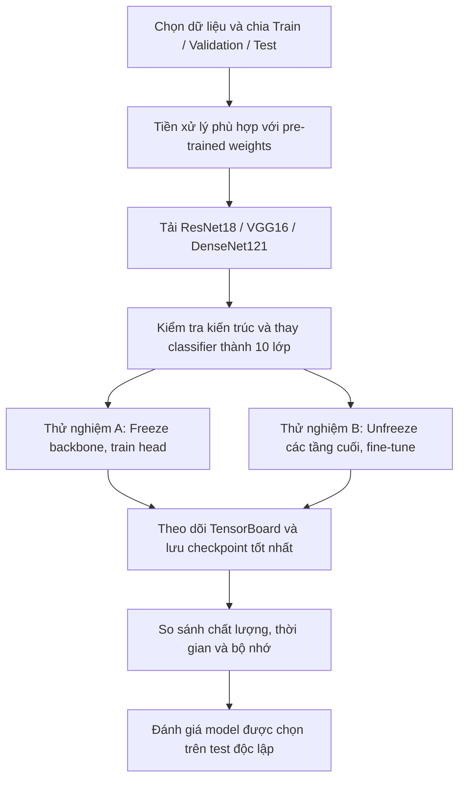

# LAB2 - Thực hành với các kiến trúc mạng nơ-ron


> **Định hướng của bài thực hành:** Nhóm sử dụng các kiến trúc đã được huấn luyện trước trên ImageNet, điều chỉnh tầng phân loại cho bài toán mới và so sánh hai chiến lược feature extraction và fine-tuning. Quá trình huấn luyện được theo dõi bằng TensorBoard để đánh giá cả chất lượng dự đoán lẫn chi phí tính toán.

---

## 1. Tổng quan bài thực hành

| Thành phần | Phương án triển khai |
|---|---|
| **Bài toán** | Phân loại ảnh thời trang thành 10 lớp |
| **Dữ liệu đề xuất** | Fashion-MNIST|
| **Kiến trúc khảo sát** | `ResNet18`, `VGG16`, `DenseNet121` từ `torchvision.models` |
| **Hướng tiếp cận** | Transfer learning: huấn luyện classifier mới; sau đó thử fine-tuning |
| **Công cụ theo dõi** | TensorBoard — loss, accuracy, learning rate và thời gian huấn luyện |

Nhóm đề xuất tiếp tục dùng Fashion-MNIST để giữ tính liên tục giữa hai bài thực hành; đề bài không bắt buộc một bộ dữ liệu cụ thể. Do ảnh Fashion-MNIST là ảnh xám 28 × 28, cần chuyển sang 3 kênh và điều chỉnh kích thước, chuẩn hóa theo yêu cầu của bộ trọng số pre-trained. Chi tiết xử lý sẽ được quy định trong [`data.md`](data.md).

## 2. Mục tiêu và câu hỏi cần trả lời

Nhóm đặt ra ba mục tiêu chính:

1. **Làm quen với mô hình pre-trained:** tải trọng số từ `torchvision.models`, quan sát cấu trúc mạng, xác định backbone, classification head và số tham số có thể huấn luyện và so sánh với kết quả LAB1.
2. **Thực hành transfer learning:** thay classifier đầu ra cho phù hợp **10 lớp**, so sánh việc chỉ huấn luyện head với việc mở khóa các tầng cuối để fine-tune.
3. **Đánh giá có kiểm soát:** khảo sát tác động của learning rate và **batch size**, theo dõi TensorBoard, đối chiếu hiệu suất với thời gian xử lý và bộ nhớ.

Báo cáo cần trả lời: **kiến trúc nào phù hợp hơn với bộ dữ liệu đã chọn; fine-tuning có đem lại lợi ích đáng kể so với chỉ train classifier; và lợi ích đó có tương xứng với chi phí tài nguyên hay không?**

## 3. Quy trình dự kiến



*Hình 1. Luồng triển khai dự kiến. Tập test được giữ riêng và chỉ sử dụng sau khi nhóm đã lựa chọn mô hình bằng validation.*

## 4. Thiết kế các thí nghiệm

Nhóm chọn ba họ kiến trúc để quan sát những cách tổ chức CNN khác nhau, thay vì chỉ thử nhiều phiên bản của cùng một mạng.

| Kiến trúc | Đặc điểm cần khảo sát | Điều chỉnh cho bài toán |
|---|---|---|
| **ResNet18** | Kết nối tắt (*residual connections*) | Thay tầng `fc` cuối thành 10 đầu ra |
| **VGG16** | Các khối tích chập xếp tuần tự | Thay tầng phân loại cuối thành 10 đầu ra |
| **DenseNet121** | Kết nối dày đặc giữa các tầng (*dense connections*) | Thay tầng `classifier` thành 10 đầu ra |

Với mỗi kiến trúc, nhóm dự kiến triển khai **hai chế độ**:

- **Feature extraction:** giữ nguyên trọng số backbone, chỉ cập nhật classifier mới. Đây là mốc tham chiếu về tốc độ và chi phí huấn luyện.
- **Partial fine-tuning:** mở khóa một số tầng cuối của backbone và tiếp tục tối ưu với learning rate nhỏ hơn. Cách này cho phép đặc trưng học sẵn thích nghi với Fashion-MNIST, nhưng tốn tài nguyên hơn và có nguy cơ overfitting.

Bộ thực nghiệm cốt lõi gồm **3 kiến trúc × 2 chế độ = 6 lượt chạy**. Sau khi có kết quả ban đầu, nhóm sẽ khảo sát thêm learning rate và batch size trên một cấu hình tiêu biểu, thay vì thay đổi đồng thời tất cả yếu tố. Việc này giúp phần so sánh dễ giải thích hơn.

## 5. Nguyên tắc so sánh và tiêu chí hoàn thành

Để phép so sánh có ý nghĩa, các mô hình cần dùng cùng phép chia dữ liệu, cùng tập validation, cùng định nghĩa metric và cùng quy tắc chọn checkpoint. Các thay đổi về kích thước ảnh, augmentation, batch size hoặc số tầng được mở khóa phải được ghi lại theo từng thí nghiệm.

Trong quá trình huấn luyện, nhóm theo dõi train/validation loss, validation accuracy, learning rate, đồng thời ghi nhận thời gian train, thời gian đánh giá và RAM/VRAM đỉnh nếu môi trường chạy cho phép. Accuracy là chỉ số lựa chọn chính; Precision, Recall, F1 và confusion matrix được dùng để xem xét các lớp dễ nhầm lẫn. Thông số bộ nhớ đo thực tế phải được phân biệt với dung lượng ước lượng từ số tham số.

Kết quả mong đợi của Practice 2 không chỉ là một checkpoint có accuracy cao, mà là một so sánh có căn cứ giữa kiến trúc, chiến lược fine-tuning và chi phí triển khai. 

## 6. Cấu trúc project dự kiến

```text
LAB2/
├── Model.py                 # Tải mô hình pre-trained, thay head, cấu hình freeze
├── Train.py                 # Huấn luyện, validation, checkpoint, TensorBoard
├── Predict.py               # Kiểm thử mô hình được lựa chọn
├── data/                    # Dữ liệu Fashion-MNIST
├── checkpoints/             # Checkpoint theo kiến trúc và chiến lược
├── logs/                    # TensorBoard events
├── reports/                 # Bảng kết quả và hình trực quan
└── docs/
    ├── lab-description.md
    ├── data.md
    ├── model.md
    ├── trainning.md
    ├── evaluation.md
    ├── demo.md
    └── plan-progression.md
```

*Cấu trúc trên là đề xuất tổ chức source để triển khai, không phải danh sách file đã hoàn thành.*

## 7. Phạm vi của các tài liệu liên quan

| Tài liệu | Nội dung chuyên trách |
|---|---|
| [`data.md`](data.md) | Bộ dữ liệu, chia tập và preprocessing phù hợp với mô hình pre-trained |
| [`model.md`](model.md) | Kiến trúc, backbone/head, freeze và unfreeze các tầng |
| [`trainning.md`](trainning.md) | Cấu hình tối ưu, training loop, scheduler, checkpoint và TensorBoard |
| [`evaluation.md`](evaluation.md) | So sánh metrics, hội tụ, thời gian và tài nguyên giữa các thí nghiệm |
| [`demo.md`](demo.md) | Quy trình tải checkpoint và kiểm thử trên tập test |
| [`plan-progression.md`](plan-progression.md) | Thứ tự triển khai, đầu ra và các mốc kiểm tra của nhóm |

---

**Phạm vi Practice 2:** sử dụng và tinh chỉnh mô hình đã huấn luyện trước, không huấn luyện VGG/ResNet/DenseNet từ đầu. Các đánh giá kết quả chỉ được bổ sung sau khi có log và checkpoint thực nghiệm.
