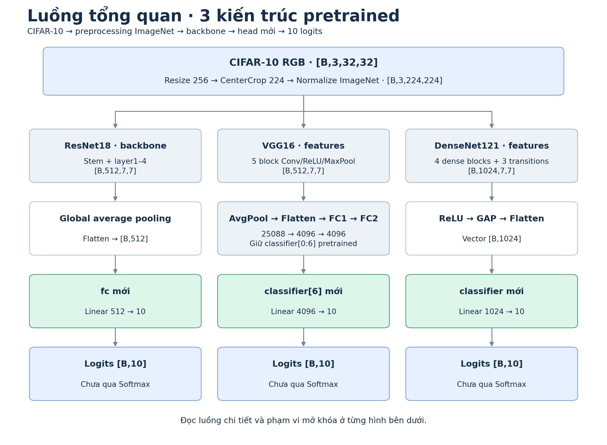
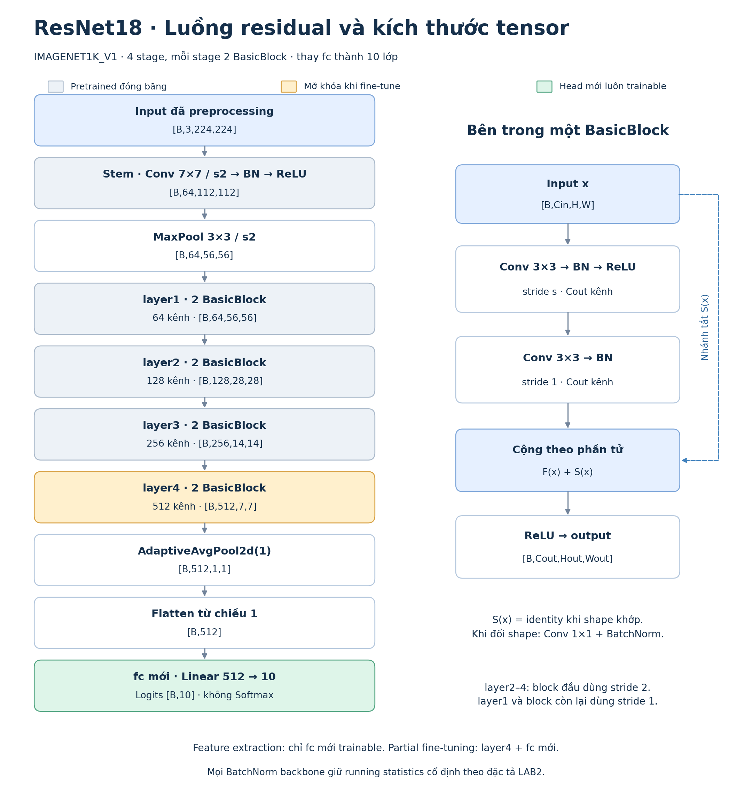
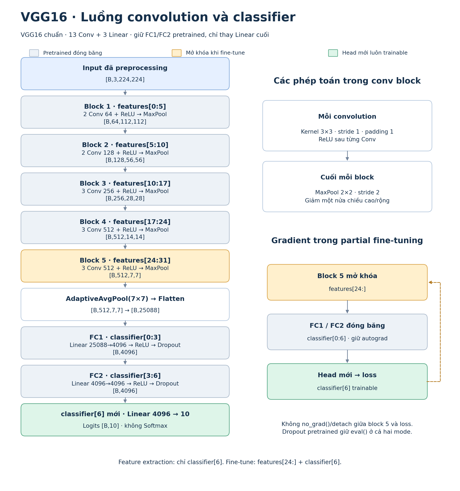
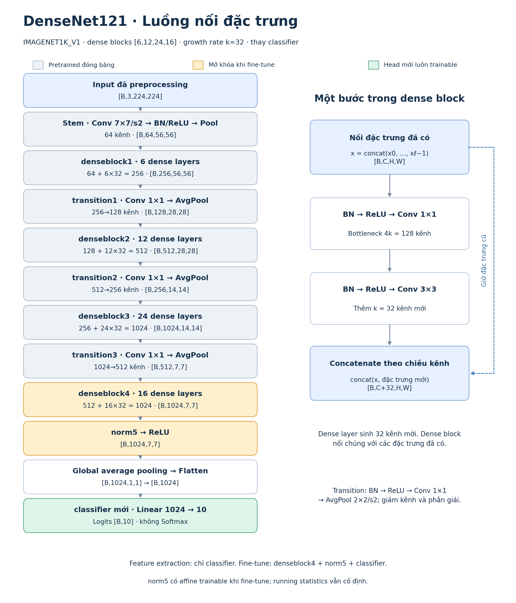
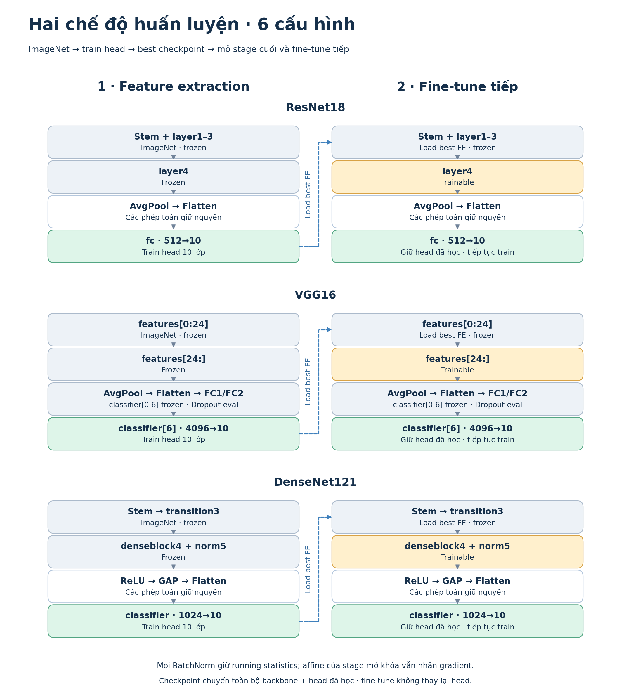

# LAB2 — Thiết kế mô hình pretrained

Tài liệu đặc tả kiến trúc, luồng tensor, cách thay tầng phân loại trong [model.py](../model.py). Dữ liệu/preprocessing theo [data.md](data.md); cấu hình, điều phối run và lưu checkpoint theo [trainning.md](trainning.md).

## 1. Kiến trúc lựa chọn

Dùng **ResNet18, VGG16 và DenseNet121**, mỗi mạng có hai giai đoạn nối tiếp: **feature extraction → partial fine-tuning**. 

| Kiến trúc | Nhiệm vụ đảm nhận | Weights enum từ `torchvision.models` |
|---|---|---|
| [ResNet18](https://docs.pytorch.org/vision/stable/models/generated/torchvision.models.resnet18.html) | Làm mốc so sánh với hai kiến trúc còn lại về chất lượng và chi phí | `ResNet18_Weights.IMAGENET1K_V1` |
| [VGG16](https://docs.pytorch.org/vision/stable/models/generated/torchvision.models.vgg16.html) | Khảo sát đặc trưng convolution với chuỗi Conv 3×3 có cấu trúc rõ | `VGG16_Weights.IMAGENET1K_V1` |
| [DenseNet121](https://docs.pytorch.org/vision/stable/models/generated/torchvision.models.densenet121.html) | Khảo sát cơ chế truyền đặc trưng khác với residual bằng cách nối và tái sử dụng feature map từ các dense layer | `DenseNet121_Weights.IMAGENET1K_V1` |

Giữ nguyên backbone của torchvision, gồm stem, convolution, pooling và các kết nối nội bộ. Thay tầng Linear cuối từ 1.000 lớp ImageNet thành **10 lớp CIFAR-10**. VGG16 dùng bản chuẩn `vgg16`, giữ hai FC pretrained; **head** trong tài liệu này chỉ tầng Linear cuối được thay.

Không dùng `DEFAULT` thay cho enum đã khóa hoặc weights `IMAGENET1K_FEATURES` của VGG16. Feature extraction cần nạp đúng weights; khi cache/tải weights lỗi phải báo lỗi, không tiếp tục run pretrained bằng trọng số ngẫu nhiên.

**Kỳ vọng cần kiểm chứng:** head mới học cách ánh xạ đặc trưng ImageNet sang CIFAR-10 sau đó fine-tuning bằng cách mở stage cuối để thử xem có thể giúp đặc trưng thích nghi thêm với dữ liệu mới hay không . Qua đó khảo sát xem fine-tuning tăng số tham số cập nhật thì có nguy cơ overfit hoặc làm suy giảm đặc trưng đã học hay không .

## 2. Luồng tổng quan và input/output



*Hình 1. Ảnh được chuẩn bị ngoài model; ba nhánh giữ backbone gốc và kết thúc bằng head 10 lớp. [Mở SVG](assets/model_overview.svg). Phần preprocessing trong hình minh họa luồng eval; augmentation train do `trainning.md` quy định.*

| Giao tiếp của `CNN.forward(x)` | Yêu cầu |
|---|---|
| Input | Tensor float `[B,3,224,224]` sau preprocessing theo `data.md`; `B` là batch size |
| Output | **Logits `[B,10]`**, cột thứ `k` ứng với lớp ID `k` theo `data.md` |
| Flatten | Chỉ sau phần trích xuất/pooling theo luồng của từng kiến trúc |
| Softmax | Không đặt trong `forward`; xác suất và nhãn dự đoán được xử lý ở bước [inference](demo.md) |


## 3. Luồng chi tiết từng mạng
Các hình dưới đọc từ trên xuống. Shape feature map theo thứ tự `[B,C,H,W]`. 
- Màu xám: tham số pretrained đóng băng
-  vàng: phần mở thêm khi fine-tune
- xanh lá: head thay mới, tiếp tục được học ở cả hai giai đoạn. Đường đi của tensor vẫn qua các phần đóng băng.
### 3.1. ResNet18 — nhánh residual



*Hình 2. Đủ bốn stage, shape sau từng stage và phép cộng trong BasicBlock. [Mở SVG](assets/model_resnet18_flow.svg).*

Mỗi stage `layer1`–`layer4` gồm hai BasicBlock. Một block tính `ReLU(F(x) + S(x))`, với `F` gồm hai Conv 3×3. Block đầu của `layer2`–`layer4` giảm phân giải bằng stride 2; nhánh tắt dùng Conv 1×1 và BatchNorm để khớp shape. Các block còn lại dùng identity.

Sau `layer4`, feature map `[B,512,7,7]` qua global average pooling và flatten thành `[B,512]`. Thay **`network.fc = Linear(512,10)`**. Giữ nguyên stem, các residual blocks và cách cộng hai nhánh.

### 3.2. VGG16 — chuỗi convolution và FC pretrained



*Hình 3. Năm conv block, hai FC pretrained và head; nhánh bên phải chỉ đường gradient về block 5. [Mở SVG](assets/model_vgg16_flow.svg).*

Năm block có lần lượt **2/2/3/3/3 convolution**, tương ứng các khoảng `features[0:5]`, `[5:10]`, `[10:17]`, `[17:24]`, `[24:31]`. Mỗi convolution dùng kernel 3×3, stride 1, padding 1 và ReLU; cuối block có MaxPool 2×2, stride 2.

Đầu ra features `[B,512,7,7]` qua adaptive average pooling 7×7 và flatten thành `[B,25088]`. Giữ `classifier[0:6]`: FC 25088→4096, ReLU, Dropout, FC 4096→4096, ReLU, Dropout. Chỉ thay **`network.classifier[6] = Linear(4096,10)`**.

Hai FC lớn vẫn chiếm bộ nhớ dù đóng băng. Khi mở block 5, gradient phải đi qua các FC này để về convolution; không dùng `no_grad()` hoặc `detach()` làm đứt đường đó.

### 3.3. DenseNet121 — nối đặc trưng



*Hình 4. Bốn dense block, ba transition và một bước tạo/nối đặc trưng. [Mở SVG](assets/model_densenet121_flow.svg).*

Bốn dense block gồm **6/12/24/16 dense layer**, growth rate `k=32`. Mỗi dense layer nhận các đặc trưng trước đó, thực hiện BN→ReLU→Conv 1×1 với 128 kênh, rồi BN→ReLU→Conv 3×3 tạo 32 kênh mới. Dense block nối chúng theo chiều kênh với các đặc trưng đã có.

Mỗi transition dùng BN→ReLU→Conv 1×1→AvgPool 2×2 để giảm kênh và phân giải. Đầu ra block cuối `[B,1024,7,7]` qua `norm5`, ReLU, global average pooling và flatten thành `[B,1024]`. Thay **`network.classifier = Linear(1024,10)`**; giữ nguyên dense connections và transitions.

## 4. Hai giai đoạn nối tiếp và chính sách trainable



*Hình 5. Mũi tên nét đứt chuyển toàn bộ trọng số từ best checkpoint train head sang giai đoạn fine-tuning. [Mở SVG](assets/model_training_modes.svg).*

1. **Feature extraction:** nạp weights ImageNet đầy đủ, đóng băng các tham số pretrained, thay head 10 lớp và chỉ train head. Chọn best checkpoint bằng validation theo `trainning.md`.
2. **Partial fine-tuning:** dựng đúng kiến trúc/head, nạp **toàn bộ best checkpoint feature extraction** bằng `strict=True`, giữ nguyên head đã học và mở thêm phần cuối theo bảng dưới. Tiếp tục train từ các trọng số vừa nạp.

| Kiến trúc | Feature extraction: phần trainable | Fine-tuning: phần trainable |
|---|---|---|
| ResNet18 | `network.fc` | `network.layer4` + `network.fc` |
| VGG16 | `network.classifier[6]` | `network.features[24:]` + `network.classifier[6]` |
| DenseNet121 | `network.classifier` | `network.features.denseblock4` + `network.features.norm5` + `network.classifier` |

Các tham số còn lại luôn đóng băng. Fine-tuning tiếp từ đúng checkpoint của cùng kiến trúc; không nạp lại ImageNet hoặc khởi tạo lại head sau khi chuyển giai đoạn. Trước optimizer step đầu tiên của fine-tuning, toàn bộ `state_dict` phải bằng checkpoint cha. Đổi `requires_grad` không được đổi giá trị trọng số.

**BatchNorm:** giữ mọi BatchNorm của backbone ở `eval()` trong cả hai giai đoạn để cố định running mean/variance. Affine weight/bias của BatchNorm thuộc phần mở khóa vẫn trainable, gồm `norm5` của DenseNet121. `requires_grad=False` và chế độ train/eval là hai cơ chế riêng; quy tắc này phải được áp dụng lại sau mỗi lần gọi `model.train()`. Cơ chế running statistics tham chiếu [BatchNorm2d](https://docs.pytorch.org/docs/stable/generated/torch.nn.BatchNorm2d.html).

**Dropout:** giữ Dropout pretrained trong `classifier[0:6]` của VGG16 ở `eval()` ở cả hai giai đoạn để phần FC đóng băng không tạo nhiễu ngẫu nhiên. Đây là lựa chọn của LAB2 so với chế độ train thông thường của VGG16; tác động tới khả năng tổng quát hóa cần đánh giá thực tế.

**Autograd:** tham số đóng băng không nhận cập nhật, nhưng phép toán của chúng vẫn phải giữ gradient tới phần trainable phía trước. Chỉ đưa tham số trainable vào optimizer, tách head/backbone không trùng hoặc thiếu. Khi validation/test, toàn bộ model ở `eval()`.

## 5. Giao diện triển khai theo form 

Dùng một lớp `nn.Module`, khai báo mạng trong `__init__`, Gọi trực tiếp model qua `forward`. Lớp `CNN` bọc kiến trúc torchvision được chọn, giữ nguyên luồng nội bộ của kiến trúc đó.

```python
CNN(architecture="resnet18", num_classes=10,
    pretrained=True, fine_tune=False)
```

| Tham số | Ý nghĩa |
|---|---|
| `architecture` | `"resnet18"`, `"vgg16"` hoặc `"densenet121"`; giá trị khác phải báo lỗi |
| `num_classes` | Số đầu ra, bằng `10` cho LAB2; giá trị không hợp lệ phải báo lỗi |
| `pretrained` | `True` để bắt đầu feature extraction từ ImageNet; `False` khi sẽ nạp checkpoint đầy đủ cho fine-tuning, resume hoặc inference |
| `fine_tune` | `False`: chỉ head trainable; `True`: áp dụng phạm vi mở khóa ở mục 4 |

- **`__init__`:** chọn builder/weights, đóng băng tham số pretrained, thay head đúng số chiều và áp dụng freeze policy.
- **`forward(self, x)`:** trả `self.network(x)`; không thêm preprocessing hoặc Softmax.
- **`train(self, mode=True)`:** chuyển mode qua `nn.Module`, áp dụng lại chính sách BatchNorm/Dropout, trả `self` để giữ cách dùng chuẩn `model.train()` / `model.eval()`.

Ví dụ phần chuyển giai đoạn, sau khi training đã kiểm tra checkpoint cha:

```python
model = CNN(architecture=architecture, num_classes=10,
            pretrained=False, fine_tune=True)
model.load_state_dict(parent_checkpoint["model_state_dict"], strict=True)
model = model.to(device)
```

`fine_tune=True` **chỉ cấu hình trainable**, không tự tìm hoặc nạp checkpoint. Phần training chịu trách nhiệm kiểm tra đúng checkpoint cha và nạp trước khi cập nhật trọng số. Danh sách `Config_parameter`, run ID, optimizer/scheduler mới khi chuyển giai đoạn và việc resume cùng run được quy định tại [trainning.md](trainning.md), theo cách tổ chức [LAB1/Train.py](../../LAB1/Train.py).

`model.py` chỉ phụ trách dựng mạng, forward, freeze policy và hỗ trợ khảo sát/nhóm tham số. Không đặt DataLoader, vòng lặp epoch hoặc xuất báo cáo trong lớp `CNN`. Số liệu cấu trúc cần xuất gồm tên module, tên/shape tham số, số lượng và trạng thái trainable; đường dẫn output do tài liệu training quy định.

## 6. Đối chiếu cấu trúc và điều kiện nghiệm thu

Số tham số sau khi thay head 10 lớp, đếm từ `CNN` hiện có bằng `model.parameters()`:

| Kiến trúc | Tổng tham số | Trainable: feature extraction | Trainable: fine-tuning |
|---|---:|---:|---:|
| ResNet18 | 11.181.642 | 5.130 | 8.398.858 |
| VGG16 | 134.301.514 | 40.970 | 7.120.394 |
| DenseNet121 | 6.964.106 | 10.250 | 2.170.378 |

Tổng không gồm buffers như running statistics. Mở stage cuối vẫn có thể cập nhật hàng triệu tham số; bảng này không thay thế phép đo thời gian hoặc peak RAM/VRAM khi chạy thật.

Trước nghiệm thu source cần xác minh:

1. Cả sáu cấu hình có cấu trúc và shape trung gian khớp hình, forward trả logits hữu hạn `[B,10]`; nạp pretrained đúng enum, đủ weights và thay đúng head.
2. Tên tham số trainable đúng bảng mục 4. Sau backward/step, phần mở khóa có gradient/cập nhật, phần đóng băng không đổi; gradient của VGG16 đi được về block 5.
3. BatchNorm giữ buffers cố định; affine ở phần mở khóa vẫn nhận gradient. Dropout VGG16 tuân thủ policy sau cả chuỗi `train()`→`eval()`→`train()`.
4. Chuyển giai đoạn giữ nguyên toàn bộ trọng số từ best checkpoint cha, gồm head; ở eval với cùng input, logits trước optimizer step đầu tiên khớp model cha trong sai số số học phù hợp.
5. In được cấu trúc và số tham số để đối chiếu bảng trên; nạp lại checkpoint đầy đủ bằng `strict=True` tái tạo đúng kiến trúc và đầu ra.

