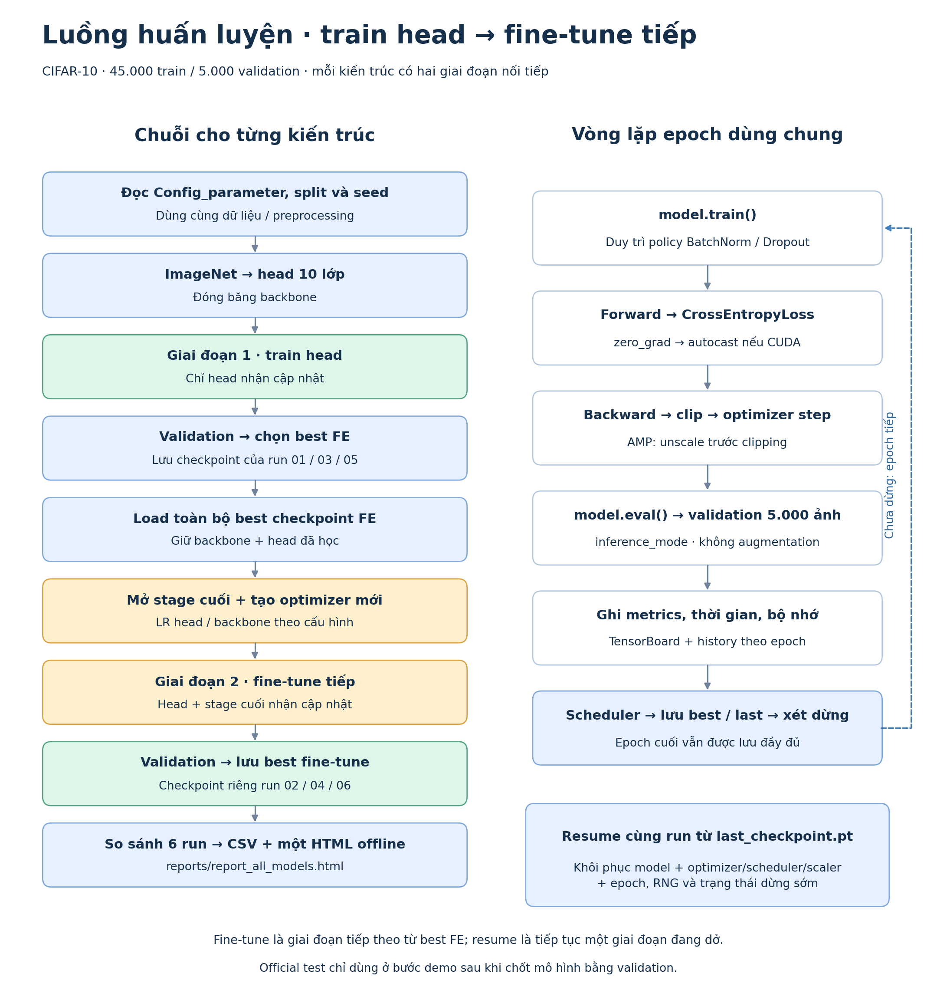

# LAB2 — Cấu hình, thực thi và đầu ra training

Tài liệu sở hữu cấu hình thí nghiệm, augmentation, tối ưu hóa, tracking, checkpoint và báo cáo training. Dữ liệu/split theo [data.md](data.md), kiến trúc và freeze policy theo [model.md](model.md). Test/inference thuộc [demo.md](demo.md).

## 1. Bộ thí nghiệm và luồng chạy

Danh sách `Config_parameter` gồm các `dict`, mỗi phần tử có `name`, `architecture`, `fine_tune`, `warm_start_from` và cấu hình bên dưới. Hàm điều phối khởi tạo `CNN` trực tiếp, dùng chung vòng train/validation; không đưa vòng epoch vào lớp model.

| Kiến trúc | Train head từ ImageNet | Fine-tune từ best của run bên trái |
|---|---|---|
| ResNet18 | `01_resnet18_feature_extract` | `02_resnet18_fine_tune` |
| VGG16 | `03_vgg16_feature_extract` | `04_vgg16_fine_tune` |
| DenseNet121 | `05_densenet121_feature_extract` | `06_densenet121_fine_tune` |

Chạy mặc định **01→02→03→04→05→06** ở feature extraction. Khi chạy riêng fine-tune phải có parent đã kết thúc hợp lệ; thiếu/sai parent thì báo lỗi.



*Hai giai đoạn nối tiếp và vòng epoch dùng chung. Phạm vi mở khóa theo `model.md`. [Mở SVG](assets/training_workflow.svg).*

## 2. Augmentation và nạp dữ liệu

### 2.1. Augmentation

Dùng thống nhất cho train của cả sáu run và hai giai đoạn. Các giá trị là cấu hình xuất phát cần kiểm chứng bằng validation, chưa phải tham số tối ưu.

| Thứ tự | Phép biến đổi | Thông số và kiểu dữ liệu |
|---:|---|---|
| 1 | `RandomResizedCrop` | Từ ảnh PIL RGB gốc: output `224`, `scale=(0.70,1.00)`, `ratio=(0.90,1.10)`, bilinear, `antialias=True` |
| 2 | `RandomHorizontalFlip` | `p=0.5` |
| 3 | `RandomApply([ColorJitter(...)])` | `p=0.8`; brightness `0.3`, contrast `0.3`, saturation `0.2`, hue `0.05` |
| 4 | `ToTensor` → `Normalize` | Lấy mean/std từ preset của weights đã chọn theo `data.md`, chỉ normalize một lần |
| 5 | `RandomErasing` | Trên tensor đã normalize: `p=0.25`, `scale=(0.02,0.12)`, `ratio=(0.5,2.0)`, `value=0`, `inplace=False` |

- Crop thay đổi vùng và tỷ lệ quan sát;
- jitter thay đổi màu/độ sáng;
- erasing mô phỏng che khuất cục bộ. `scale` của crop/erasing là **tỷ lệ diện tích**, không phải tỷ lệ độ dài cạnh. Giá trị xóa `0` sau normalization tương ứng màu mean chuẩn hóa. Giới hạn crop và vùng xóa nhằm giảm nguy cơ mất vật thể trên ảnh gốc nhỏ; chưa có bảo đảm mọi ảnh sau biến đổi đều giữ đủ tín hiệu nhận diện.

> ColorJitter thực hiện trước normalization; RandomErasing thực hiện sau bước chuyển thành tensor. Train xây pipeline riêng từ các thành phần trên, không ghép thêm toàn bộ `weights.transforms()` sau đó làm crop/normalize lại. Validation chỉ dùng eval preset theo `data.md`.


Trước full training, tạo **một ảnh preview** gồm ảnh gốc và nhiều biến thể từ chính pipeline sẽ train, lấy mẫu đủ mười lớp, seed cố định. Lưu `reports/augmentation_preview.png`

### 2.2. DataLoader và tái lập

| Thành phần | Quy định |
|---|---|
| Dataset/split | Dùng đúng artifact và kiểm tra theo `data.md`; không chia lại hoặc lọc bớt mẫu |
| Train/validation dataset | Hai object `CIFAR10(train=True)` với transform riêng, áp `Subset` bằng chỉ số tương ứng |
| Train / validation batch | `16` / `32` cho core run |
| Shuffle / drop last | Train shuffle, validation không shuffle; cả hai `drop_last=False` |
| Workers / pin memory | `num_workers=4` theo điều chỉnh được duyệt khi chạy thực nghiệm; pin memory khi CUDA, tắt trên CPU |
| Seed | `42` cho Python, NumPy, Torch/CUDA, generator của DataLoader khi bắt đầu run mới |
| Determinism | `cudnn.benchmark=False`, `cudnn.deterministic=True`; lưu cấu hình thực tế |

Training chỉ nạp train fit/validation theo `data.md`; không tạo test loader. Augmentation không nhân số mẫu mỗi epoch: mỗi ảnh train được lấy một lần và biến đổi khi đọc.

Seed kiểm soát các nguồn ngẫu nhiên, không bảo đảm tái lập tuyệt đối giữa phần cứng/phiên bản. Resume khôi phục RNG, không reseed về đầu. Nếu tăng workers sau này, phải kiểm soát seed worker và kiểm chứng lại tính tái lập.

## 3. Cấu hình tối ưu hóa

| Tham số | Feature extraction | Fine-tuning |
|---|---|---|
| `lr_head` / `lr_backbone` | `1e-3` / `None` | `1e-4` / `1e-5` |
| Optimizer | AdamW: weight decay `1e-4`, betas `(0.9,0.999)`, eps `1e-8` | Cùng cấu hình, tạo mới khi chuyển giai đoạn |
| Epoch tối đa | `10` | `10`, tính riêng giai đoạn |
| Scheduler | CosineAnnealingLR, `T_max=epochs`, `eta_min=1e-6` | Scheduler mới với cùng quy tắc |
| Early Stopping | Validation loss, patience `3`, min delta `1e-4` | Bộ đếm mới với cùng quy tắc |
| Loss | CrossEntropyLoss từ logits, reduction `mean`, label smoothing `0.0`, không class weights | Cùng định nghĩa |
| Gradient clipping | L2 norm, `max_norm=1.0`, chỉ tham số trainable | Cùng quy tắc |
| Precision train | CUDA: FP16 AMP, GradScaler initial scale `1024`; CPU: FP32 | Cùng quy tắc |
| Precision validation | FP32 | FP32 |

Nhóm optimizer chỉ gồm tham số `requires_grad=True`: `head` và, khi fine-tune, `backbone` theo `model.md`; không trùng/thiếu tham số. Kiến trúc/freeze policy không được thay để xử lý thiếu bộ nhớ.

Các giá trị trên là cấu hình khởi đầu. Batch 16 phải được smoke test trên thiết bị thực tế, đặc biệt VGG16. Nếu OOM, giữ artifact hợp lệ và ghi lỗi; thay batch qua cấu hình mới với output riêng. Bộ so sánh core phải thống nhất batch và policy; không âm thầm giảm batch/resolution trong một run.

## 4. Vòng epoch, metrics và selection

1. Gọi `model.train()` và áp freeze/BatchNorm/Dropout policy trong `model.md`.
2. Mỗi batch: `zero_grad(set_to_none=True)` → forward → loss → backward → clip → optimizer step. CUDA dùng autocast và GradScaler: **unscale trước clip**, sau đó scaler step/update. CPU chạy FP32. Ghi số AMP update bị bỏ qua; lỗi loss không hữu hạn hoặc cả epoch không có update hợp lệ phải dừng và ghi nguyên nhân. Tham chiếu [AMP examples](https://docs.pytorch.org/docs/2.7/notes/amp_examples.html).
3. Validation dùng `model.eval()` và `torch.inference_mode()`, xử lý đủ tập, không backward hoặc augmentation ngẫu nhiên.
4. Tổng hợp metrics, cập nhật best/dừng sớm; log LR thực dùng, step scheduler một lần cuối epoch; lưu history và checkpoint rồi mới kết thúc nếu đạt điều kiện dừng.

**Tổng hợp theo mẫu:** `epoch_loss = sum(batch_loss * batch_size) / total_images`; accuracy = tổng dự đoán đúng/tổng ảnh. Không lấy trung bình đều các batch khi batch cuối nhỏ. Train loss/accuracy phản ánh các ảnh đã augmentation và trọng số thay đổi trong epoch; không diễn giải chênh train–validation như hai phép đo trên cùng điều kiện.

| Dữ liệu metrics | Định nghĩa/yêu cầu lưu |
|---|---|
| Train | Loss, accuracy, số mẫu, gradient norm trước clip (mean/max), tỷ lệ bị clip, số AMP update bị bỏ |
| Validation | Loss, accuracy, macro precision/recall/F1; confusion matrix và precision/recall/F1/support từng lớp |
| Macro metrics | Trung bình không trọng số trên đủ nhãn 0–9, `zero_division=0`; accuracy và metrics tỷ lệ lưu `[0,1]` |
| ROC/AUC validation | One-vs-rest từ xác suất Softmax, AUC từng lớp/macro/micro; lớp thiếu positive hoặc negative thì để thiếu và ghi lý do |
| FPR validation | Từng lớp one-vs-rest: `FP/(FP+TN)`; macro là trung bình trên lớp hợp lệ, không phải `1-accuracy` |

Các biểu đồ/báo cáo dùng đúng class order và đủ số mẫu. Thông tin không tính được lưu `null`/`N/A`, không dựng đường ROC hoặc giá trị 0 giả.

| Quyết định | Quy tắc |
|---|---|
| Best checkpoint của run | Validation accuracy cao nhất; hòa giữ epoch sớm đã lưu |
| Reset Early Stopping | `val_loss < best_val_loss - 1e-4`; nếu không thì tăng counter, dừng khi counter đạt 3 |
| Global best | Chỉ xét sáu core run hợp lệ đã kết thúc: accuracy giảm dần → macro-F1 giảm dần → loss tăng dần → run ID từ điển |

Epoch đánh số từ **1 trong từng giai đoạn**. Best và Early Stopping tách biệt; metric trong hàng best phải cùng epoch/checkpoint, không ghép minimum loss của epoch khác. Fine-tuning có thể kém train head; selection vẫn xét cả hai. Chỉ xuất global best khi đủ sáu core run và checkpoint/metadata nhất quán; bộ thiếu ghi rõ chưa hoàn tất.

## 5. Chuyển giai đoạn, checkpoint và resume

| Thành phần | Bắt đầu fine-tuning | Resume cùng run |
|---|---|---|
| Nguồn model | Best checkpoint của parent theo mục 1 | `last_checkpoint.pt` của chính run đang dở |
| Kiểm tra | Parent đã kết thúc; đúng architecture, classes, split, eval transform và nguồn thực nghiệm; xác minh hash, kiểm tra policy của parent/đích theo cấu hình run | Đúng run/config, architecture/mode, split, transform/augmentation, nhóm optimizer và nguồn code tương thích |
| Trọng số | Nạp toàn bộ `state_dict`, giữ head theo `model.md` | Nạp toàn bộ state của run |
| Optimizer/scheduler/scaler | Tạo mới | Khôi phục đầy đủ |
| Epoch/best/counter | Epoch 1, best và counter mới | Epoch tiếp sau checkpoint, giữ best/counter |
| RNG | Seed của run mới | Khôi phục Python/NumPy/Torch/CUDA và generator sau khi dựng/load các đối tượng, trước batch tiếp |


| Nhóm dữ liệu trong checkpoint | Nội dung bắt buộc |
|---|---|
| Định danh | `architecture`, `mode`, `config`, `epoch`, `best_epoch`, `status`, `is_smoke` |
| Dữ liệu/preprocessing | `dataset`, `classes`, `transform_spec`, `augmentation_spec` |
| Trạng thái học | `model_state_dict` đầy đủ cả buffers, `optimizer_state_dict`, `scheduler_state_dict`, `scaler_state_dict`, RNG và DataLoader generator |
| Lịch sử/selection | `history` tới epoch hoàn thành, `best_accuracy`, `best_metrics`, `best_val_loss` của dừng sớm và `early_stopping_counter` |

Best checkpoint lưu model tại best epoch , last lưu trạng thái epoch hoàn thành gần nhất **sau scheduler step** dùng để resume ở ranh giới epoch. Gián đoạn giữa epoch chỉ tiếp tục từ last đã hoàn thành, không coi batch dang dở là epoch đã xong. Đồng bộ history và TensorBoard theo checkpoint, loại record/step phát sinh sau mốc khôi phục để không nhân đôi.

## 6. Tracking, tài nguyên và bộ output

Mỗi run có SummaryWriter riêng, epoch là global step; ghi config/lineage bằng text, flush cuối epoch và close khi kết thúc. Các nhóm scalar cần có:

| Nhóm tag | Giá trị |
|---|---|
| `Loss/*`, `Train/accuracy`, `Validation/*` | Train/validation loss, accuracy và macro precision/recall/F1 |
| `Optimization/*` | LR head/backbone thực dùng, gradient norm mean/max trước clip, tỷ lệ clip, số AMP update bị bỏ; bỏ LR backbone ở feature extraction |
| `Performance/*` | Giây train/validation riêng, số ảnh/giây tương ứng |
| `Resources/train_*`, `Resources/val_*` | Peak CUDA allocated/reserved MiB và CPU RSS peak quan sát được theo mỗi phần |

Đo bằng `perf_counter()`, đồng bộ CUDA trước/sau vùng đo; reset peak CUDA riêng trước train/validation. Thời gian gồm đọc/augmentation batch và tính toán của phần tương ứng, tách khỏi tải weights, setup và xuất báo cáo. RSS lấy mẫu theo batch là peak quan sát của process chính; không phải peak RAM toàn hệ thống. Không có CUDA/không đo được thì lưu thiếu, không suy bộ nhớ từ số tham số. Ghi gián đoạn sleep/hibernate nếu xảy ra và không diễn giải elapsed đó như tốc độ chạy liên tục.

Tất cả đường dẫn sau neo vào **`<output_root>`**, độc lập thư mục terminal:

```text
checkpoints/<run_id>/checkpoint_best.pt
checkpoints/<run_id>/last_checkpoint.pt
checkpoints/checkpoint_best_global.pt
logs/<run_id>/
reports/<run_id>/history.json
reports/<run_id>/architecture.txt
reports/<run_id>/best_validation.npz
reports/augmentation_preview.png
reports/run_summary.csv
reports/selection.json
reports/report_all_models.html
```

- `history.json`: metadata/config/lineage và một record mỗi epoch, đủ metrics, số mẫu, LR, thời gian, tài nguyên và quyết định best/dừng. Trạng thái: `running`, `completed`, `early_stopped`, `interrupted`, `failed`; summary dùng `pending` cho run chưa bắt đầu.
- `architecture.txt`: cấu trúc mạng, tên/shape/số lượng tham số và trainable flag theo `model.md`.
- `best_validation.npz`: `y_true` và `y_prob` của đủ validation, thứ tự theo `val_indices`, ứng với đúng best epoch; không lưu predictions epoch cuối thay cho best.
- `run_summary.csv`: đủ sáu run cùng trạng thái; best epoch/metrics, số epoch, params, cấu hình/precision/device, parent/hash, tổng thời gian và peak tài nguyên. Fine-tuning có chi phí riêng giai đoạn và tổng cả chuỗi; throughput = tổng mẫu/tổng thời gian. Parent thiếu thì tổng chuỗi là thiếu, không cộng như 0.
- `selection.json`: rule, danh sách xếp hạng core, run/epoch được chọn, checkpoint SHA-256 và split identity; phải khớp bản sao `checkpoint_best_global.pt`.

## 7. Báo cáo HTML tổng hợp sau train

**Bắt buộc xuất `reports/report_all_models.html` từ history thực tế sau khi các run được chọn kết thúc**, đồng thời giữ TensorBoard để theo dõi lúc chạy. Một file HTML chung chứa log/diễn biến và kết quả train–validation; không tạo thêm HTML riêng cho từng model.

Kế thừa/custom [LAB1/TrainReport.py](../../LAB1/TrainReport.py) thành [LAB2/TrainReport.py](../TrainReport.py), giữ form và tương tác hữu ích. LAB2 chạy độc lập, không import LAB1 lúc thực thi hoặc sửa source LAB1.


HTML phải có:

1. **Bảng so sánh và trạng thái:** sáu run, best epoch và metrics cùng checkpoint. Có architecture/mode, parent, policy augmentation, params, cấu hình thực tế, timing/resources và tổng chi phí chuỗi.
2. **Tab từng run:** train/validation loss, accuracy, macro-F1, LR, gradient/clipping, thời gian và tài nguyên qua epoch. Hiển thị epoch tốt nhất, lý do dừng, config và lineage; confusion matrix, per-class metrics và ROC validation từ artifact hợp lệ.
3. **Tương tác theo form LAB1:** bật/tắt đường, tooltip, zoom/reset, sort bảng, sáng/tối, xuất CSV/ảnh, hiển thị tốt trên màn hình hẹp. Không đo được thì ghi `N/A`, không vẽ thành số 0. Preview augmentation có thể nhúng từ ảnh đã lưu.
4. **Một file mở offline:** nhúng dữ liệu, CSS/JS và hình cần thiết, không CDN, TensorBoard server hoặc phụ thuộc file nằm cạnh. Mang riêng HTML sang thư mục khác vẫn dùng được.

Log/history lưu sau mỗi epoch, không đợi cuối bộ run mới lưu. Có thể cập nhật HTML sau từng run; khi chỉ chạy một phần hoặc bị ngắt phải ghi đúng trạng thái/thiếu run, không giả hoàn tất. Mọi biểu đồ/bảng chỉ dùng train/validation; official test trình bày theo `demo.md`. Dựng lại HTML từ history phải giữ nguyên số liệu, không chạy inference hoặc train lại.

Nghiệm thu HTML bằng mở trình duyệt offline, thử các control và màn hình hẹp, di chuyển một bản sao HTML sang thư mục riêng; đối chiếu tối thiểu ba ô bảng và ba điểm biểu đồ với history/checkpoint. Báo lỗi nếu xuất HTML thất bại, dù checkpoint đã có.
