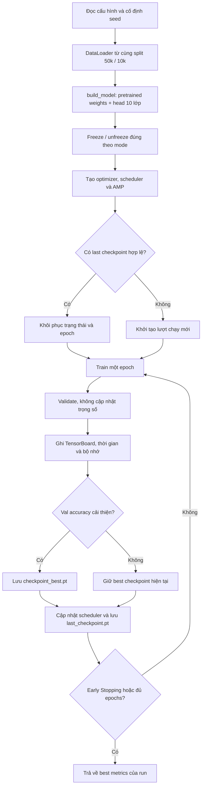

# Practice 2 — Đặc tả quy trình huấn luyện

*Transfer Learning · ResNet18 / VGG16 / DenseNet121 · PyTorch*

> **Vai trò tài liệu:** Nhóm quy định cách tổ chức sáu thí nghiệm, tối ưu trọng số, theo dõi TensorBoard, quản lý checkpoint và đo tài nguyên. Kiến trúc và các tầng được phép cập nhật tuân theo [`model.md`](model.md); dữ liệu tuân theo [`data.md`](data.md).

## 1. Mục tiêu và nguyên tắc thực nghiệm

So sánh ba kiến trúc pretrained trên Fashion-MNIST bằng hai chiến lược: **feature extraction** và **partial fine-tuning**. Vì mỗi kiến trúc có chi phí tính toán khác nhau, quá trình huấn luyện phải ghi nhận cả chất lượng dự đoán lẫn thời gian và bộ nhớ sử dụng

Các yêu cầu chung:

- Sáu run bắt buộc sử dụng cùng **50.000 ảnh train / 10.000 ảnh validation**, cùng split seed `1`, đầu vào `[B, 3, 224, 224]` và phép chuẩn hóa ImageNet. Seed khởi tạo và xáo trộn cho mỗi run , được đặt một lần lúc bắt đầu run, không đặt lại theo mỗi epoch.
- Mỗi run khởi tạo một model độc lập từ ImageNet `IMAGENET1K_V1`. Run fine-tuning tiếp tục từ checkpoint của run feature extraction.
- Mỗi run dùng cùng quy tắc đánh giá, lựa chọn checkpoint và Early Stopping. Các thông số thay đổi phải có ID thí nghiệm riêng.
- Không âm thầm giảm kích thước ảnh, đổi backbone, tắt pretrained weights hoặc bỏ qua run không chạy được.

## 2. Danh sách thí nghiệm và cấu hình mặc định

| Run ID | Kiến trúc | Chế độ | Tham số được cập nhật |
|---|---|---|---|
| `01_resnet18_feature_extract` | ResNet18 | Feature extraction | `fc` mới |
| `02_resnet18_fine_tune` | ResNet18 | Fine-tuning | `layer4` + `fc` mới |
| `03_vgg16_feature_extract` | VGG16 | Feature extraction | `classifier[6]` mới |
| `04_vgg16_fine_tune` | VGG16 | Fine-tuning | `features[24:]` + `classifier[6]` mới |
| `05_densenet121_feature_extract` | DenseNet121 | Feature extraction | `classifier` mới |
| `06_densenet121_fine_tune` | DenseNet121 | Fine-tuning | `denseblock4` + `norm5` + `classifier` mới |

Phạm vi freeze/unfreeze là hợp đồng bắt buộc trong [`model.md`](model.md). `Train.py` không được tự thay đổi danh sách này.

### Cấu hình tối ưu hóa đề xuất để triển khai lần đầu

| Tham số | Feature extraction | Partial fine-tuning |
|---|---:|---:|
| Optimizer | AdamW | AdamW |
| Learning rate của head mới | `1e-3` | `5e-4` |
| Learning rate của backbone được mở khóa | Không áp dụng | `1e-5` |
| Weight decay | `1e-4` | `1e-4` |
| Train batch size | `32` | `32` |
| Validation batch size | `64` | `64` |
| Giới hạn epochs | `20` | `20` |
| Scheduler | `CosineAnnealingLR` | `CosineAnnealingLR` |
| `T_max` / `eta_min` | `10` / `1e-6` | `10` / `1e-6` |
| Early Stopping | Patience `5` | Patience `5` |


## 3. Luồng huấn luyện bắt buộc



*Mỗi run có thư mục log và checkpoint riêng. Trạng thái của epoch cuối phải được ghi trước khi kết thúc vì Early Stopping.*

## 4. Loss, optimizer và cập nhật trọng số

Bài toán có 10 lớp và đầu ra là logits `[B, 10]`, nên nhóm chọn **Cross-Entropy Loss**, không thêm `Softmax` vào đầu ra của model và không gọi `softmax` trước `nn.CrossEntropyLoss()`.

$$
\mathcal{L}_{\mathrm{CE}}
=-\frac{1}{B}\sum_{i=1}^{B}
\log\frac{\exp(z_{i,y_i})}{\sum_{k=0}^{9}\exp(z_{i,k})}
$$

**Thiết lập mặc định:** `nn.CrossEntropyLoss(label_smoothing=0.0, reduction="mean")`. Chưa đưa class weights hoặc focal loss vào sáu run chính vì Fashion-MNIST có các lớp tương đối cân bằng; thử loss khác phải được định nghĩa thành thí nghiệm mới.

Một batch được xử lý theo thứ tự: `zero_grad` → forward → tính loss → backward → gradient clipping → optimizer step. Chỉ những tham số `requires_grad=True` mới được đưa vào optimizer:

- **Feature extraction:** một nhóm tham số head, LR `1e-3`.
- **Fine-tuning:** hai nhóm riêng: backbone được mở khóa với LR `1e-5`, head mới với LR `5e-4`.
- Gradient clipping: `max_norm=1.0`, áp dụng **sau khi unscale gradient** nếu dùng FP16 AMP.
- Scheduler cập nhật **một lần sau mỗi epoch**, không cập nhật theo từng batch.

### Mixed precision

Trên CUDA, mặc định bật AMP cho cả sáu run để giảm chi phí xử lý; sử dụng API `torch.amp.autocast("cuda")` và `torch.amp.GradScaler("cuda")` khi dùng FP16. Nếu không có CUDA, chạy FP32 và không bật CUDA AMP. AI cần ghi `device`, `amp_enabled` và dtype thực tế của mỗi run

Sau mỗi `model.train()`, phải áp dụng lại chính sách từ `model.md`: BatchNorm thuộc backbone giữ ở `eval()` để không cập nhật running statistics; Dropout trong các tầng pretrained đã đóng băng của VGG16 giữ `eval()`. Không chuyển toàn bộ model sang `eval()` trong bước training vì head và những tầng được mở khóa vẫn cần nhận gradient.

### Loss trung bình của một epoch

Loss của từng batch do `CrossEntropyLoss` trả về là **giá trị trung bình**, không phải tổng. Do batch cuối có thể ít ảnh hơn, phải tính trung bình theo số lượng mẫu:

$$
L_{\mathrm{epoch}}
=\frac{\sum_{b=1}^{M} n_b L_b}{\sum_{b=1}^{M} n_b}
$$

Trong đó `n_b` là số ảnh của batch `b`, `L_b` là loss trung bình của batch đó. Không lấy trung bình đơn giản của mọi `L_b` nếu kích thước batch không bằng nhau.

## 5. Validation, lưu mô hình tốt nhất và dừng sớm

Sau mỗi epoch, chạy trên **toàn bộ 10.000 ảnh validation** với `model.eval()` và `torch.inference_mode()`. Không gọi backward, không cập nhật optimizer và không áp dụng augmentation ngẫu nhiên. Model phải được chuyển lại sang chế độ train đúng chính sách freeze ở epoch tiếp theo.

| Quyết định | Tiêu chí được chốt |
|---|---|
| Best checkpoint của một run | **Validation accuracy cao nhất**; chỉ cập nhật khi lớn hơn `best_accuracy` trước đó |
| Early Stopping | **Validation loss** không cải thiện ít nhất `1e-4` trong `3` epochs liên tiếp |
| Global-best giữa sáu run | So sánh **best validation accuracy** của từng run; nếu bằng nhau, ưu tiên macro F1 cao hơn |

Accuracy, loss, precision, recall và F1 dùng để mô tả **cùng epoch của best checkpoint**. Không ghép `best accuracy` của epoch này với `minimum loss` của epoch khác thành một hàng dữ liệu. `best_epoch` phải lưu theo quy ước **bắt đầu từ 1**.

Khi kiểm tra Early Stopping, cần ghi log và lưu checkpoint của epoch hiện tại **trước** khi `break`. Dừng sớm không có nghĩa là lấy trọng số epoch cuối; đầu ra dùng để so sánh là `checkpoint_best.pt`.

## 6. Checkpoint và tiếp tục huấn luyện

Đề xuất cây thư mục:

```text
LAB2/
├── checkpoints/
│   ├── 01_resnet18_feature_extract/
│   │   ├── checkpoint_best.pt
│   │   └── last_checkpoint.pt
│   ├── 02_resnet18_fine_tune/
│   ├── 03_vgg16_feature_extract/
│   ├── 04_vgg16_fine_tune/
│   ├── 05_densenet121_feature_extract/
│   ├── 06_densenet121_fine_tune/
│   └── checkpoint_best_global.pt
├── logs/<run_id>/
└── reports/
```

Mỗi checkpoint cần lưu **ít nhất**: `run_id`, `architecture`, `mode`, `epoch`, `config`, `model_state_dict`, `optimizer_state_dict`, `scheduler_state_dict`, `scaler_state_dict` (nếu AMP), `best_epoch`, `best_accuracy`, `best_metrics`, `best_val_loss` và `early_stopping_counter`. `last_checkpoint.pt` phải đủ để resume; `checkpoint_best.pt` phải đủ để khôi phục model cho inference.

Quy tắc resume:

1. Kiểm tra `run_id`, pretrained weights, input size và cấu hình optimizer/scheduler khớp với checkpoint trước khi tiếp tục.
2. Khôi phục model, optimizer, scheduler, AMP scaler, epoch và trạng thái Early Stopping; không chỉ tải trọng số model.
3. Không load `checkpoint_best.pt` chồng lên model vừa khôi phục từ `last_checkpoint.pt`.
4. Lưu file qua đường dẫn tạm rồi `os.replace()` để hạn chế checkpoint hỏng khi ghi dở.
5. Nếu thay learning rate, chế độ fine-tuning hoặc số epochs mục tiêu, ghi thành **run mới** thay vì giả định resume tương đương tiếp tục lượt chạy cũ.

Để tăng tính tái lập, lưu cả seed, phiên bản PyTorch/torchvision, định danh GPU và trạng thái RNG nếu cần resume sát với lần chạy liên tục. Chỉ tải checkpoint từ nguồn đáng tin cậy.

## 7. TensorBoard, thời gian và bộ nhớ

Mỗi run phải có log riêng. Những trường sau là **đầu ra bắt buộc của `Train.py`**, không chỉ là gợi ý:

| Nhóm log | Dữ liệu cần ghi |
|---|---|
| `Loss/train_epoch`, `Loss/validation` | Loss trung bình trên toàn bộ ảnh của tập tương ứng, theo epoch |
| `Validation/accuracy`, `Validation/f1_macro` | Chất lượng phân loại trên validation |
| `Validation/precision_macro`, `Validation/recall_macro` | Chỉ số bổ sung để phân tích các lớp |
| `Optimization/lr_head`, `Optimization/lr_backbone` | Learning rate thực tế của từng nhóm trainable (bỏ lr backbone nếu feature extraction) |
| `Performance/train_seconds`, `Performance/val_seconds` | **Thời gian riêng** cho train và validation ở mỗi epoch |
| `Performance/train_images_per_second`, `Performance/val_images_per_second` | Thông lượng thực tế, tính bằng số ảnh / thời gian tương ứng |
| `Resources/train_peak_cuda_allocated_mib`, `Resources/val_peak_cuda_allocated_mib` | Peak VRAM tensor đo riêng cho hai giai đoạn (CUDA) |
| `Resources/train_peak_cuda_reserved_mib`, `Resources/val_peak_cuda_reserved_mib` | Peak bộ nhớ PyTorch allocator dành riêng trên GPU |
| `Resources/cpu_rss_observed_peak_mib` | RSS lớn nhất quan sát được khi lấy mẫu trong run (nếu có `psutil`) |

**Quy tắc đo:** dùng `time.perf_counter()`; trên CUDA gọi `torch.cuda.synchronize()` trước và sau đoạn cần đo để tránh sai số do GPU chạy bất đồng bộ. Đặt lại peak thống kê CUDA **riêng trước train và trước validation**, sau đó đọc `max_memory_allocated()` và `max_memory_reserved()` khi từng giai đoạn kết thúc. Nếu dùng `psutil`, lấy mẫu RSS trong các batch và ghi **đỉnh RSS quan sát được**, không gọi đó là đỉnh RAM tuyệt đối của hệ thống. Đo thời gian train/validation **không gồm** lần tải pretrained weights từ Internet hay thời gian tạo model. Nếu không có CUDA hoặc không đo được RAM, ghi `N/A` — tuyệt đối **không thay bằng ước lượng từ số tham số**.

Ngoài TensorBoard, xuất `reports/run_summary.csv` gồm `run_id`, mode, best epoch, best accuracy/F1/loss, số tham số tổng/trainable, số epochs thực tế, tổng thời gian train, tổng thời gian validation, thông lượng và peak RAM/VRAM nếu đo được. Phần phân tích, xếp hạng và trực quan hóa dữ liệu này thuộc [`evaluation.md`](evaluation.md), không viết kết luận thực nghiệm trong tài liệu thiết kế.

## 8. Điều chỉnh hyperparameters có kiểm soát

Sau sáu run cốt lõi, nhóm cần khảo sát **learning rate và batch size** theo yêu cầu bài thực hành. Để tiết kiệm thời gian, dùng `02_resnet18_fine_tune` làm cấu hình đối chứng và tạo các run riêng:

| Run bổ sung | Thay đổi duy nhất so với `02_resnet18_fine_tune` | Mục đích |
|---|---|---|
| `07_resnet18_fine_tune_lr` | LR head `2e-4`, LR backbone giữ `1e-5` | Kiểm tra ảnh hưởng LR của head |
| `08_resnet18_fine_tune_bs8` | Train batch size `8` thay vì `16` | Kiểm tra ảnh hưởng batch size |

Tất cả yếu tố khác (data split, weights, augmentation, optimizer, seed và tiêu chí chọn best) phải giữ nguyên. Nếu muốn đánh giá độ ổn định thay vì một lần chạy ngẫu nhiên, bổ sung các seed khác như thí nghiệm độc lập, không ghi đè kết quả cũ.

## 9. Hợp đồng triển khai và tiêu chí nghiệm thu

`Train.py` cần có các chức năng tối thiểu: xây dựng DataLoader theo `data.md`, tạo model qua `build_model()` của `Model.py`, cấu hình optimizer theo chế độ, train một epoch, validate, ghi TensorBoard, quản lý checkpoint/resume và điều phối danh sách thí nghiệm. Code phải hỗ trợ chạy **một run bằng ID** hoặc **toàn bộ sáu run**; có tùy chọn `--run`, `--epochs`, `--train-batch-size`, `--workers`, `--device`, `--fresh`/`--resume` được kiểm tra hợp lệ. Không cần tạo quá nhiều hàm nhỏ nếu không giúp rõ trách nhiệm.

AI chỉ được coi phần huấn luyện đáp ứng đặc tả khi:

- [ ] Cả 6 run khởi tạo độc lập với pretrained weights ImageNet đúng phiên bản và trả về logits `[B, 10]`.
- [ ] Chỉ đúng các tham số được phép trong [`model.md`](model.md) nhận gradient; BatchNorm/Dropout của phần frozen không thay đổi trạng thái ngoài dự kiến.
- [ ] Training và validation dùng cùng split nhưng transform khác nhau; tập test chưa được sử dụng.
- [ ] Optimizer có nhóm LR đúng cho head và backbone; scheduler cập nhật theo epoch; AMP và gradient clipping không gây lỗi.
- [ ] Train/validation loss tính theo số ảnh; accuracy và macro F1 được tính trên toàn bộ validation.
- [ ] `checkpoint_best.pt` lưu đúng epoch đạt validation accuracy cao nhất; `last_checkpoint.pt` khôi phục được tiến độ, scheduler, AMP và Early Stopping.
- [ ] TensorBoard cho thấy loss, accuracy, learning rate, **thời gian train/validation riêng** và **peak VRAM/RAM thực đo hoặc N/A**.
- [ ] Báo cáo CSV có đủ sáu run, số tham số trainable, epochs thực tế và thông tin phần cứng; không đưa số liệu giả định vào kết quả thực nghiệm.
- [ ] Có bài chạy thử **1 batch forward/backward + 1 lượt validation ngắn** trước khi khởi động sáu thí nghiệm đầy đủ; phát hiện lỗi shape, freeze và OOM sớm.

**Đầu ra mong đợi:** `Train.py` có thể chạy và resume từng run, tạo checkpoint/log/CSV nhất quán; các số liệu đủ để đối chiếu chiến lược feature extraction và fine-tuning trong `evaluation.md` mà không cần truy ngược đo thủ công.

---

**Tham chiếu kỹ thuật:** [PyTorch AMP](https://docs.pytorch.org/docs/stable/amp.html) · [PyTorch CUDA memory statistics](https://docs.pytorch.org/docs/stable/generated/torch.cuda.memory.max_memory_allocated.html) · [TensorBoard trong PyTorch](https://docs.pytorch.org/docs/stable/tensorboard.html).
