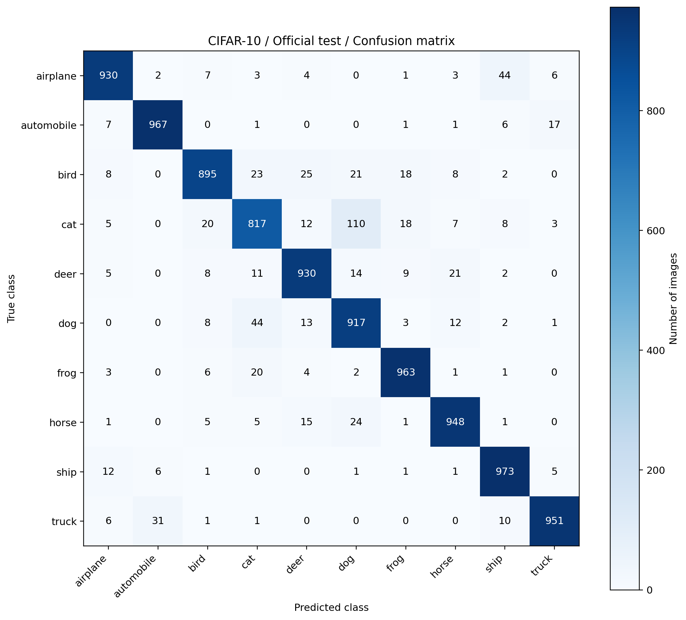
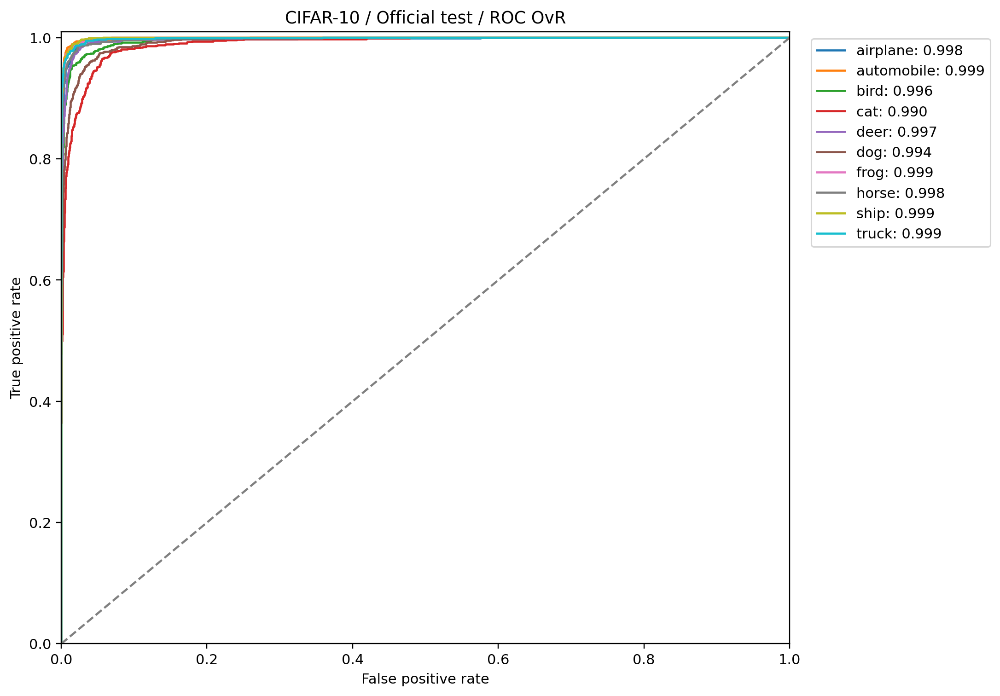
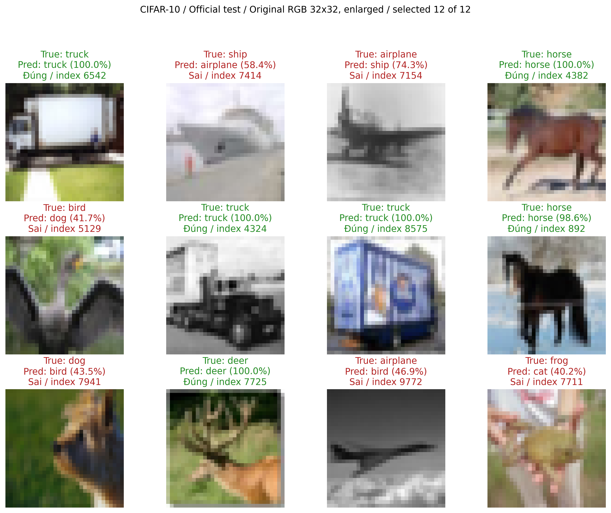

# LAB2 — Official test

Run `02_resnet18_fine_tune` · epoch 10 · checkpoint SHA-256 `b55b143e53b08e5d14f304c4b5196848c1127db04dac81e2b497e65fa1de02a7`

| Metric | Value |
|---|---:|
| samples | 10000 |
| correct_count | 9291 |
| incorrect_count | 709 |
| loss | 0.2572464696280658 |
| accuracy | 0.9291 |
| precision_macro | 0.9296632190497546 |
| recall_macro | 0.9291 |
| f1_macro | 0.9289544187456645 |
| fpr_macro | 0.007877777777777779 |
| auc_macro_ovr | 0.9967950277777777 |
| auc_micro_ovr | 0.9971903166666666 |

Validation metrics được lưu riêng trong JSON. Confidence chưa hiệu chỉnh. Gallery chỉ là minh họa.

- cat → dog: 110 ảnh.
- dog → cat: 44 ảnh.
- airplane → ship: 44 ảnh.
- truck → automobile: 31 ảnh.
- bird → deer: 25 ảnh.

[PDF](../Predict_Report.pdf)
