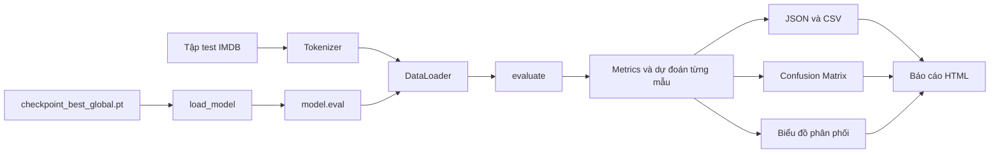

# Demo phân tích cảm xúc bằng Predict.py

## 1. Vai trò của Predict.py

`Predict.py` là script kiểm thử cuối cùng của mô hình. Script tải checkpoint tốt nhất theo validation, chạy toàn bộ tập test chính thức, tính metrics tổng thể và theo từng lớp, sau đó xuất các file báo cáo, biểu đồ và danh sách dự đoán.

Script không huấn luyện lại hoặc cập nhật trọng số mô hình. Nó chỉ khôi phục checkpoint đã chọn và chuyển mô hình sang chế độ `eval()` để suy luận.

## 2. Đầu vào

| Thành phần | Giá trị |
|---|---|
| Mô hình | `distilbert-base-uncased` đã fine-tuning (Bài 2) hoặc pipeline pretrained (Bài 1) |
| Checkpoint | `checkpoints/checkpoint_best_global.pt` |
| Dữ liệu | Tập test IMDB chính thức (25.000 mẫu) |
| Tiền xử lý | Cùng tokenizer và preprocessing đã lưu cùng checkpoint |
| Batch size | 32 |
| Thiết bị | CUDA nếu có, ngược lại CPU |

Các đường dẫn trong script được tạo tương đối theo thư mục chứa `Predict.py`, nên script không phụ thuộc vào thư mục terminal hiện tại.

## 3. Luồng xử lý



## 4. Các chức năng chính

- Kiểm tra checkpoint có tồn tại hay không.
- Đọc kiến trúc và config từ checkpoint.
- Khởi tạo lại mô hình và tokenizer.
- Nạp `model_state_dict` bằng chế độ `strict=True`.
- Chuyển mô hình sang thiết bị đã chọn và gọi `eval()`.
- Tính tổng Cross-Entropy loss trên toàn bộ tập test.
- Tính accuracy, Macro Precision/Recall/F1, confusion matrix.
- Lưu nhãn thật, nhãn dự đoán, xác suất và confusion matrix.

Vẽ confusion matrix:
- Hàng biểu diễn nhãn thật; cột biểu diễn nhãn dự đoán.
- Ô ngoài đường chéo là số lượng mẫu bị phân loại sai.

## 5. Output được tạo ra

```text
reports/
├── Predict_Report.html
└── test/
    ├── test_metrics.json
    ├── test_predictions.csv
    ├── confusion_matrix.png
    └── prediction_distribution.png
```

Ý nghĩa từng file:
- `test_metrics.json`: accuracy, loss, precision, recall, F1 và classification report của hai lớp.
- `test_predictions.csv`: từng mẫu với index, nhãn thật, nhãn dự đoán, confidence và cờ đúng/sai.
- `confusion_matrix.png`: ma trận lỗi trên toàn bộ tập test.
- `prediction_distribution.png`: phân phối dự đoán theo hai lớp cảm xúc.
- `Predict_Report.html`: báo cáo tổng hợp các kết quả và biểu đồ của lần test (tự chứa, mở ngoại tuyến được).

## 6. Báo cáo HTML

Báo cáo HTML được sinh tự động từ `test_metrics.json` và các artifact trong `reports/test/`. File HTML:

- **Tự chứa:** không cần internet, không dùng CDN, mở ngoại tuyến được.
- **Bảng metrics tổng thể:** accuracy, loss, precision, recall, F1, confusion matrix.
- **Bảng theo từng lớp:** precision, recall, F1, support cho negative và positive.
- **Hình ảnh:** nhúng confusion matrix và phân phối dự đoán.
- **Tiếng Việt:** hỗ trợ hiển thị tiếng Việt, mở được trên trình duyệt bất kỳ.

Phân tích số liệu kết quả được trình bày tại [evaluation.md](evaluation.md).