# LAB 3 · Phân tích cảm xúc văn bản với Hugging Face

### Suy luận và fine-tuning mô hình pretrained trên Hugging Face Hub

> **Tổng quan dự án**  
> Xây dựng quy trình phân tích cảm xúc (sentiment analysis) bằng các mô hình ngôn ngữ pretrained từ Hugging Face Hub. Thực hiện hai bài tập: (1) suy luận cảm xúc trên câu văn mẫu với pipeline sẵn có, (2) fine-tuning mô hình pretrained cho phân loại văn bản nhị phân trên Dataset IMDB và đánh giá kết quả.

## 1. Mục tiêu bài LAB

- Nạp và sử dụng pipeline/pretrained model từ Hugging Face Hub.
- Tokenize văn bản đầu vào và thực hiện suy luận cảm xúc.
- Tải Dataset IMDB cho phân loại văn bản nhị phân, tiền xử lý phù hợp với mô hình.
- Định nghĩa `TrainingArguments`, tạo `Trainer`, fine-tuning mô hình `distilbert-base-uncased`.
- Đánh giá mô hình đã fine-tuning (accuracy, F1, confusion matrix, classification report).
- Xuất báo cáo HTML tổng hợp kết quả thực nghiệm.

Phạm vi thực nghiệm:
- Thống nhất dữ liệu và quy trình đánh giá giữa hai bài tập, chi tiết tại [data.md](data.md) và [trainning.md](trainning.md).
- Chọn checkpoint bằng validation accuracy. Kết quả trình bày tại [evaluation.md](evaluation.md) và [demo.md](demo.md).

## 2. Quy trình thực hiện

```mermaid
flowchart LR
    A[Khảo sát Hugging Face Hub và Dataset IMDB] --> B[Tiền xử lý và tokenize văn bản]
    B --> C[Bài 1: Suy luận cảm xúc với pipeline pretrained]
    C --> D[Bài 2: Fine-tuning distilbert-base-uncased trên IMDB]
    D --> E[Validation và theo dõi quá trình huấn luyện]
    E --> F[Chọn best checkpoint]
    F --> G[Đánh giá trên tập test và xuất báo cáo HTML]
    G --> H[Báo cáo kết quả dự đoán]
```

Báo cáo EDA và mô tả dữ liệu được trình bày tại [data.md](data.md). Quy trình train và chọn checkpoint nằm trong [trainning.md](trainning.md), phần demo và kết quả demo được trình bày tại [demo.md](demo.md).

## 3. Phạm vi các mô hình

| Thí expériment | Mô hình | Dataset | Hướng so sánh |
|---|---|---|---|
| **Bài 1** | `distilbert-base-uncased` (pipeline pretrained) | IMDB (sample câu văn) | Suy luận cảm xúc trên câu mẫu, không huấn luyện |
| **Bài 2** | `distilbert-base-uncased` (fine-tuning) | IMDB (train/validation/test) | Huấn luyện trên Dataset nhị phân, đánh giá test |

Chi tiết về kiến trúc, tham số và các điểm cần đối chiếu với source đặt tại [model.md](model.md) và [trainning.md](trainning.md). Không quy mọi chênh lệch kết quả cho riêng kiến trúc khi một cấu hình thay đổi đồng thời nhiều hyperparameter.

## 4. Source và tài liệu liên quan

| Thành phần | Source (tham chiếu) | Tài liệu chuyên trách |
|---|---|---|
| Dữ liệu và EDA | `EDA.py`, `data.py` | [data.md](data.md) |
| Xây dựng mô hình và tokenizer | `model.py` | [model.md](model.md) |
| Huấn luyện, TensorBoard, checkpoint | `train.py` | [trainning.md](trainning.md) |
| Ghi lịch sử và báo cáo HTML | `TrainReport.py` | [trainning.md](trainning.md), [evaluation.md](evaluation.md) |
| Dự đoán và xuất báo cáo HTML | `Predict.py`, `PredictPDF.py` | [demo.md](demo.md) |
| Đánh giá và so sánh hai bài tập | `Evaluate.py` | [evaluation.md](evaluation.md) |
| Kiểm tra tính nhất quán và tiến độ | — | [plan-progression.md](plan-progression.md) |

Phần cài đặt, hướng dẫn chạy và cấu trúc repository được trình bày trong [README.md](../../README.md); không lặp lại tại đây.