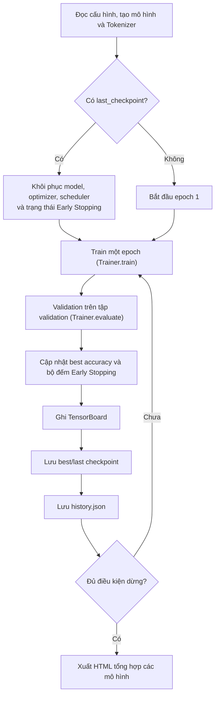

# Thiết kế quy trình huấn luyện — Phân tích cảm xúc Hugging Face

> **Vai trò tài liệu:** Quy định cách nhóm triển khai, theo dõi và kiểm tra quá trình huấn luyện. Bảng kết quả và phân tích thực nghiệm được trình bày trong [evaluation.md](evaluation.md).

## 1. Định hướng huấn luyện

Sử dụng một quy trình training/validation chung cho hai bài tập. Phép chia dữ liệu và preprocessing được thống nhất theo [data.md](data.md); thiết kế mô hình được trình bày tại [model.md](model.md).

## 2. Luồng xử lý tổng thể



*Luồng trong [train.py](../../train.py). Epoch cuối vẫn được ghi log, checkpoint và lịch sử trước khi dừng sớm.*

## 3. Thư viện sử dụng

| Thư viện | Vai trò |
|---|---|
| `transformers` | `AutoModelForSequenceClassification`, `AutoTokenizer`, `Trainer`, `TrainingArguments` |
| `datasets` | `load_dataset("imdb")`, `map` để tokenize |
| `evaluate` | `load_metric("accuracy")`, `load_metric("f1")` |
| `torch` | Backend tensor, `nn.Module`, `optim.AdamW` |
| `tensorboard` | Ghi log train/validation qua `SummaryWriter` |

## 4. Điều kiện huấn luyện chung

| Thiết lập | Giá trị tham khảo |
|---|---|
| Dataset | IMDB qua `datasets.load_dataset("imdb")` |
| Mô hình | `distilbert-base-uncased` |
| Tokenizer | `DistilBertTokenizer.from_pretrained("distilbert-base-uncased")` |
| Optimizer | `AdamW` (tự tạo trong `Trainer`) |
| Loss training | `CrossEntropyLoss` (tự tạo trong `Trainer`) |
| Epoch tối đa | 3 |
| Batch size train / evaluation | 16 / 32 |
| Early Stopping | Patience 2, theo validation loss |
| Learning rate | 2e-5 |
| Weight decay | 0.01 |
| Warmup steps | 500 |
| Seed khởi tạo | 42 |
| DataLoader workers | 0 |
| Device | `cuda` nếu có; ngược lại `cpu` |
| Mixed precision | `fp16` nếu CUDA, khác `fp32` |

## 5. Cấu hình TrainingArguments

| Tham số | Giá trị |
|---|---|
| `output_dir` | `./checkpoints/<run_id>` |
| `num_train_epochs` | 3 |
| `per_device_train_batch_size` | 16 |
| `per_device_eval_batch_size` | 32 |
| `learning_rate` | 2e-5 |
| `weight_decay` | 0.01 |
| `warmup_steps` | 500 |
| `logging_dir` | `./logs/<run_id>` |
| `logging_steps` | 100 |
| `evaluation_strategy` | `epoch` |
| `save_strategy` | `epoch` |
| `load_best_model_at_end` | `True` |
| `metric_for_best_model` | `accuracy` |
| `greater_is_better` | `True` |
| `seed` | 42 |
| `fp16` | `True` nếu CUDA, khác `False` |

## 6. Trainer và compute_metrics

```python
trainer = Trainer(
    model=model,
    args=training_args,
    train_dataset=tokenized_train,
    eval_dataset=tokenized_val,
    compute_metrics=compute_metrics,
)
```

Hàm `compute_metrics` tính:
- `accuracy`: tỷ lệ dự đoán đúng
- `f1`: F1 macro (nhị phân)
- `precision`: precision macro
- `recall`: recall macro

Sử dụng `evaluate.load_metric("accuracy")` và `evaluate.load_metric("f1")`.

## 7. Quy trình training

1. Tải Dataset IMDB qua `datasets.load_dataset("imdb")`.
2. Chia train fit / validation / test theo [data.md](data.md).
3. Tạo `DistilBertTokenizer` và tokenize toàn bộ tập (truncation, padding).
4. Khởi tạo `AutoModelForSequenceClassification` với `num_labels=2`.
5. Định nghĩa `TrainingArguments` theo bảng mục 5.
6. Tạo `Trainer` với `compute_metrics`.
7. Gọi `trainer.train()` — training sẽ tự động chạy theo epoch, validation và lưu checkpoint.
8. Áp dụng Early Stopping khi validation loss không cải thiện trong 2 epoch liên tiếp.
9. Lưu `last_checkpoint.pt` để phục vụ resume.

## 8. Validation, checkpoint và Early Stopping

| Quyết định | Tiêu chí | Quy tắc |
|:---|---|:---|
| Best checkpoint | Validation accuracy | Lưu khi lớn hơn best accuracy trước đó |
| Early Stopping | Validation loss | Dừng sau 2 epochs liên tiếp không giảm |
| Global best | Best validation accuracy | So sánh các mô hình bằng max theo accuracy |

| File | Vai trò |
|---|---|
| `checkpoints/<run>/checkpoint_best.pt` | Trọng số và metrics tại epoch có validation accuracy cao nhất |
| `checkpoints/<run>/last_checkpoint.pt` | Phục vụ resume từ epoch đã hoàn thành |
| `checkpoints/checkpoint_best_global.pt` | Bản sao best checkpoint của mô hình dẫn đầu |

Checkpoint chứa `epoch`, `config`, `model_state_dict`, `optimizer_state_dict`, `scheduler_state_dict`, `best_acc` và `best_metrics`.

## 9. Theo dõi bằng TensorBoard và báo cáo HTML

Training ghi log vào `logs/<run>/` qua `SummaryWriter`. Các nhóm log:
- `Loss/train`, `Loss/eval`
- `Accuracy/train`, `Accuracy/eval`
- `F1/train`, `F1/eval`
- `Learning_rate`
- `Time/train_seconds`, `Time/eval_seconds`

Lưu `reports/<run>/history.json` sau từng epoch và xuất `reports/<run>/report.html` khi run kết thúc. Sau khi hoàn thành, tạo `reports/report_all_models.html` tổng hợp.

HTML được tạo từ `history.json`, không phải chuyển đổi trực tiếp TensorBoard event files. Có thể dựng lại từ history đã lưu bằng cách chạy `python TrainReport.py ./reports` tại thư mục `LAB3/`.

## 10. Điều kiện hoàn thành

- [ ] Cấu hình run trong checkpoint tương ứng với [model.md](model.md).
- [ ] train/validation dùng cùng split; validation không cập nhật gradient.
- [ ] TensorBoard ghi đúng loss, accuracy, F1, learning rate theo các tag trong source.
- [ ] Best checkpoint lấy theo accuracy và mọi metric đi kèm thuộc đúng epoch đó.
- [ ] Đảm bảo hoạt động resume khôi phục model, optimizer, scheduler, trạng thái dừng sớm.
- [ ] Early Stopping không làm mất log, `history.json` hay checkpoint của epoch cuối.
- [ ] Mở `report_all_models.html`, kiểm tra đủ các mô hình khi đã có đủ history.