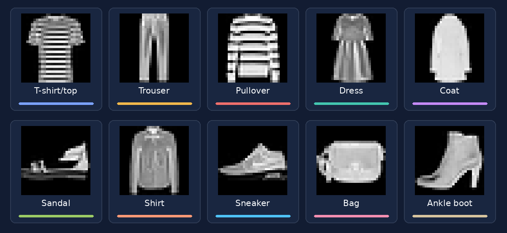
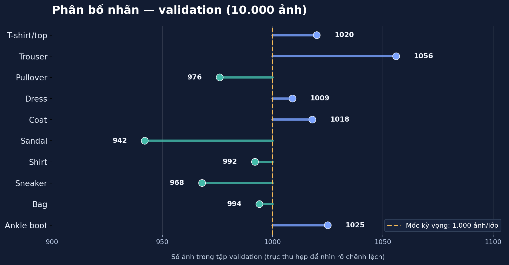
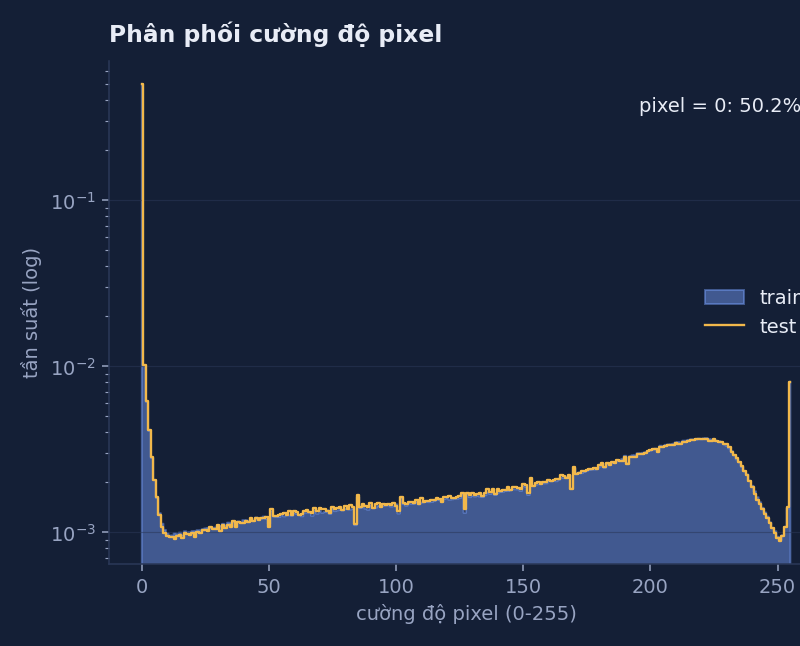
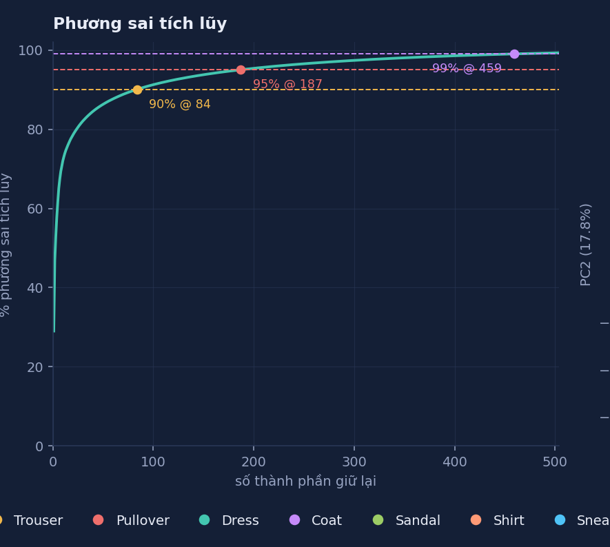
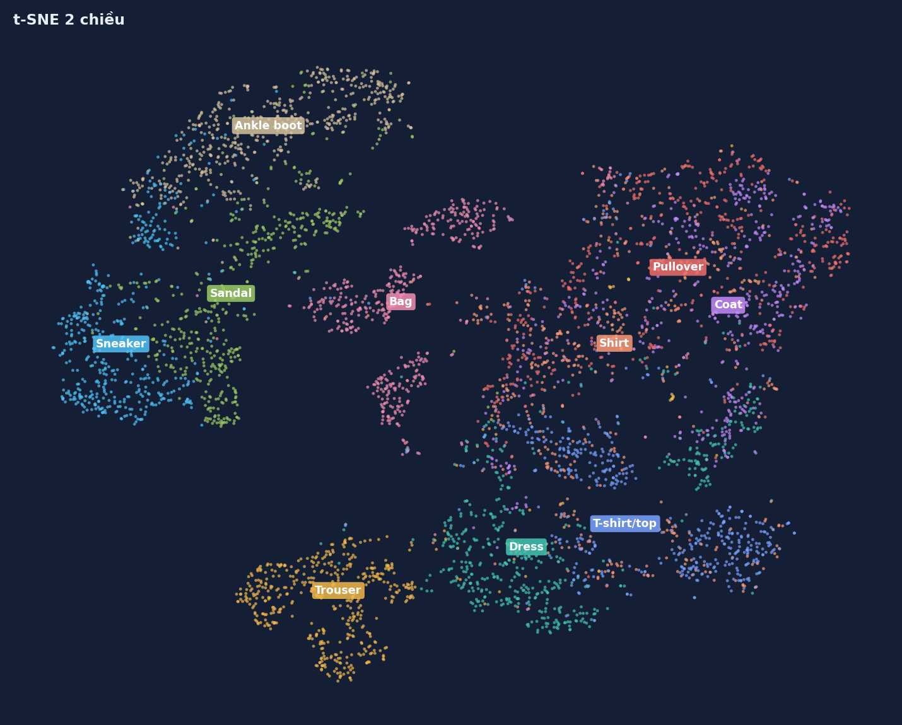

# Dữ liệu và phân tích khám phá — Fashion-MNIST

*Báo cáo dữ liệu sử dụng cho phân loại ảnh bằng mạng MLP*

Mục tiêu khảo sát : dữ liệu có cân bằng giữa các lớp hay không, những loại trang phục nào dễ bị nhầm lẫn và lựa chọn cách tiền xử lý phù hợp với đặc điểm ảnh

## 1. Bộ dữ liệu được sử dụng

Fashion-MNIST gồm 70.000 ảnh xám kích thước 28 × 28 pixel, chia sẵn thành 60.000 ảnh huấn luyện và 10.000 ảnh kiểm thử. Mỗi ảnh thuộc một trong mười nhóm sản phẩm thời trang, được đánh nhãn từ `0` đến `9`. Ảnh gốc lưu pixel dưới dạng số nguyên từ `0` đến `255`.

*Hình 1. Mỗi lớp được minh họa bằng một ảnh lấy từ dữ liệu trong báo cáo EDA. Ở kích thước 28 × 28, một số loại áo có đường nét rất giống nhau.*

`10 nhãn gồm T-shirt/top, Trouser, Pullover, Dress, Coat, Sandal, Shirt, Sneaker, Bag và Ankle boot.` 

## 2. Phân chia dữ liệu

| Tập dữ liệu | Số ảnh | Mục đích sử dụng |
|---|---:|---|
| **Training** | **50.000** | Cập nhật trọng số của MLP |
| **Validation** | **10.000** | Theo dõi loss, metrics, early stopping và chọn checkpoint |
| **Test chính thức** | **10.000** | Giữ riêng; `Predict.py` hiện lấy ảnh từ tập này để minh họa dự đoán |

### Phân bố nhãn

Bộ train gốc có đúng 6.000 ảnh cho mỗi lớp. Số lượng ảnh validation ở mỗi lớp có sự lệch nhỏ nhưng không quá lớn so với quy mô dữ liệu 

*Hình 2. Phân bố 10.000 ảnh validation theo từng lớp*

Vì dữ liệu tương đối cân bằng nên chọn accuracy làm chỉ số để theo dõi kết quả tổng thể. Cùng với đó vẫn sử dụng precision, recall và F1 ở bước đánh giá, bởi một mô hình có accuracy tốt chưa chắc dự đoán đồng đều trên tất cả các lớp. Phần định nghĩa và so sánh các chỉ số được trình bày trong [`evaluation.md`](evaluation.md).

## 3. Tiền xử lý ảnh

Các ảnh có cùng kích thước nên không cần resize. Hai bước luôn được áp dụng là chuyển ảnh thành tensor và chuẩn hóa giá trị pixel. Riêng tập training có thêm phép lật ngang ngẫu nhiên nhằm tăng độ đa dạng khi học.

| Bước xử lý | Training | Validation / Test |
|---|---|---|
| Lật ngang ngẫu nhiên | `RandomHorizontalFlip()` | Không áp dụng |
| Chuyển ảnh sang tensor | `ToTensor()` | `ToTensor()` |
| Chuẩn hóa | `Normalize((0,286,), (0,353,))` | `Normalize((0,286,), (0,353,))` |

`ToTensor()` đưa pixel về khoảng `[0, 1]`. Sau đó, `Normalize((0,286,), (0,353,))` biến đổi giá trị theo công thức:

$$
x' = \frac{x-0,286}{0,353}, \qquad x \in [0,1].
$$

Cho nên ảnh được đưa về khoảng `[-1, 1]` trước khi đi qua MLP. Với một batch gồm `B` ảnh, đầu vào có kích thước `[B, 1, 28, 28]` và được tầng `Flatten` chuyển thành `[B, 784]`. Cùng với đó nhóm tăng cường ảnh ở tập training. Validation và test sử dụng ảnh không bị biến đổi ngẫu nhiên, để kết quả đánh giá không phụ thuộc vào một lần lật ảnh bất kỳ.

## 4. Kết quả khảo sát dữ liệu (EDA)

### 4.1. Độ sáng và phân bố pixel

Khi phân tích ảnh gốc trước chuẩn hóa, Nhóm nhận thấy nền đen chiếm tỷ lệ đáng kể. Báo cáo EDA ghi nhận khoảng **50,2% số pixel của tập train bằng 0**. Điều này cho thấy sản phẩm thường nằm giữa ảnh và được bao quanh bởi vùng nền 

*Hình 3. Phân bố cường độ pixel của train và test  trong báo cáo EDA*

Báo cáo cũng cho biết pixel mean và standard deviation (trên thang `[0, 1]`) lần lượt là **0,2860 và 0,3530** ở tập train gốc; tập test có các giá trị tương ứng **0,2868 và 0,3524**.

### 4.2. Sự tương đồng giữa các lớp

 Trong báo cáo EDA, khi so sánh ảnh trung bình của mỗi lớp theo khoảng cách Euclid, ba cặp gần nhau nhất là:

| Cặp lớp | Khoảng cách Euclid giữa ảnh trung bình |
|---|---:|
| Pullover – Coat | **2,48** |
| Pullover – Shirt | **2,68** |
| Coat – Shirt | **3,02** |

Các khoảng cách này cho thấy hình dạng tổng quát của những lớp trên khá giống nhau ở không gian pixel. Một thông tin quan trọng để kết hợp với coonffusion matrix từ kết quả dự đoán để biết được lớp nào thường bị nhầm với nhóm nào nhất 

### 4.3. PCA

Mỗi ảnh 28 × 28 được trải phẳng thành vector 784 chiều. Nhóm dùng kết quả PCA trong báo cáo EDA để xem phương sai tập trung ở bao nhiêu thành phần chính. Kết quả cho thấy chỉ cần **84 thành phần để giữ 90% phương sai**, **187 thành phần để giữ 95%** và **459 thành phần để giữ 99%**.

*Hình 4. Tỷ lệ phương sai tích lũy theo số thành phần chính*

Như vậy các pixel không hoàn toàn độc lập: nhiều vị trí cùng thay đổi theo hình dạng, độ sáng hoặc kích thước vùng sản phẩm. Nhưng việc giữ lại 95% phương sai không đồng nghĩa giữ lại 95% thông tin phân loại. Trong phạm vi LAB này, không áp dụng PCA trước khi train do mục tiêu là so sánh các mạng MLP trên cùng đầu vào gốc 784 chiều.

### 4.4. Quan sát các cụm dữ liệu bằng t-SNE

Để hình dung mức độ tách biệt giữa các lớp, báo cáo EDA sử dụng **5.000 ảnh train**, giảm trước về 50 chiều bằng PCA, sau đó biểu diễn bằng t-SNE trên mặt phẳng hai chiều.

*Hình 5. Phép chiếu t-SNE trong báo cáo EDA*

Trên bản đồ này, các nhóm giày, túi và quần hình thành những vùng tương đối dễ nhận diện. Ngược lại, Pullover, Coat và Shirt chồng lấn nhiều hơn. Quan sát này nhất quán với phân tích độ tương đồng của ảnh trung bình và cho thấy nhóm áo là nơi cần tập trung khi đánh giá chất lượng mô hình.

## 5. Mục tiêu chính
    Đánh giá tác động của kiến trúc mạng, Nhóm giữ nguyên phép chia 50.000/10.000 và cùng một quy trình tiền xử lý cho tất cả các thí nghiệm. Nhờ đó, khi các mô hình cho kết quả khác nhau, việc đối chiếu sẽ có cơ sở hơn so với trường hợp mỗi mô hình được train trên một tập dữ liệu khác nhau.

