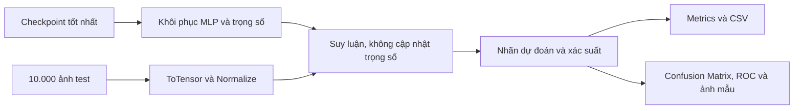
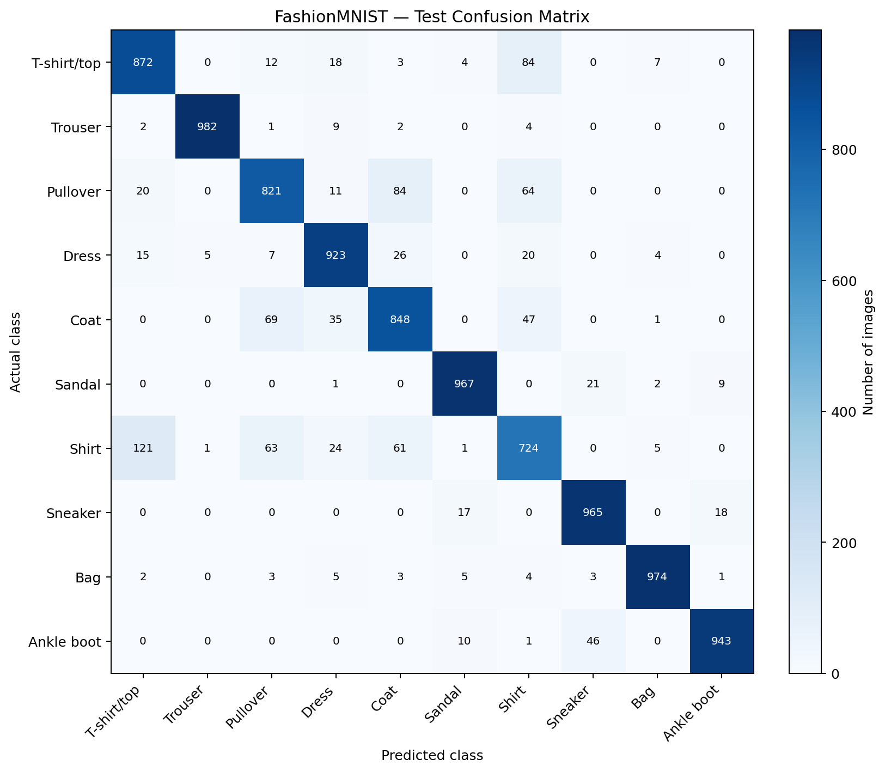
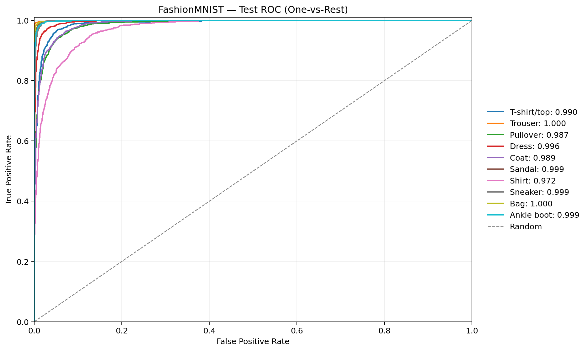
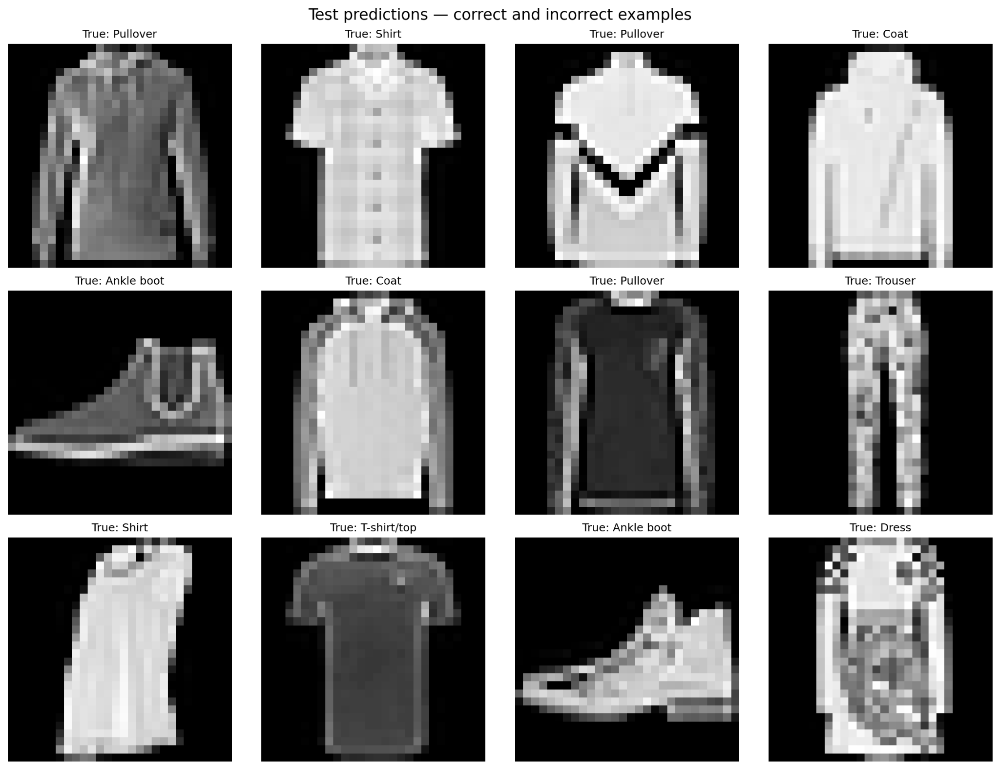

# Demo và kiểm thử mô hình trên Fashion-MNIST 

## 1. Mô hình được sử dụng trong demo

Mô hình được lựa chọn là **`04_batchnorm_mlp`**, với trọng số lưu ở epoch 18. Nhóm dùng checkpoint tốt nhất đã chọn qua validation, sau đó đánh giá một lần trên tập 10.000 ảnh test  của Fashion-MNIST. Tập test này không sử dụng để điều chỉnh cấu hình hoặc chọn lại mô hình.

| Thành phần | Thiết lập của mô hình được chọn |
|---|---|
| Kiến trúc | MLP fully-connected |
| Hidden layers | `512 → 256 → 128` |
| Hàm kích hoạt | `GELU` |
| Chuẩn hóa | `BatchNorm1d` ở các tầng ẩn |
| Dropout | `0.1` |
| Residual blocks | `0` |
| Đầu vào → đầu ra | `784 → 10` |
| Checkpoint demo | `checkpoints/checkpoint_best_global.pt` |

Các thông số kiến trúc được tái tạo từ trường `config` trong checkpoint; trọng số được khôi phục bằng `model_state_dict`. Vì vậy, nhóm không cần tự nhập lại kích thước từng tầng khi chạy demo. Phương án xây dựng các cấu hình MLP được trình bày tại [`model.md`](model.md).

## 2. Quy trình chạy demo



Nhóm thực hiện lần lượt các bước sau khi chạy `Predict.py`:

1. **Nạp mô hình** từ `checkpoint_best_global.pt`, kiểm tra kiến trúc và chuyển sang chế độ `eval()`.
2. **Đọc tập test chính thức** bằng `FashionMNIST(train=False)`, áp dụng `ToTensor()` và `Normalize((0,286,), (0,353,))` giống giai đoạn validation.
3. **Chạy suy luận** trên toàn bộ 10.000 ảnh, dùng `torch.inference_mode()` để không xây dựng đồ thị gradient.
4. **Tổng hợp đầu ra** thành báo cáo chỉ số, dữ liệu từng ảnh và ba biểu đồ phục vụ minh họa.

### Cách thực hiện

Cấu trúc tối thiểu cần có tại thư mục chứa `Predict.py`:

```text
LAB1/
├── ModelMLP.py
├── Predict.py
├── checkpoints/
│   └── checkpoint_best_global.pt
├── data/
└── reports/
    └── test/
```


Sau khi chạy, nhóm thu được các tệp:

```text
reports/test/
├── test_metrics.json          # Kết quả tổng hợp và classification report
├── test_predictions.csv       # Nhãn thật, nhãn dự đoán, confidence từng ảnh
├── confusion_matrix.png       # Phân bố dự đoán đúng và sai giữa 10 lớp
├── roc_ovr.png                # ROC One-vs-Rest cho từng lớp
└── prediction_examples.png    # 12 ảnh dự đoán đúng / sai
```

## 3. Kết quả kiểm thử chính thức

Trên **10.000 ảnh test**, mô hình phân loại đúng **9.019 ảnh** và sai **981 ảnh**, tương ứng với **90,19% accuracy**:

| Chỉ số | Giá trị |
|---|---:|
| **Test accuracy** | **90,19%** |
| Test Cross-Entropy loss | 0,3017 |
| Macro Precision | 0,9017 |
| Macro Recall | 0,9019 |
| Macro F1-score | 0,9016 |
| Macro FPR | 0,0109 |
| Macro ROC–AUC (OvR) | 0,9930 |
| Micro ROC–AUC (OvR) | 0,9955 |

*Bảng 1. Kết quả kiểm thử của `04_batchnorm_mlp` tại checkpoint epoch 18*

Ở mức tổng thể, mô hình nhận diện đúng khoảng chín trên mười sản phẩm. Tuy nhiên, để đánh giá một cách thực tế hơn, nhóm không chỉ dừng ở accuracy mà tiếp tục xem những lỗi dự đoán đang tập trung vào lớp nào.

## 4. Confusion Matrix — mô hình thường nhầm gì?



*Hình 1. Confusion Matrix theo số lượng ảnh. Mỗi **hàng** là nhãn thật, mỗi **cột** là nhãn dự đoán; các ô trên đường chéo là dự đoán chính xác.*

Hình 1 cho thấy **Shirt** là lớp khó nhất đối với mô hình: chỉ **724/1.000 ảnh** được phân loại đúng. Các nhầm lẫn nổi bật nhất được ghi lại trong bảng dưới đây.

| Nhãn thật | Bị dự đoán thành | Số ảnh |
|---|---|---:|
| Shirt | T-shirt/top | **121** |
| T-shirt/top | Shirt | **84** |
| Pullover | Coat | **84** |
| Coat | Pullover | **69** |
| Pullover | Shirt | **64** |
| Ankle boot | Sneaker | **46** |

*Bảng 2. Một số cặp nhầm lẫn đáng chú ý Confusion Matrix.*

Phần lớn lỗi tập trung ở các loại áo có dáng gần nhau. Đặc biệt, Shirt bị phân loại thành T-shirt/top, Pullover hoặc Coat khá thường xuyên. 
- Bởi ở độ phân giải **28 × 28**, các chi tiết như cổ áo, tay áo và chất liệu không phải lúc nào cũng đủ rõ để MLP phân biệt

Ngược lại, các lớp có đặc điểm hình dạng tương đối đặc trưng đạt tỷ lệ nhận diện cao hơn: **Trouser 98,2%**, **Bag 97,4%**, **Sandal 96,7%** và **Sneaker 96,5%**. Kết quả này cho thấy hiệu suất tổng thể khá tốt nhưng không đồng đều giữa tất cả các nhóm sản phẩm.

## 5. ROC–AUC — khả năng phân biệt từng lớp



*Hình 2. Đường ROC One-vs-Rest trên tập test*

Các đường ROC tập trung gần góc trên bên trái, với **Macro ROC–AUC = 0,9930**. Ở mức từng lớp, Shirt có AUC thấp nhất, khoảng **0,972**, trong khi Trouser và Bag có AUC được làm tròn lên **1,000** trên hình. Điều đó cho thấy mô hình nhìn chung xếp hạng xác suất tốt, nhưng vẫn khó tách biệt hoàn toàn các nhóm áo.

Trong 981 ảnh dự đoán sai, có 261 ảnh vẫn được gán confidence từ 90% trở lên. Điều đó cho thấy mô hình đôi khi rất tự tin vào một dự đoán không chính xác. Vì vậy onfidence không đồng nghĩa với xác suất mô hình chắc chắn đúng .

AUC đánh giá khả năng xếp hạng điểm dự đoán qua các ngưỡng, còn accuracy yêu cầu mô hình chọn đúng một nhãn cuối cùng do đó việc Accuracy và AUC có sự chênh lệch là đường nhiên

## 6. Minh họa dự đoán trên ảnh thực tế



*Hình 3. Mười hai ảnh từ tập test. Nhãn thật được hiển thị phía trên; chương trình đặt nhãn dự đoán và mức confidence ở phía dưới mỗi ảnh, dùng màu xanh cho kết quả đúng và màu đỏ cho kết quả sai.*

Để việc minh họa không chỉ chọn những trường hợp dễ, nhóm sử dụng **6 ảnh dự đoán đúng và 6 ảnh dự đoán sai** khi cả hai nhóm đều có đủ mẫu. 


## 7. Kết luận

>Độ chính xác **90,19%** cho thấy mô hình có khả năng tổng quát hóa tương đối tốt trên Fashion-MNIST. Tuy nhiên, kết quả vẫn còn hạn chế ở nhóm áo có hình dạng tương đồng, nổi bật nhất là Shirt.

> Việc đánh giá đã được thực hiện trên ảnh 28 × 28 của Fashion-MNIST và tài liệu này không đưa ra kết luận về khả năng nhận diện ảnh thời trang ngoài đời thực, ảnh màu hoặc ảnh có nhiều vật thể.

