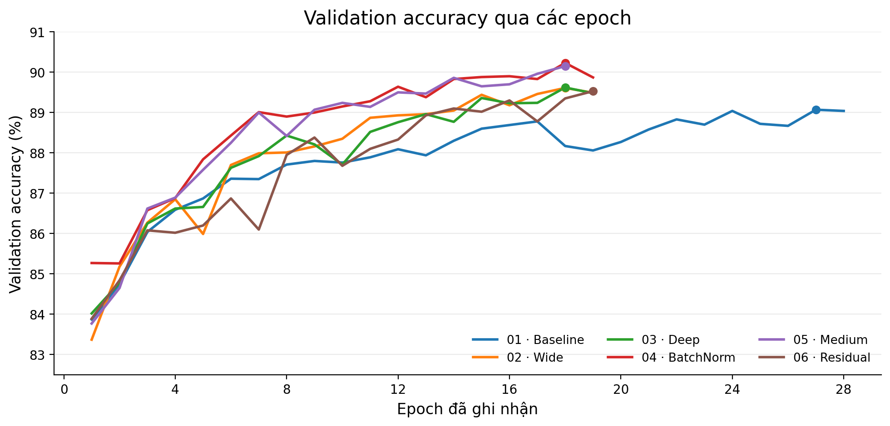
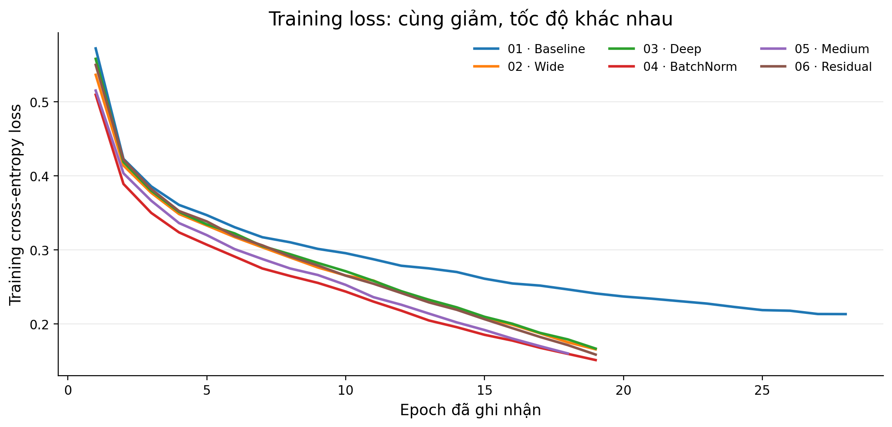
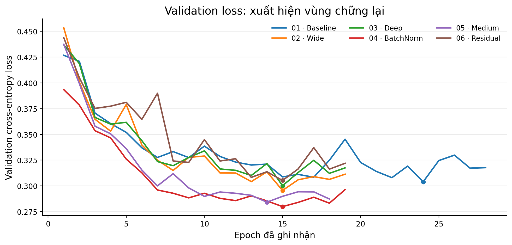
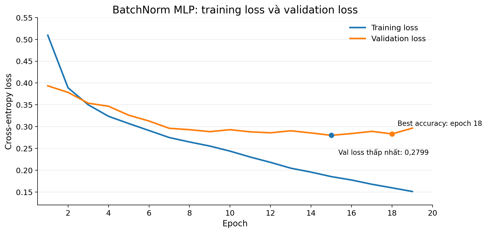
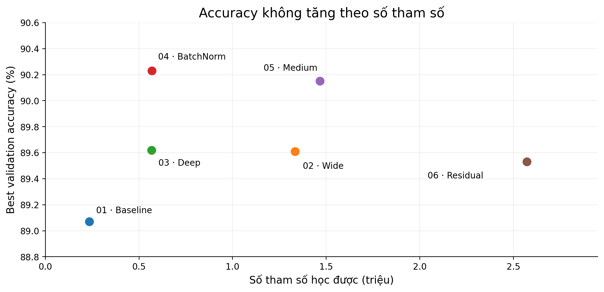
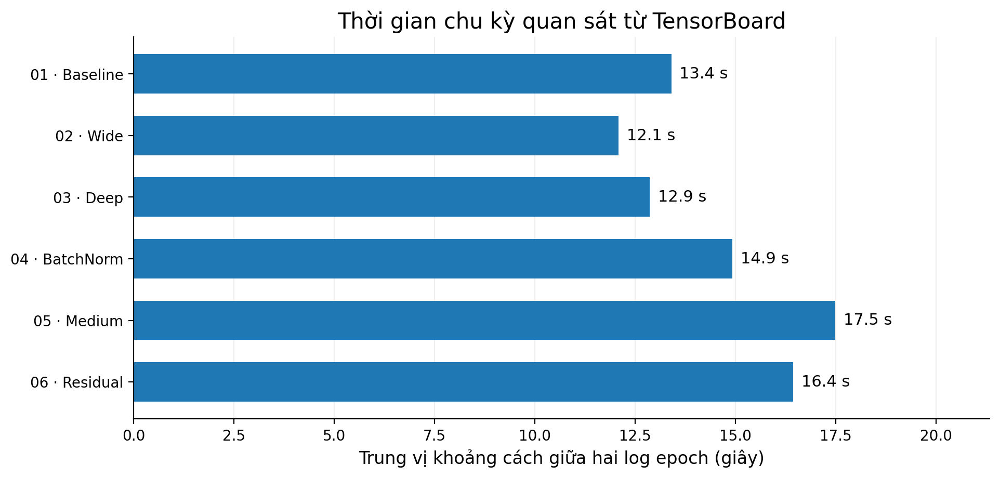
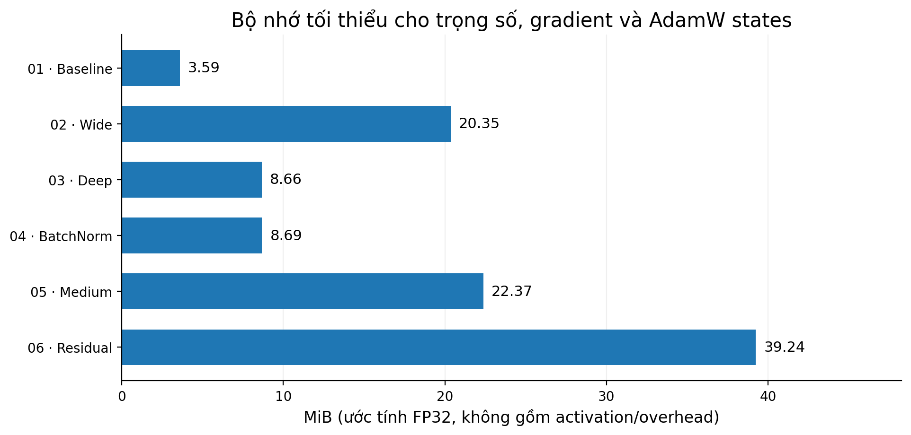

# Đánh giá thực nghiệm 6 cấu hình MLP

## 1. Kết quả chính

Tất cả mô hình dùng cùng tập 50.000 ảnh train / 10.000 ảnh validation, batch size 64, AdamW và giới hạn 30 epoch. Checkpoint tốt nhất của mỗi thí nghiệm được chọn theo validation accuracy. 

| Mô hình | Epoch tốt nhất | Accuracy ↑ | Macro F1 ↑ | Macro ROC–AUC ↑ | Val loss ↓ |
|:--|--:|--:|--:|--:|--:|
| **01 — Baseline** | 27 | **89.07%** | 0.8902 | 0.9924 | 0.3173 |
| **02 — Wide** | 18 | **89.61%** | 0.8949 | 0.9929 | 0.3063 |
| **03 — Deep** | 18 | **89.62%** | 0.8951 | 0.9927 | 0.3122 |
| **04 — BatchNorm** | 18 | **90.23%** | 0.9019 | 0.9935 | 0.2832 |
| **05 — Medium** | 18 | **90.15%** | 0.9011 | 0.9934 | 0.2873 |
| **06 — Residual** | 19 | **89.53%** | 0.8949 | 0.9925 | 0.3219 |

**Kết quả nổi bật:** `04_batchnorm_mlp` đạt accuracy cao nhất (**90,23%**), đồng thời có Macro F1 (**0,9019**) và Macro ROC–AUC (**0,9935**) tốt nhất trong sáu run. Khoảng cách accuracy giữa mô hình này và `05_medium_mlp` chỉ 0,08 điểm phần trăm, nên chưa thể kết luận chênh lệch sẽ giữ nguyên ở các lần khởi tạo khác.

## 2. Diễn biến trong quá trình huấn luyện

### 2.1. Accuracy tăng nhanh rồi bước vào vùng bão hòa

*Hình 1. Validation accuracy theo epoch*

Nhìn chung, accuracy tăng mạnh trong **5–10 epoch đầu** rồi tăng chậm hơn. Chẳng hạn, `04_batchnorm_mlp` đi từ **85,27% ở epoch 1** lên **89,15% ở epoch 10**, sau đó đạt cao nhất **90,23% ở epoch 18**. Mạng tiếp tục cải thiện, nhưng lợi ích của các epoch về sau nhỏ hơn giai đoạn đầu. Do đó train lâu hơn không đồng nghĩa tăng accuracy tương ứng.

Một điểm đáng chú ý là các đường accuracy khá sát nhau ở giai đoạn cuối. Điều đó cho thấy nhóm không nên chọn kiến trúc chỉ dựa trên chênh lệch vài phần mười điểm phần trăm; cần nhìn thêm số tham số, chi phí xử lý.

### 2.2. Training loss tiếp tục giảm nhưng validation loss không giảm mãi

*Hình 2. Training loss trung bình theo epoch của sáu model.*

Training loss của cả sáu mô hình giảm rõ rệt. Điều này xác nhận quá trình tối ưu trên dữ liệu train vẫn tiếp tục ngay cả khi accuracy trên validation đã tăng chậm.

*Hình 3. Validation loss theo epoch*

*Hình 4. Hai đường loss của cùng một mô hình: training loss tiếp tục giảm khi validation loss bắt đầu chững lại.*

Khác với training loss, validation loss ở phần lớn cấu hình giảm mạnh ban đầu rồi **dao động hoặc tăng nhẹ sau vùng cực tiểu**. Với `04_batchnorm_mlp`, validation loss thấp nhất là **0,2799 tại epoch 15**, nhưng accuracy tốt nhất xuất hiện ở **epoch 18**, khi validation loss bằng **0,2832**. Sự khác biệt này hợp lý: accuracy đo tỷ lệ chọn đúng nhãn, còn Cross-Entropy còn nhạy với mức độ tự tin, nhất là những dự đoán sai.

Đây là dấu hiệu của lợi ích tổng quát hóa suy giảm về cuối quá trình train nhưng chưa phải overfit nặng. Khi so sánh hai loss, cần nhớ rằng quá trình train dùng Dropout và `RandomHorizontalFlip`, còn validation dùng `model.eval()` và ảnh không augmentation

## 3. Sự khác nhau giữa các cấu hình

*Hình 5. Accuracy tốt nhất so với số tham số. Đường xu hướng không tăng đơn điệu; mạng lớn hơn không tự động tốt hơn.*

### 3.1. Baseline → Wide: nhiều neuron hơn, hiệu quả tăng có giới hạn

Mở rộng hai tầng ẩn từ **256–128** lên **1024–512** đi kèm với mức tăng accuracy từ **89,07%** lên **89,61%**. Tuy nhiên, số tham số tăng **5,67 lần** (235.146 → 1.333.770). Điều này cho thấy cấu hình lớn hơn có thể cải thiện kết quả, nhưng tỷ lệ tăng accuracy thấp hơn rất nhiều so với tỷ lệ tăng quy mô.

### 3.2. Wide → Deep: độ sâu có hiệu quả tham số tốt hơn, chưa chứng minh accuracy tốt hơn

`02_wide_mlp` có hai tầng ẩn **1024–512**, còn `03_deep_mlp` có ba tầng ẩn **512–256–128**. Kết quả gần như trùng nhau (**89,61%** so với **89,62%**), trong khi Deep chỉ cần **567.434 tham số**, bằng **42,5%** của Wide (ít hơn khoảng **57,5%**).

> Vì vậy Deep là lựa chọn gọn hơn về tham số mà không đánh đổi đáng kể về accuracy. Về mặt biểu diễn, nhiều tầng cho phép kết hợp đặc trưng qua nhiều phép biến đổi liên tiếp, còn tầng rộng cho phép nhiều đặc trưng được học song song.

### 3.3. Deep → BatchNorm: hiệu quả rõ nhất trong cặp đối chiếu gần như chỉ đổi một yếu tố

`03_deep_mlp` và `04_batchnorm_mlp` giữ cùng kích thước tầng **512–256–128**, GELU, dropout 0,1, AdamW, learning rate, batch size và cosine scheduler; khác biệt chính là thêm **BatchNorm**. Accuracy tăng từ **89,62%** lên **90,23%** , còn số tham số chỉ tăng **1.792**.

> Cùng với training/validation loss thấp hơn trong phần lớn giai đoạn, đây là thực nghiệm mạnh nhất trong 6 cấu hình cho thấy normalization có ích với thiết lập đang dùng.

### 3.4. Medium và Residual: thêm độ phức tạp không đảm bảo điểm số tốt hơn

>`05_medium_mlp` tăng lên **1,47 triệu tham số** và đạt **90,15%**, thấp hơn BatchNorm 0,08% . Kết quả này cho thấy rằng mặc dù Medium MLP có năng lực biểu diễn lớn hơn, hiệu suất vẫn gần như tương đương BatchNorm MLP bởi các kiến trúc đã có đủ khả năng học những đặc trưng cơ bản của FashionMNIST. Cho nên việc bổ sung neuron có thể mang lại lợi ích ngày càng nhỏ, trong khi chi phí lưu trữ và tính toán tiếp tục tăng.

>`06_residual_mlp` có **2,57 triệu tham số** nhưng chỉ đạt **89,53%**. Vì mô hình sử dụng LayerNorm, residual blocks, dropout và learning rate .Residual connections tạo ra đường truyền gradient trực tiếp, giúp việc tối ưu các mạng sâu thuận lợi hơn nhưng việc kết hợp residual blocks, LayerNorm và Dropout làm tăng độ phức tạp của kiến trúc nhưng chưa tạo ra lợi thế tương ứng về kết quả phân loại bởi quy mô và độ phức tạp của Residual MLP vượt quá mức cần và không hiệu quả với ảnh FashionMNIST 28×28.

## 4. Chi phí thời gian và bộ nhớ

### 4.1. Thời gian theo log: đo được và chưa đo được

Dữ liệu TensorBoard không tách riêng thời gian `train()` và `validate()`. Vì `Loss/train/epoch` được ghi sau cả hai giai đoạn.

*Hình 6. Mốc thời gian thực tế lấy từ TensorBoard*
### 4.2. Tham số, xử lý lý thuyết và bộ nhớ

Với cùng ảnh đầu vào 28×28, số phép nhân–cộng (*MACs*) của các tầng `Linear` có thể tính từ kích thước ma trận trọng số. Đây là chỉ báo khối lượng tính toán forward, chưa bao gồm GELU/BatchNorm/LayerNorm/Dropout, và không phải thời gian xử lý đo được

| Mô hình | Tham số | Linear MAC/ảnh (triệu) | Chu kỳ/epoch (s, trung vị) | FP32 weights (MiB) | Train state FP32 (MiB) |
|:--|--:|--:|--:|--:|--:|
| 01 · Baseline | 235,146 | 0.235 | 13.4 | 0.90 | 3.59 |
| 02 · Wide | 1,333,770 | 1.332 | 12.1 | 5.09 | 20.35 |
| 03 · Deep | 567,434 | 0.567 | 12.9 | 2.16 | 8.66 |
| 04 · BatchNorm | 569,226 | 0.567 | 14.9 | 2.17 | 8.69 |
| 05 · Medium | 1,466,122 | 1.461 | 17.5 | 5.59 | 22.37 |
| 06 · Residual | 2,571,786 | 2.563 | 16.4 | 9.81 | 39.24 |

*Hình 7. Ước lượng chỉ phần bộ nhớ liên quan tới tham số và AdamW*

Cấu hình Deep dùng khoảng **8,66 MiB** cho trạng thái tham số trong quá trình train, thấp hơn Wide (**20,35 MiB**), dù accuracy gần như bằng nhau. `06_residual_mlp` có mức ước lượng cao nhất (**39,24 MiB**) nhưng không đạt accuracy cao nhất. 

## 5. Kết luận đánh giá

>Kết quả cho thấy mở rộng mạng không đồng nghĩa hiệu quả cao hơn với bộ dữ liệu này. Wide cải thiện so với Baseline nhưng đánh đổi số tham số lớn

>Deep gần tương đương Wide với chỉ **42,5%** số tham số

> BatchNorm đem lại cải thiện accuracy rõ nhất trong cặp đối chiếu được kiểm soát tương đối tốt. Về quá trình học, training loss vẫn giảm trong khi validation loss thường chững lại, cho thấy việc tăng epoch hay tăng quy mô cần cân nhắc theo khả năng tổng quát hóa, không chỉ theo loss trên train.

