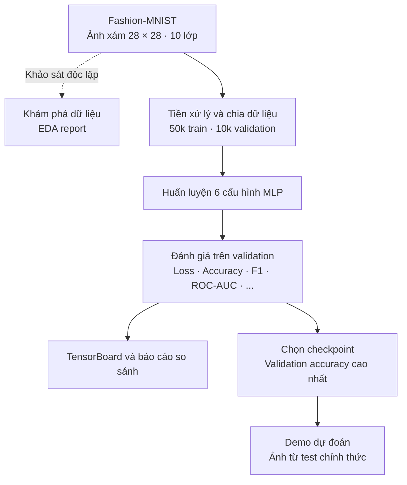

# LAB 2 · Fashion-MNIST Classification

### Nghiên cứu và so sánh các kiến trúc Multi-Layer Perceptron

> **Tổng quan dự án**  
> Xây dựng một quy trình phân loại ảnh thời trang bằng **mạng nơ-ron kết nối đầy đủ (MLP)**: từ phân tích dữ liệu, huấn luyện nhiều cấu hình đến đánh giá, lựa chọn checkpoint và trình diễn dự đoán. Dự án **không sử dụng CNN hoặc attention**.

---

## Tổng quan thực nghiệm

| **10 lớp** | **50.000 ảnh train** | **10.000 ảnh validation** | **6 cấu hình MLP** |
|:--:|:--:|:--:|:--:|
| Phân loại sản phẩm thời trang | Huấn luyện mô hình | So sánh và chọn checkpoint | Đối chiếu kiến trúc, chuẩn hóa và tối ưu |

**Fashion-MNIST** gồm ảnh xám kích thước **28 × 28 px**. Dự án tách tập huấn luyện chính thức (60.000 ảnh) thành 50.000 ảnh train và 10.000 ảnh validation theo một hoán vị cố định. **10.000 ảnh test chính thức được giữ riêng**, hiện được dùng trong chương trình minh họa dự đoán.

### Câu hỏi nghiên cứu

> Khi giữ nguyên bài toán và tập validation, việc thay đổi **độ rộng**, **độ sâu**, **normalization** và **skip connection** ảnh hưởng thế nào đến chất lượng phân loại của MLP?

Mục tiêu không chỉ là tìm model có validation accuracy cao nhất, mà còn quan sát khả năng hội tụ, mức độ ổn định và sự đánh đổi giữa các cấu hình.

## Quy trình thực hiện



*EDA là báo cáo phân tích dữ liệu riêng; quá trình training không phụ thuộc vào việc chạy báo cáo này.*

## Phạm vi các mô hình

Sáu thí nghiệm được định nghĩa trong `Train.py` và cùng sử dụng lớp `MLP` trong `ModelMLP.py`.

| Thí nghiệm | Hướng so sánh |
|---|---|
| **01 · Baseline MLP** | Kiến trúc cơ sở làm mốc tham chiếu |
| **02 · Wide MLP** | Tăng số neuron ở các tầng ẩn |
| **03 · Deep MLP** | Tăng số tầng fully-connected |
| **04 · BatchNorm MLP** | Bổ sung Batch Normalization |
| **05 · Medium MLP** | Kết hợp mạng nhiều tầng, BatchNorm và cấu hình tối ưu riêng |
| **06 · Residual MLP** | Sử dụng LayerNorm và residual/skip connections |

Chi tiết về số tầng, kích thước tensor và hyperparameters được trình bày trong **[model.md](model.md)**; bảng trên chỉ mô tả vai trò của mỗi thí nghiệm.

## Các thành phần đã triển khai

| Hạng mục | Kết quả đầu ra |
|---|---|
| **EDA** | Báo cáo HTML về phân phối dữ liệu, pixel, tính tương đồng giữa các lớp và các phép chiếu giảm chiều |
| **Training** | Quy trình train/validation, AdamW, gradient clipping, cosine scheduler cho các run được cấu hình và early stopping |
| **Experiment tracking** | TensorBoard theo từng model: loss theo batch/epoch, validation metrics, learning rate và ROC từng lớp |
| **Model selection** | Checkpoint tốt nhất của mỗi run theo **validation accuracy**; chọn tiếp checkpoint tốt nhất toàn cục |
| **Reporting** | File CSV, biểu đồ so sánh metrics, heatmap và đồ thị Accuracy–Loss |
| **Inference demo** | Load checkpoint toàn cục và trực quan hóa dự đoán trên 6 ảnh test được chọn ngẫu nhiên bằng seed cố định |


## Cấu trúc repository

Sơ đồ dưới đây thể hiện vị trí các file khi đặt ba script chính trong cùng thư mục và chạy `Train.py` từ thư mục đó.

```text
project-root/
├── Train.py                 # Huấn luyện, validation, checkpoint, so sánh
├── ModelMLP.py              # Kiến trúc MLP và ResidualBlock
├── Predict.py               # Dự đoán bằng checkpoint tốt nhất
├── eda_report.html          # Báo cáo EDA (nếu đặt cùng repository)
│
├── data/                    # Fashion-MNIST tải qua torchvision
├── checkpoints/             # Best/last checkpoint của từng run
│   └── checkpoint_best_global.pt
├── logs/                    # TensorBoard event files
├── reports/                 # CSV và ảnh xuất từ phần so sánh
│
└── docs/
    ├── lab2-description.md  # Trang giới thiệu này
    ├── data.md
    ├── model.md
    ├── trainning.md
    ├── evaluation.md
    ├── demo.md
    └── plan-progression.md
```


## Tài liệu chi tiết

| Tài liệu | Nội dung chuyên trách |
|---|---|
| **[data.md](data.md)** | Đặc điểm tập dữ liệu, kết quả EDA và tiền xử lý |
| **[model.md](model.md)** | Kiến trúc mạng, residual block và cấu hình sáu thí nghiệm |
| **[trainning.md](trainning.md)** | Quy trình huấn luyện, tối ưu, early stopping, TensorBoard và checkpoint |
| **[evaluation.md](evaluation.md)** | Phương pháp tính metrics, đọc biểu đồ và phân tích kết quả |
| **[demo.md](demo.md)** | Cách nạp model đã train và chạy chương trình dự đoán |
| **[plan-progression.md](plan-progression.md)** | Hạng mục đã hoàn thành, giới hạn kỹ thuật và kế hoạch phát triển |

---
