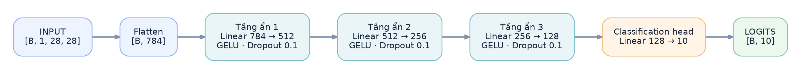
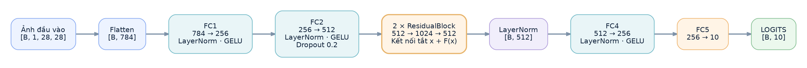
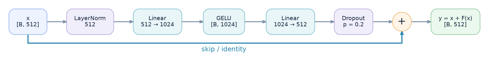

# Thiết kế mô hình — Multilayer Perceptron trên Fashion-MNIST

## 1. Hướng thiết kế

Tất cả mô hình đều xử lý đầu vào thông qua những phép biến đổi tuyến tính `nn.Linear`. Để dễ quan sát rõ ảnh hưởng của độ rộng, độ sâu, các yêu tố ảnh hướng đến quá trình học.

Đầu vào là ảnh xám 28 × 28 pixel. Trước khi đi qua các tầng ẩn, ảnh được trải phẳng thành vector gồm 784 phần tử:

## 2. Luồng xử lý của MLP thông thường

Với các cấu hình không sử dụng residual (`residual_blocks=0`), nhóm xây dựng mạng bằng cách ghép các tầng ẩn theo cùng một thứ tự:

**`Linear → Normalization → Activation → Dropout`**

Sau tầng ẩn cuối cùng là một lớp `Linear` đưa đặc trưng về 10 logits

*Hình 1. Luồng xử lý của `03_deep_mlp`, một ví dụ tiêu biểu cho nhánh MLP tuần tự.*

Mô hình Deep MLP cho thấy rõ cách chiều đặc trưng giảm dần từ **784 → 512 → 256 → 128 → 10**. Trong mỗi tầng ẩn, phi tuyến tính giúp mạng học những quan hệ mà một phép biến đổi tuyến tính đơn lẻ không biểu diễn được, Dropout đóng vai trò regularization trong lúc huấn luyện. Normalization được thay bằng none, `nn.BatchNorm1d()` hoặc `nn.LayerNorm()`. Điều này cho phép nhóm giữ cùng bộ khung MLP và chỉ thay đổi thành phần chuẩn hóa khi cần kiểm tra tác động của nó.

## 3. Residual MLP: thêm đường truyền thông tin trực tiếp

Đối với cấu hình `06_residual_mlp`, nhóm muốn kiểm tra một cách xây dựng mạng sâu hơn mà không chỉ nối tiếp nhiều lớp `Linear`. Ý tưởng được đưa vào là **skip connection**: đầu vào của một block được cộng trực tiếp với đầu ra của nhánh biến đổi.

$$
\boxed{y = x + F(x)}
$$

Nhánh `F(x)` học phần điều chỉnh trên đặc trưng đầu vào, trong khi đường truyền `x` vẫn đi thẳng đến phép cộng. Về mặt lan truyền gradient, đây là một đường phụ giúp tín hiệu đạo hàm có thể đi qua block mà không bắt buộc phải nhân liên tiếp với toàn bộ Jacobian của nhánh biến đổi.

### 3.1. Luồng tổng thể của model 06

*Hình 2. Kiến trúc thực tế của `06_residual_mlp`: đặc trưng được chiếu lên 512 chiều, đi qua hai ResidualBlock, rồi giảm về 256 chiều trước tầng phân loại.*

Với cấu hình hiện tại, `hidden=(256,)` và `residual_blocks=2`. Nhóm lấy phần tử đầu tiên của `hidden` làm chiều rộng nền `c=256`, sau đó tạo đặc trưng trung gian có chiều rộng `2c=512`. Các bước xử lý chính là:

| Thành phần | Phép biến đổi | Kích thước đầu ra |
|---|---|---|
| Flatten | Ảnh → vector | `[B, 784]` |
| FC1 | `Linear(784, 256)` → LayerNorm → GELU | `[B, 256]` |
| FC2 | `Linear(256, 512)` → LayerNorm → GELU → Dropout | `[B, 512]` |
| Residual stack | 2 × `ResidualBlock(512)` → LayerNorm | `[B, 512]` |
| FC4 | `Linear(512, 256)` → LayerNorm → GELU | `[B, 256]` |
| FC5 | `Linear(256, 10)` | `[B, 10]` |

### 3.2. Bên trong một ResidualBlock

*Hình 3. Hai nhánh của một block: nhánh biến đổi `F(x)` và nhánh identity. Đầu ra của hai nhánh có cùng kích thước `[B, 512]` nên có thể cộng theo từng phần tử.*

Trong source, nhánh biến đổi gồm **`LayerNorm(512) → Linear(512,1024) → GELU → Linear(1024,512) → Dropout(0.2)`**. Không có normalization sau `Linear(1024,512)` ở bên trong block; một `LayerNorm(512)` được đặt **sau toàn bộ chuỗi hai residual blocks**.

Đây là chi tiết quan trọng khi đọc kiến trúc: tuy có tầng mở rộng lên 1024 chiều, đầu ra mỗi block vẫn là 512 chiều vì phép cộng residual yêu cầu hai nhánh tương thích về kích thước. Toàn bộ nhánh này chỉ sử dụng các lớp fully-connected

## 4. Sáu cấu hình nhóm đã xây dựng

Từ hai cách tổ chức mạng trên, nhóm thiết lập sáu cấu hình để lần lượt khảo sát các thay đổi về kích thước và thành phần kiến trúc.

| Mô hình | Dãy kích thước đặc trưng | Kích hoạt thực tế | Chuẩn hóa | Residual blocks | Số tham số học được |
|---|---|---|---|---:|---:|
| `01_baseline` | 784 → 256 → 128 → 10 | LeakyReLU | Không | 0 | **235.146** |
| `02_wide_mlp` | 784 → 1024 → 512 → 10 | LeakyReLU | Không | 0 | **1.333.770** |
| `03_deep_mlp` | 784 → 512 → 256 → 128 → 10 | GELU | Không | 0 | **567.434** |
| `04_batchnorm_mlp` | 784 → 512 → 256 → 128 → 10 | GELU | BatchNorm1d | 0 | **569.226** |
| `05_medium_mlp` | 784 → 1024 → 512 → 256 → 10 | GELU | BatchNorm1d | 0 | **1.466.122** |
| `06_residual_mlp` | 784 → 256 → 512 → 2 × ResidualBlock → 256 → 10 | GELU | LayerNorm | 2 | **2.571.786** |

*Bảng 1. Cấu hình kiến trúc trong `Train.py`*

- Baseline, nhóm sử dụng hai tầng ẩn vừa phải để có một mốc xuất phát 
- Wide MLP tăng số neuron ở các tầng ẩn
- Deep MLP sử dụng thêm một tầng ẩn. 
- Model 04, nhóm giữ cấu trúc của Deep MLP nhưng bổ sung BatchNorm để có thể thấy rõ hơn ảnh hưởng của chuẩn hóa. 
- Model 05 tiếp tục mở rộng kích thước mạng và điều chỉnh mức Dropout
- Model 06 đưa LayerNorm và kết nối residual vào kiến trúc.

Những thay đổi ở learning rate, weight decay và scheduler được ghi cụ thể tại [`trainning.md`](trainning.md).

## 5. Kiểm tra tính nhất quán của kiến trúc

Sự khác biệt giữa các cấu hình nằm trong cách tổ chức các tầng ẩn. Cách này giúp phần phân tích kết quả ở [`evaluation.md`](evaluation.md) tập trung vào câu hỏi model đã học hiệu quả đến đâu, thay vì phải so sánh các bài toán đầu vào khác nhau.

