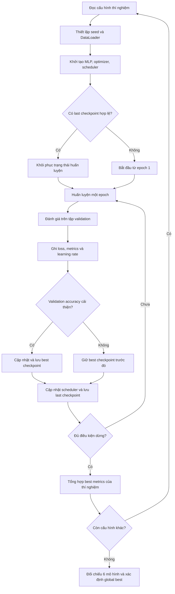

# Thiết kế quy trình huấn luyện MLP

> **Vai trò tài liệu:** Đặc tả cách nhóm tổ chức, triển khai và kiểm chứng quá trình huấn luyện. Tài liệu này tập trung vào phương pháp, không trình bày bảng thành tích hoặc kết luận mô hình nào tốt nhất; các kết quả thực tế được phân tích trong [evaluation.md](evaluation.md).

## 1. Định hướng huấn luyện

Nhóm xây dựng một quy trình huấn luyện chung cho sáu cấu hình MLP. Mục tiêu không chỉ là tối ưu độ chính xác, mà còn bảo đảm mỗi thí nghiệm được thực hiện trong điều kiện có thể đối chiếu: dùng cùng tập train/validation, có cách tính loss nhất quán, theo dõi quá trình học theo epoch và lưu đủ trạng thái để tiếp tục khi cần.

Các lựa chọn được giữ cố định gồm dữ liệu đầu vào, thứ tự nhãn và nguyên tắc đánh giá. Những yếu tố như kích thước mạng, normalization, learning rate và weight decay có thể thay đổi theo cấu hình đã xác định. Vì một số cấu hình thay đổi nhiều yếu tố đồng thời cho nên khi so sánh sáu phương án hoàn chỉnh không mặc nhiên quy mọi chênh lệch kết quả cho riêng một kỹ thuật.

## 2. Luồng xử lý tổng thể



*Hình 1. Trong thiết kế này, log và checkpoint của epoch hiện tại phải được lưu trước khi quyết định dừng sớm, để không làm mất kết quả ở epoch cuối*

## 3. Dữ liệu và điều kiện thực nghiệm

Khi huấn luyện, ảnh được lật ngang ngẫu nhiên bằng `RandomHorizontalFlip()`, chuyển sang tensor và chuẩn hóa với `Normalize((0,286,), (0,353,))`. Validation không có phép biến đổi ngẫu nhiên; điều này giúp các lần đánh giá dựa trên cùng đầu vào. Hai tập phải dùng cùng hệ thống 10 nhãn Fashion-MNIST và cùng phép chia chỉ số cho cả sáu mô hình.

| Thiết lập | Training | Validation |
|:--|:--|:--|
| Số ảnh | 50.000 | 10.000 |
| Batch size | 64 | 256 |
| Trộn dữ liệu | Có (`shuffle=True`) | Không |
| Augmentation | Lật ngang ngẫu nhiên | Không |
| Cập nhật trọng số | Có | Không |

Sử dụng seed cố định để kiểm soát các nguồn ngẫu nhiên trong quá trình thiết lập thí nghiệm. Cần lưu lại phép chia và cấu hình này để bảo đảm những lần chạy sau vẫn có thể đối chiếu trên cùng dữ liệu. Việc cố định seed giúp tăng tính tái lập

## 4. Các cấu hình tối ưu hóa

Sáu phương án được định nghĩa trong cùng một danh sách cấu hình. Chi tiết số tầng, chiều rộng và skip connection nằm tại [model.md](model.md); ở đây nhóm chỉ tập trung vào các tham số liên quan đến huấn luyện.

| Cấu hình | Learning rate | Weight decay | Batch size | Scheduler |
|:--|--:|--:|--:|:--|
| `01_baseline` | 0.001 | 0 | 64 | Không |
| `02_wide_mlp` | 0.001 | 0 | 64 | CosineAnnealingLR |
| `03_deep_mlp` | 0.001 | 0 | 64 | CosineAnnealingLR |
| `04_batchnorm_mlp` | 0.001 | 0 | 64 | CosineAnnealingLR |
| `05_medium_mlp` | 0.002 | 0.01 | 64 | CosineAnnealingLR |
| `06_residual_mlp` | 0.0005 | 0.001 | 64 | CosineAnnealingLR |

Nhóm chọn AdamW cho cả sáu phương án, đặt 30 epochs là giới hạn trên và cho phép Early Stopping kết thúc trước mốc này.
### Cross-Entropy Loss

Đầu ra MLP là logits có kích thước `[B, 10]`. Với batch gồm $B$ ảnh, nhãn đúng $y_i \in \{0,\ldots,9\}$ và logit của lớp $k$ là $z_{i,k}$, nhóm sử dụng Cross-Entropy trung bình:

$$
\mathcal{L}_{\mathrm{CE}}
= -\frac{1}{B}\sum_{i=1}^{B}
\log\left(\frac{\exp(z_{i,y_i})}{\sum_{k=0}^{9}\exp(z_{i,k})}\right).
$$

Loss được tính trực tiếp từ **logits**, không cần gọi `softmax` trước khi đưa vào `CrossEntropyLoss`.

### Learning-rate scheduler

Với năm cấu hình có `CosineAnnealingLR`, learning rate được điều chỉnh theo lịch cosine với `T_max = 30`, còn baseline giữ learning rate cố định. Nhóm cập nhật scheduler một lần sau mỗi epoch và ghi lại learning rate thực tế vào TensorBoard.

Với trường hợp cosine annealing tiêu chuẩn và learning rate tối thiểu bằng 0, lịch dự kiến có dạng:

$$
\eta_t = \frac{\eta_0}{2}\left(1+\cos\frac{\pi t}{T_{\max}}\right),
\qquad T_{\max}=30.
$$

Nếu một thí nghiệm dừng sớm, lịch learning rate chỉ được thực hiện đến epoch tương ứng. Khi tiếp tục huấn luyện, trạng thái scheduler phải được khôi phục cùng optimizer để tránh lặp lại lịch từ đầu.

## 5. Quy trình train

Trong một batch, dữ liệu đi qua ba bước chính: **forward → backward → cập nhật tham số**. Nhóm giữ vòng lặp chung cho mọi MLP để sự khác biệt giữa các thí nghiệm đến từ cấu hình, thay vì từ cách viết quá trình tối ưu.

```python
model.train()

for images, labels in train_loader:
    images, labels = images.to(device), labels.to(device)

    logits = model(images)               # [B, 10]
    loss = criterion(logits, labels)     # Scalar, mean reduction

    optimizer.zero_grad()
    loss.backward()
    torch.nn.utils.clip_grad_norm_(model.parameters(), max_norm=5.0)
    optimizer.step()
```

Gradient clipping (`max_norm = 5.0`) giúp giới hạn chuẩn gradient trước khi optimizer cập nhật trọng số. Đây là biện pháp ổn định tối ưu, không phải bảo đảm loss luôn giảm ở mỗi batch.

 **Công thức tính rain loss trung bình của toàn epoch**

$$
L_{\mathrm{train,epoch}}
= \frac{\sum_{b=1}^{M} n_b L_b}{\sum_{b=1}^{M}n_b},
$$

trong đó 
- $L_b$ là loss trung bình của batch $b$ 
-  $n_b$ là số ảnh trong batch đó

## 6. Validation, lựa chọn checkpoint và Early Stopping

Sau mỗi epoch, nhóm chuyển mô hình sang `eval()` và tắt theo dõi gradient. Đây là thời điểm Dropout ngừng ngẫu nhiên loại neuron và BatchNorm sử dụng thống kê đã lưu. Validation thực hiện trên toàn bộ 10.000 ảnh, không cập nhật optimizer.

Hai tiêu chí được sử dụng cho hai mục đích khác nhau:

| Quyết định | Tiêu chí | Quy tắc |
|:--|:--|:--|
| **Chọn best checkpoint của từng mô hình** | Validation accuracy | Lưu khi accuracy cao hơn mức tốt nhất trước đó |
| **Early Stopping** | Validation loss | Dừng sau 5 epochs liên tiếp không giảm ít nhất `1e-4` |
| **Chọn global best** | Best validation accuracy | So sánh checkpoint tốt nhất của sáu cấu hình |

Nhóm lựa chọn accuracy làm tiêu chí lưu checkpoint vì mục tiêu chính là phân loại đúng nhãn sản phẩm. Trong khi đó, validation loss phù hợp để quan sát mức độ tự tin của dự đoán và phát hiện khi quá trình tối ưu không còn cải thiện rõ rệt. Epoch có loss thấp nhất và epoch có accuracy cao nhất không nhất thiết trùng nhau

Trong thiết kế huấn luyện, thứ tự cuối mỗi epoch được thống nhất như sau: ``đánh giá → ghi log → cập nhật best checkpoint (nếu cần) → cập nhật scheduler → lưu last checkpoint → kiểm tra Early Stopping``. Vì vậy ngay cả khi dừng sớm, kết quả và trạng thái tại epoch vừa hoàn tất vẫn được ghi nhận. Khi so sánh các model, Precision, Recall, F1, FPR, AUC và loss phải được lấy cùng epoch với best accuracy, không ghép các đỉnh chỉ số từ những epoch khác nhau.

## 7. Checkpoint và khả năng tiếp tục huấn luyện

Nhóm quản lý hai checkpoint riêng cho mỗi cấu hình. `checkpoint_best.pt` dùng cho đánh giá hoặc dự đoán; `last_checkpoint.pt` phục vụ tiếp tục huấn luyện khi bị gián đoạn.

```text
checkpoints/
├── 01_baseline/
│   ├── checkpoint_best.pt
│   └── last_checkpoint.pt
├── 02_wide_mlp/
├── 03_deep_mlp/
├── 04_batchnorm_mlp/
├── 05_medium_mlp/
├── 06_residual_mlp/
└── checkpoint_best_global.pt
```

Một checkpoint đáp ứng yêu cầu khôi phục cần lưu tối thiểu các nhóm thông tin sau:

| Trường dữ liệu | Mục đích |
|:--|:--|
| `epoch`, `config` | Xác định tiến độ và dựng lại đúng kiến trúc/cấu hình |
| `model_state_dict` | Khôi phục trọng số và buffer của MLP |
| `optimizer_state_dict` | Tiếp tục trạng thái tối ưu của AdamW |
| `scheduler_state_dict` | Tiếp tục đúng lịch learning rate nếu được sử dụng |
| `best_acc`, `best_metrics` | Giữ thành tích validation tốt nhất đã ghi nhận |
| `best_loss`, `patience_counter` | Tiếp tục Early Stopping mà không đặt lại bộ đếm |

Khi resume, nhóm chỉ tải `last_checkpoint.pt` cho trạng thái huấn luyện , không tải chồng `checkpoint_best.pt` lên mô hình đang resume. Việc khôi phục phải đồng bộ epoch, model, optimizer, scheduler và bộ đếm Early Stopping. Nếu thay đổi số epoch mục tiêu hoặc cấu hình optimizer, nhóm cần xem đây là một lượt thí nghiệm mới hoặc xử lý lại lịch learning rate có chủ đích, thay vì mặc định resume sẽ tương đương train liên tục.

Để giảm nguy cơ hỏng file khi chương trình bị dừng giữa lúc lưu, checkpoint nên được ghi vào file tạm rồi thay thế file đích sau khi hoàn tất. Với yêu cầu tái lập cao hơn, nhóm có thể lưu thêm trạng thái bộ sinh số ngẫu nhiên 

## 8. Theo dõi bằng TensorBoard và sản phẩm đầu ra

Trong mỗi lần train, nhóm cần thấy được cả loss theo batch (độ dao động) và loss theo epoch (xu hướng hội tụ). Các chỉ số validation và learning rate được ghi theo từng epoch để thuận tiện đối chiếu các cấu hình.

| Nhóm log | Nội dung cần theo dõi |
|:--|:--|
| `Loss/train/batch`, `Loss/train/epoch` | Mức loss và xu hướng tối ưu trên training |
| `Loss/validation` | Diễn biến loss trên dữ liệu chưa dùng cập nhật trọng số |
| `Validation/accuracy`, `Validation/f1` | Hai chỉ số chính để quan sát chất lượng phân loại |
| `Validation/precision`, `Validation/recall`, `Validation/fpr` | Bổ sung góc nhìn theo các lớp |
| `Validation/auc` | Macro ROC–AUC nếu được ghi thành scalar |
| `Optimization/learning_rate` | Xác nhận scheduler hoạt động đúng |
| `ROC_Curve` | Đường ROC One-vs-Rest cho từng lớp |

Sau khi có kết quả của sáu thí nghiệm, nhóm tổng hợp để tạo biểu đồ so sánh. TensorBoard giúp theo dõi quá trình học, bảng kết quả cuối cùng cần lấy từ các giá trị thực

## 9. Điều kiện nghiệm thu quy trình huấn luyện

Trước khi chuyển sang đánh giá trên tập test chính thức, nhóm đặt ra các điều kiện kiểm tra sau:

- [ ] Cả sáu cấu hình sử dụng đúng một phép chia train/validation và tiền xử lý nhất quán.
- [ ] Loss trung bình theo epoch được tính có xét kích thước từng batch; validation không cập nhật gradient.
- [ ] Learning rate thay đổi theo đúng scheduler của từng cấu hình.
- [ ] Best checkpoint được chọn bằng validation accuracy, mọi metric đi kèm thuộc đúng epoch đó.
- [ ] Early Stopping không làm mất log hoặc checkpoint của epoch cuối.
- [ ] Resume khôi phục đầy đủ trạng thái model, optimizer, scheduler và bộ đếm dừng sớm.
- [ ] TensorBoard, checkpoint và file kết quả có thể liên kết ngược về đúng cấu hình thực nghiệm.
- [ ] Tập test chính thức chưa được sử dụng để lựa chọn mô hình hay tinh chỉnh hyperparameter.


